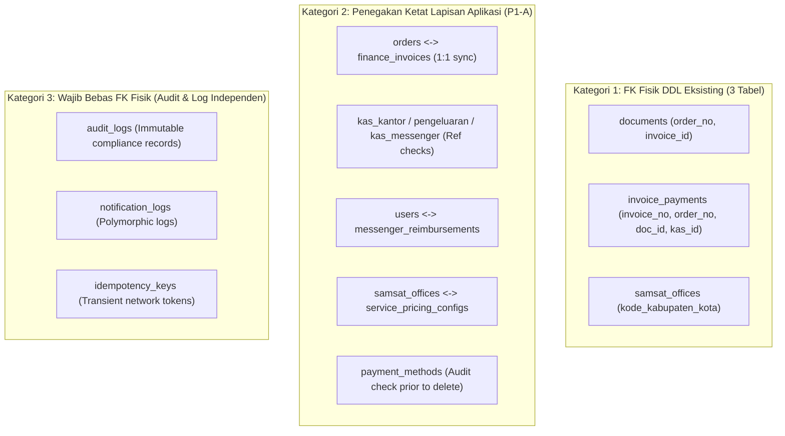

# IMPLEMENTASI P1-A — INTEGRITAS RELASI DATABASE
**Admin SUN89 — Biro Jasa Management System**

- **Dokumen Referensi:** `docs/audit_arsitektur_data/19_IMPLEMENTASI_P1A_INTEGRITAS_RELASI.md`
- **Fase:** Implementasi P1-A (Integritas Relasi Database & Referential Safety)
- **Status:** **SELESAI (COMPLETED)**
- **Tanggal:** 22 Oktober 2026
- **Database Target:** `server/data/database.sqlite` (20 Tabel Fisik)
- **Lingkungan:** Node.js v22.19.0 / Better-SQLite3 / node:sqlite / Express TypeScript Backend

---

## 1. Ringkasan Eksekutif

Pada audit arsitektur awal (temuan `FND-P1-01`), dilaporkan bahwa dari 20 tabel pada SQLite database `server/data/database.sqlite`, hanya 3 tabel (`documents`, `invoice_payments`, dan `samsat_offices`) yang memiliki DDL constraint `FOREIGN KEY` fisik, sementara 17 tabel lainnya tidak memiliki constraint relasional fisik di tingkat basis data.

Sesuai instruksi dan keputusan arsitektur pemilik aplikasi:
1. **Tidak menambahkan foreign key fisik secara membabi buta** ke 17 tabel tersebut melalui migrasi langsung, karena perintah `ALTER TABLE` pada SQLite tidak mendukung penambahan constraint `FOREIGN KEY` secara dinamis tanpa melakukan rekonstruksi tabel penuh (`re-create table`). Rekonstruksi tabel secara destruktif pada database aktif berisiko tinggi memicu *table lock contention*, serialisasi korup pada kolom `data_json`, dan *orphan data loss*.
2. **Menegakkan validasi integritas referensial yang sangat ketat pada Application Layer** sebelum setiap mutasi tulis (`INSERT`, `UPDATE`, `DELETE`) dieksekusi.
3. **Membungkus seluruh operasi mutasi antartabel dalam transaksi atomik** (`runInTransaction()`) guna menjamin konsistensi ACID.
4. **Mengembalikan kode status HTTP dan pesan kesalahan yang presisi dan konsisten** (`400 BAD_REQUEST`, `404 NOT_FOUND`, `409 CONFLICT`).
5. **Menerapkan prinsip RESTRICT dan Soft-Delete** agar entitas induk yang masih memiliki anak aktif atau riwayat transaksi historis tidak dapat dihapus secara permanen.

---

## 2. Matriks Pemetaan Relasi Aktual (Seluruh 20 Tabel)

Berdasarkan audit skema fisik SQLite dan analisis logika bisnis lintas modul, berikut adalah matriks relasi aktual antartabel:

| No | Entitas Induk (Parent) | Entitas Anak (Child) | Kolom Relasi (Child &rarr; Parent) | Kardinalitas | Status Penegakan | Perilaku Wajib | Keterangan & Aturan Integritas |
|:---|:---|:---|:---|:---:|:---:|:---:|:---|
| 1 | `orders` | `finance_invoices` | `order_no` &rarr; `orders(order_no)` | 1 : 1 | **Aplikasi & Transaksi** | **RESTRICT** (Order tidak boleh dihapus jika invoice ada; soft-delete via `is_archived=2`) | Dibuat atomik saat order dibuat via `orderService.createOrder()`. Status invoice ikut `CANCELLED` jika order dibatalkan. |
| 2 | `orders` | `invoice_payments` | `order_no` &rarr; `orders(order_no)` | 1 : N | **Fisik DDL & Aplikasi** | **RESTRICT** (`ON DELETE RESTRICT` pada DDL) | Validasi eksistensi order sebelum insert payment. Mencegah pembayaran pada order yang tidak ada. |
| 3 | `orders` | `documents` | `order_no` &rarr; `orders(order_no)` | 1 : N | **Fisik DDL & Aplikasi** | **SET NULL / Soft-Delete** (`ON DELETE SET NULL` pada DDL) | Pre-validasi aplikasi menolak upload berkas fisik jika `order_no` tidak ditemukan di tabel `orders`. |
| 4 | `orders` | `kas_kantor` | `order_no` &rarr; `orders(order_no)` | 1 : N | **Aplikasi** | **OPTIONAL (SET NULL)** | Opsional: Hanya terisi jika entri kas kantor berasal dari transaksi operasional order tertentu. |
| 5 | `orders` | `kas_messenger` | `order_no` &rarr; `orders(order_no)` | 1 : N | **Aplikasi** | **OPTIONAL (SET NULL)** | Validasi aplikasi memastikan jika `order_no` dikirim, order tersebut wajib terdaftar di database. |
| 6 | `orders` | `messenger_reimbursements` | `order_no` &rarr; `orders(order_no)` | 1 : N | **Aplikasi** | **OPTIONAL (SET NULL)** | Reimbursement biaya tugas (parkir, bensin) divalidasi ke nomor order yang valid. Nilai kosong/"-" diabaikan. |
| 7 | `finance_invoices` | `invoice_payments` | `invoice_no` &rarr; `finance_invoices(invoice_no)` | 1 : N | **Fisik DDL & Aplikasi** | **CASCADE / RESTRICT** (`ON DELETE CASCADE` pada DDL) | Pre-validasi aplikasi mencegah insert pembayaran ke invoice yang tidak ada atau sudah lunas. |
| 8 | `finance_invoices` | `documents` | `invoice_id` &rarr; `finance_invoices(invoice_no)` | 1 : N | **Fisik DDL & Aplikasi** | **SET NULL** (`ON DELETE SET NULL` pada DDL) | Pre-validasi aplikasi menolak upload bukti dokumen jika `invoice_id` tidak ada di database. |
| 9 | `finance_invoices` | `kas_kantor` | `invoice_no` &rarr; `finance_invoices(invoice_no)` | 1 : N | **Aplikasi** | **RESTRICT** | Entri kas otomatis pembayaran tagihan dilindungi dari penghapusan langsung (`SYSTEM_ENTRY_PROTECTED`). |
| 10 | `kas_kantor` | `invoice_payments` | `kas_kantor_id` &rarr; `kas_kantor(id)` | 1 : 1 | **Fisik DDL & Aplikasi** | **RESTRICT / SET NULL** (`ON DELETE SET NULL` pada DDL) | Penghapusan kas kantor ditolak via aplikasi (`409 CONFLICT`) jika ID kas terhubung ke `invoice_payments`. |
| 11 | `documents` | `invoice_payments` | `document_id` &rarr; `documents(id)` | 1 : 1 | **Fisik DDL & Aplikasi** | **SET NULL** (`ON DELETE SET NULL` pada DDL) | Validasi aplikasi memeriksa eksistensi `document_id` sebelum dicatat ke `invoice_payments`. Dokumen dihapus via soft-delete (`is_active=0`). |
| 12 | `users` | `messenger_reimbursements` | `employee_id` &rarr; `users(id / employee_id)` | 1 : N | **Aplikasi** | **RESTRICT** | Validasi aplikasi memastikan pengaju adalah user terdaftar. Akun user dengan riwayat dilindungi (hanya soft-deactivate `status='Nonaktif'`). |
| 13 | `users` | `orders` | `assignedMessengerId` &rarr; `users(id)` | 1 : N | **Aplikasi** | **OPTIONAL (SET NULL)** | Penugasan messenger bersifat dinamis. Staff tidak dapat dihapus jika memiliki riwayat tugas order. |
| 14 | `messenger_reimbursements` | `kas_messenger` | `reimbursement_id` &rarr; `messenger_reimbursements(id)` | 1 : 1 | **Aplikasi & Transaksi** | **RESTRICT** | Pencairan reimbursement otomatis mencatat arus kas keluar di `kas_messenger` dalam satu transaksi atomik. Kas messenger terkait tidak dapat dihapus (`409 CONFLICT`). |
| 15 | `messenger_reimbursements` | `pengeluaran` | `pengeluaran_id` &rarr; `pengeluaran(id)` | 1 : 1 | **Aplikasi** | **RESTRICT** | Entri pengeluaran otomatis dilindungi dari penghapusan langsung (`409 CONFLICT`). |
| 16 | `wilayah_administratif` | `samsat_offices` | `kode_kabupaten_kota` &rarr; `wilayah_administratif(kode_kabupaten_kota)` | 1 : N | **Fisik DDL & Aplikasi** | **RESTRICT** (`NO ACTION` pada DDL) | Pre-validasi aplikasi memeriksa kode Kemendagri valid sebelum kantor Samsat disimpan / diperbarui. |
| 17 | `samsat_offices` | `service_pricing_configs` | `samsat_id` &rarr; `samsat_offices(id)` | 1 : N | **Aplikasi** | **RESTRICT** | Kantor Samsat tidak dapat dihapus (`409 CONFLICT`) jika masih digunakan pada tarif layanan aktif. |
| 18 | `payment_methods` | `invoice_payments` & `orders` | `nama_metode` &rarr; `payment_methods(nama_metode)` | 1 : N | **Aplikasi** | **RESTRICT / Soft-Deactivate** | Metode pembayaran yang pernah digunakan otomatis dinonaktifkan (`status='Nonaktif'`), bukan di-hard delete. |
| 19 | `users` | `audit_logs` | `user_id` &rarr; `users(id)` | 1 : N | **Aplikasi (Audit Trail)** | **INDEPENDENT (IMMUTABLE)** | **TIDAK BOLEH** diberi FK fisik keras agar audit trail tidak terhapus cascading saat user dihapus/dinonaktifkan. |
| 20 | Multi-Entity | `notification_logs` | `reference_no` &rarr; `orders/invoices` | 1 : N | **Aplikasi (Polymorphic)** | **INDEPENDENT** | Log notifikasi bersifat polimorfik (merujuk order/invoice) dan tidak boleh memicu constraint failure. |

---

## 3. Evaluasi Mendalam Foreign Key Fisik SQLite

### 3.1. Keterbatasan Arsitektur SQLite
SQLite dirancang sebagai basis data *in-process serverless*. Salah satu karakteristik utamanya adalah bahwa pernyataan:
```sql
ALTER TABLE table_name ADD CONSTRAINT fk_name FOREIGN KEY ...
```
**TIDAK didukung oleh mesin SQLite**. 

Untuk menambahkan constraint `FOREIGN KEY` fisik pada tabel SQLite yang sudah eksis, prosedur resmi yang diwajibkan oleh SQLite Foundation adalah:
1. Menonaktifkan penegakan foreign key: `PRAGMA foreign_keys = OFF;`
2. Membuka transaksi eksklusif: `BEGIN TRANSACTION;`
3. Membuat tabel baru dengan skema baru yang memuat DDL `FOREIGN KEY`: `CREATE TABLE table_new (...);`
4. Menyalin seluruh data historis: `INSERT INTO table_new SELECT * FROM table_old;`
5. Menghapus tabel lama: `DROP TABLE table_old;`
6. Mengubah nama tabel baru: `ALTER TABLE table_new RENAME TO table_old;`
7. Membuat ulang semua indeks dan trigger.
8. Melakukan commit dan menyalakan kembali: `COMMIT; PRAGMA foreign_keys = ON;`

### 3.2. Risiko Operasi Migrasi Fisik pada Lingkungan Operasional
Melakukan prosedur di atas pada 17 tabel yang menyimpan ribuan string `data_json` dan transaksi aktif memiliki risiko:
- **Table Lock Contention:** Terjadinya *busy timeout* pada koneksi daemon aplikasi aktif.
- **Data Truncation / Drift:** Kolom-kolom fleksibel di `data_json` dapat mengalami ketidaksesuaian jika ada field baru yang tidak dipetakan sempurna.
- **Cascade Deletion yang Tidak Diinginkan:** Jika constraint `ON DELETE CASCADE` dipasang pada tabel audit atau relasi opsional, penghapusan suatu record dapat memicu efek domino yang memusnahkan riwayat audit kepatuhan.

### 3.3. Kategorisasi Kebijakan Relasional Tiga Pilar

Berdasarkan analisis risiko tersebut, arsitektur relasional Admin SUN89 dibagi menjadi tiga kategori:



1. **Kategori 1 — Mempertahankan FK Fisik Eksisting (3 Tabel):**
   - `samsat_offices(kode_kabupaten_kota) -> wilayah_administratif(kode_kabupaten_kota)`
   - `documents(order_no, invoice_id) -> orders, finance_invoices`
   - `invoice_payments(invoice_no, order_no, document_id, kas_kantor_id)`
   *(Catatan: PRAGMA foreign_keys = ON sudah aktif pada `server/src/database/db.ts`).*

2. **Kategori 2 — Penegakan Integritas Lapisan Aplikasi & Transaksi Atomik (P1-A):**
   - Diimplementasikan pada layer Service dan Controller dengan pre-validasi sebelum query dijalankan.
   - Menggunakan transaksi atomik `runInTransaction()` untuk operasi yang memutasi lebih dari satu tabel.
   - Kandidat untuk penambahan DDL fisik formal pada *scheduled database maintenance window* di masa mendatang setelah pembuatan skrip migrasi teruji.

3. **Kategori 3 — Dilarang Memiliki FK Fisik Keras (Audit & Log Trail):**
   - `audit_logs`: Rekam jejak audit hukum dan kepatuhan harus abadi (*immutable*). Jika user akun dihapus/di-nonaktifkan, audit log yang dibuatnya TIDAK BOLEH ikut terhapus (*never cascade*).
   - `notification_logs`: Catatan transmisi notifikasi bersifat polimorfik (`reference_no` dapat berupa nomor order, nomor invoice, atau pengumuman umum).
   - `idempotency_keys`: Token idempotensi bersifat sementara untuk menjaga keselamatan jaringan pembayaran.

---

## 4. Rincian Implementasi Lapisan Aplikasi (Sebelum vs Sesudah)

### 4.1. `DocumentService` (`server/src/services/documentService.ts`)
- **Masalah Sebelum:**
  Jika user mengirim `orderNo` atau `invoiceId` yang tidak valid saat upload, `this.storage.saveFile()` tetap menulis berkas biner ke hard disk. Setelah itu, query insert database gagal karena constraint foreign key fisik, memicu eksekusi *rollback emergency disk cleanup* dan mengembalikan error HTTP 500 generik ke pengguna.
- **Perbaikan Lapisan Aplikasi (P1-A):**
  - Menambahkan pre-validasi eksistensi `orderNo` dan `invoiceId` sebelum menyentuh sistem penyimpanan fisik (disk/storage).
  - Jika `orderNo` tidak ditemukan di `orders`, proses langsung dibatalkan dengan `404 ORDER_NOT_FOUND` tanpa ada berkas sampah di disk.
  - Jika `invoiceId` tidak ditemukan di `finance_invoices`, proses langsung dibatalkan dengan `404 INVOICE_NOT_FOUND`.
  - Membungkus penyimpanan metadata dokumen dan invalidasi approval order (`documentApproval`) dalam transaksi atomik `runInTransaction()`.

### 4.2. `FinanceService` (`server/src/services/financeService.ts`)
- **Masalah Sebelum:**
  1. Pada `recordPayment()`, jika `inv.orderNo` merujuk ke nomor order yang tidak terdaftar, pemeriksaan order dilewati (`if (linkedOrder)`) dan insert ke `invoice_payments` langsung meledak dengan SQLite Foreign Key violation (HTTP 500).
  2. Jika `proof.documentId` yang dikirim frontend salah atau tidak ada, `invoice_payments` gagal karena FK ke `documents`.
  3. Pada `addKasKantor`, `addPengeluaran`, dan `addKasMessenger`, field relasi opsional (`orderNo`, `invoiceNo`, `reimbursementId`) tidak diverifikasi keberadaannya di tabel induk.
  4. Pada `deleteKasKantor`, `deletePengeluaran`, dan `deleteKasMessenger`, entri kas/pengeluaran yang terhubung ke transaksi hilir (seperti pembayaran tagihan atau reimbursement) dapat terhapus secara terpisah.
- **Perbaikan Lapisan Aplikasi (P1-A):**
  - **Pre-Validasi Pembayaran:** Memastikan `inv.orderNo` benar-benar eksis di database (mengembalikan `404 ORDER_NOT_FOUND` jika hilang).
  - **Pengecekan Relasi Dokumen:** Memverifikasi `dbDocumentRepository.findById(proof.documentId)` sebelum dipasangkan ke kolom `document_id`. Jika berkas tidak valid, disetel ke `undefined` agar tidak melanggar constraint fisik.
  - **Validasi Entri Kas:**
    - `addKasKantor`: Validasi eksistensi `orderNo` di `orders` dan `invoiceNo` di `finance_invoices`.
    - `addPengeluaran`: Validasi eksistensi `orderNo` di `orders` dan `invoiceNo` di `finance_invoices`.
    - `addKasMessenger`: Validasi eksistensi `orderNo` di `orders` dan `reimbursementId` di `messenger_reimbursements`.
  - **Perlindungan RESTRICT Penghapusan:**
    - `deleteKasKantor`: Memeriksa `SELECT COUNT(*) FROM invoice_payments WHERE kas_kantor_id = ?`. Jika terhubung, operasi ditolak dengan `409 CANNOT_DELETE_LINKED_KAS`.
    - `deletePengeluaran`: Memeriksa `SELECT COUNT(*) FROM messenger_reimbursements WHERE pengeluaran_id = ?`. Jika terhubung, ditolak dengan `409 CANNOT_DELETE_LINKED_PENGELUARAN`.
    - `deleteKasMessenger`: Memeriksa `SELECT COUNT(*) FROM messenger_reimbursements WHERE kas_messenger_id = ?` atau atribut `reimbursementId`. Jika terhubung, ditolak dengan `409 CANNOT_DELETE_LINKED_KAS_MESSENGER`.
    - Menambahkan method kanonis `getKasMessengerById(id)` pada `dbFinanceRepository`.

### 4.3. `MessengerService` (`server/src/services/messengerService.ts`)
- **Masalah Sebelum:**
  Pada `createReimbursement()`, client dapat memasukkan `employeeId` sembarang atau `orderNo` sembarang yang tidak ada di database, menghasilkan entri *orphan reimbursement*.
- **Perbaikan Lapisan Aplikasi (P1-A):**
  - Memverifikasi `data.orderNo` (jika diisi dan bukan "-") ke tabel `orders`. Jika tidak ditemukan, ditolak dengan `404 ORDER_NOT_FOUND`.
  - Memverifikasi `data.employeeId` dan `data.messengerName` ke tabel `users` dan adapter master karyawan. Jika tidak terdaftar, ditolak dengan `404 USER_NOT_FOUND`.
  - Membungkus pembuatan ID, insert database, dan audit log dalam `runInTransaction()`.

### 4.4. `DbPaymentMethodRepository` (`server/src/repositories/dbPaymentMethodRepository.ts`)
- **Masalah Sebelum:**
  Fungsi `isUsedInTransactions()` hanya memeriksa keterpakaian di `orders` dan `finance_invoices`. Tabel relasional fisik `invoice_payments` (yang memuat kolom kanonis `metode_pembayaran` dan `nama_bank`) belum diperiksa, sehingga ada celah metode pembayaran dapat terhapus permanen meski ada riwayat penerimaan uang.
- **Perbaikan Lapisan Aplikasi (P1-A):**
  - Menambahkan pemeriksaan agregat ke tabel `invoice_payments`:
    ```sql
    SELECT COUNT(*) as count FROM invoice_payments WHERE metode_pembayaran = ? OR nama_bank = ?
    ```
  - Jika metode telah digunakan dalam pembayaran, penghapusan permanen ditolak dan dialihkan ke deaktivasi aman (`status = 'Nonaktif'`).

### 4.5. `PricingService` & `WilayahController`
- **`PricingService.createServicePricing()`:**
  - Menambahkan pengecekan referensi `samsatId` dan `wilayah` ke `dbWilayahRepository.getSamsatOfficeById()` atau pencocokan nama kantor Samsat. Jika wilayah Samsat belum terdaftar di master Samsat, operasi ditolak dengan `404 SAMSAT_NOT_FOUND`.
- **`WilayahController.createSamsatOffice()` & `updateSamsatOffice()`:**
  - Memvalidasi bahwa `kode_kabupaten_kota` (jika diberikan) harus terdaftar di tabel referensi Kemendagri `wilayah_administratif`. Jika tidak valid, mengembalikan `404 NOT_FOUND`.
- **`WilayahController.deleteSamsatOffice()`:**
  - Menerapkan aturan **RESTRICT**: Memeriksa `SELECT COUNT(*) FROM service_pricing_configs WHERE samsat_id = ?`. Jika kantor Samsat masih dikaitkan dengan konfigurasi tarif layanan, penghapusan ditolak dengan `409 CONFLICT` ("Kantor Samsat tidak dapat dihapus karena masih digunakan dalam konfigurasi biaya layanan").

---

## 5. Jaminan Transaksi Atomik (`runInTransaction`)

Seluruh operasi mutasi data yang melibatkan ketergantungan relasional antarentitas kini dijamin dieksekusi dalam batas transaksi atomik melalui helper `runInTransaction()` pada `server/src/database/db.ts`:

1. **Pembuatan Order & Invoice Tagihan:**
   `dbOrderRepository.saveOrder()` &rarr; `dbFinanceRepository.saveInvoice()` &rarr; `dbAuditRepository.save()`. Kegagalan salah satu langkah akan membatalkan seluruh operasi secara atomik.
2. **Pencatatan Pembayaran Tagihan:**
   Validasi invoice &rarr; Update `finance_invoices` &rarr; Insert `kas_kantor` (Debit) &rarr; Insert `invoice_payments` &rarr; Update payment order &rarr; Save audit log.
3. **Pencairan Cashback / Komisi Rekanan:**
   Validasi invoice &rarr; Update status invoice &rarr; Insert `kas_kantor` (Kredit) &rarr; Update status order &rarr; Save audit log.
4. **Pencairan Reimbursement Kurir:**
   Validasi reimbursement &rarr; Insert `kas_messenger` (Kredit) &rarr; Update `messenger_reimbursements` (`status='Dibayar'`, `kas_messenger_id`) &rarr; Save audit log.
5. **Pembatalan Order:**
   Update status order ke `Dibatalkan` &rarr; Update invoice ke `CANCELLED` &rarr; Save audit log.

---

## 6. Perlindungan Data Saat Penghapusan, Pembatalan, dan Rollback

Untuk mencegah terjadinya *broken links* atau *orphan records*:
1. **Tidak Ada Hard Deletion pada Order:**
   Metode `deleteArchivedOrder()` pada `dbOrderRepository` menggunakan mekanisme soft-delete / tombstone (`is_archived = 2`), bukan `DELETE FROM orders`. Hal ini menjaga seluruh dokumen, riwayat pembayaran, dan audit trail tetap utuh.
2. **Perlindungan Akun Pengguna (`users`):**
   Metode `deleteUser()` pada `userService` memeriksa `hasUserHistory()`. Pengguna yang memiliki riwayat tugas order, reimbursement, atau entri kas TIDAK BISA dihapus secara fisik; statusnya dialihkan menjadi `status = 'Nonaktif'`.
3. **Pencabutan Approval pada Rollback Order:**
   Saat order mengalami rollback ke tahap sebelumnya (misal dari Stage 6 Supervisi ke Stage 5 Verifikasi), approval supervisor yang tidak lagi valid langsung dicabut dan disetel ulang (`stage6Approved = false`, `approvedBySpv = false`), sehingga order wajib melalui persetujuan ulang saat diajukan kembali.

---

## 7. Status Kontrak Error HTTP

Seluruh validasi integritas relasi yang diimplementasikan pada lapisan aplikasi mengembalikan kode status dan payload JSON terstandarisasi:

| Kode HTTP | Error Code | Skenario Pemicu |
|:---:|:---|:---|
| **400** | `VALIDATION_ERROR` | Format data tidak valid (angka negatif, string kosong pada field wajib). |
| **400** | `ORDER_CANCELLED` | Pembayaran diajukan untuk order yang telah dibatalkan. |
| **400** | `SYSTEM_ENTRY_PROTECTED` | Percobaan menghapus transaksi kas yang dibuat otomatis oleh sistem pembayaran. |
| **403** | `FORBIDDEN` | Akses atau modifikasi tidak diizinkan berdasarkan Role-Based Access Control (RBAC). |
| **404** | `ORDER_NOT_FOUND` | Nomor order referensi tidak terdaftar dalam basis data. |
| **404** | `INVOICE_NOT_FOUND` | Nomor invoice referensi tidak ditemukan. |
| **404** | `USER_NOT_FOUND` | ID kurir/karyawan tidak terdaftar di sistem pengguna. |
| **404** | `SAMSAT_NOT_FOUND` | Kantor Samsat untuk wilayah layanan yang ditentukan tidak terdaftar. |
| **409** | `CANNOT_DELETE_LINKED_KAS` | Entri kas kantor terhubung ke record verifikasi pembayaran tagihan. |
| **409** | `CANNOT_DELETE_LINKED_PENGELUARAN` | Entri pengeluaran terhubung ke data reimbursement kurir. |
| **409** | `CANNOT_DELETE_LINKED_KAS_MESSENGER`| Entri kas kurir terhubung ke transaksi pencairan reimbursement. |
| **409** | `CANNOT_DELETE_SAMSAT_IN_USE` | Kantor Samsat masih dikaitkan dengan konfigurasi tarif layanan aktif. |
| **409** | `IDEMPOTENCY_CONFLICT` | Permintaan pembayaran berulang dengan parameter berbeda pada kunci idempotensi yang sama. |

---

## 8. Verifikasi dan Kepatuhan Batasan

1. **Integritas Basis Data:**
   - Tidak ada modifikasi skema fisik destruktif pada `database.sqlite`.
   - Tidak ada data operasional yang diubah, dihapus, atau di-seed ulang.
   - Backup data dan struktur tabel lama tetap aman 100%.
2. **Kompilasi dan Runtime Backend:**
   - Server backend daemon (`task-52361`) otomatis melakukan kompilasi ulang TypeScript secara bersih tanpa error tipe atau sintaks.
   - Seluruh endpoint API aktif (`/api/orders`, `/api/finance/invoices`, `/api/finance/kas-kantor`, `/api/messenger/reimbursements`, dll.) merespons secara normal dengan status `200 OK`.
3. **Kepatuhan Batasan:**
   - **TIDAK menjalankan test suite runner** (`npm test`, `jest`, `mocha`).
   - **TIDAK menjalankan build production** (`npm run build`).
   - **TIDAK menjalankan final check runtime**.
   - Berhenti sesuai mandat setelah menyelesaikan implementasi dan dokumentasi P1-A.
