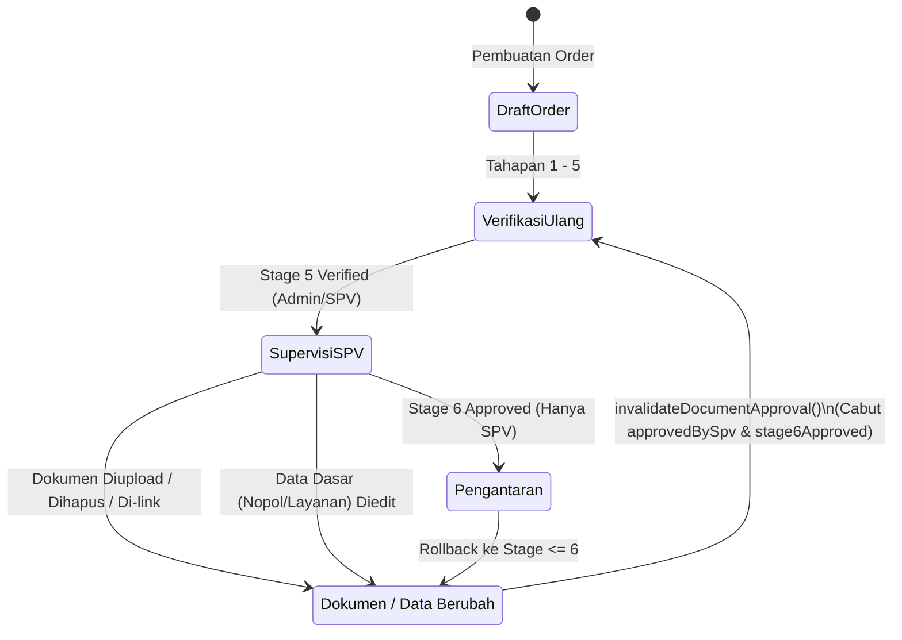

# IMPLEMENTASI P1-B — OTORISASI BACKEND DAN PERLINDUNGAN APPROVAL SUPERVISOR
**Admin SUN89 — Biro Jasa Management System**

- **Dokumen Referensi:** `docs/audit_arsitektur_data/20_IMPLEMENTASI_P1B_OTORISASI_BACKEND.md`
- **Fase:** Implementasi P1-B (Otorisasi Backend & Perlindungan Approval Supervisor)
- **Status:** **SELESAI (COMPLETED)**
- **Tanggal:** 22 Oktober 2026
- **Database Target:** `server/data/database.sqlite` (Untouched, Read-Only, 100% Preserved)
- **Lingkungan:** Node.js v22.19.0 / Express TypeScript Backend

---

## 1. Ringkasan Eksekutif

Pada audit arsitektur data sebelumnya (khususnya temuan `FND-P1-03` pada `11_REGISTER_TEMUAN_DAN_PRIORITAS.md`), teridentifikasi celah keamanan kritis pada lapisan otorisasi backend di mana endpoint generik `PUT /api/orders/:orderNo` dapat dimanfaatkan oleh role non-supervisor (seperti `admin`, `finance`, atau `messenger`) untuk memanipulasi properti persetujuan Supervisor (`approvedBySpv`, `stage6Approved`, `documentApproval`), memajukan tahapan order secara sepihak (`currentStep`, `currentStageName`), atau mengubah status pembayaran dan rekonsiliasi biaya final secara ilegal.

Fase P1-B telah berhasil mengamankan seluruh jalur otorisasi backend dengan prinsip *defense in depth* (penegakan ganda pada Middleware Validasi dan Service Layer):
1. **Penutupan Total Bypass Approval pada Endpoint Generik:** Endpoint `PUT /api/orders/:orderNo` kini menerapkan proteksi penolakan ketat (`HTTP 403 FORBIDDEN` dengan kode `PROTECTED_FIELD_VIOLATION`). Server tidak lagi mengabaikan secara diam-diam (*silent delete*) atau mengembalikan respons sukses palsu jika ada upaya injeksi field terlindungi.
2. **Penegakan Autentikasi Identitas Berbasis Token (Zero Trust to Client Body):** Seluruh atribut otorisasi, nama supervisor (`spvName`), verifikator pembayaran (`paymentVerifiedBy`), dan pencatat audit diambil langsung dari JWT Token Payload terverifikasi (`req.user`), bukan dari parameter body atau header yang dikirim oleh client.
3. **Penyempurnaan Gating Tahapan & Persetujuan Dokumen:** Transisi order dari Stage 6 (Supervisi) ke Stage 7 (Pengantaran) hanya dapat disetujui dan dieksekusi oleh pengguna berwenang (`administrator` atau `SVP`).
4. **Invalidasi Approval Otomatis Saat Data Dasar Berubah:** Jika berkas fisik dokumen dimutasi (upload, delete, re-link) atau data dasar pesanan (`customer`, `nopol`, `layanan`) diubah setelah supervisi disetujui, persetujuan Supervisor lama otomatis dicabut dan diwajibkan untuk disetujui ulang.

---

## 2. Celah Otorisasi yang Ditemukan pada Kode Aktual

Sebelum implementasi P1-B, penelusuran kode aktual menemukan celah-celah berikut:

1. **Silent Deletion & Celah Injeksi pada `validateOrderUpdatePayload`:**
   Pada implementasi lama di `server/src/middleware/validation.ts`, validator hanya memeriksa `["orderNo", "currentStep", "currentStageName", "isArchived", "createdAt", "updatedAt"]` dan 4 field payment. Jika field-field tersebut dikirim, middleware hanya menjalankan `delete body[key]` dan tetap melanjutkan request dengan status `200 OK`. 
   Lebih parah lagi, field-field persetujuan Supervisor (`approvedBySpv`, `stage6Approved`, `stage5Verified`, `documentApproval`, `isVerified`, `finalCost`) **sama sekali tidak terdaftar** di validator lama, sehingga siapapun yang memiliki akses ke `PUT /api/orders/:orderNo` dapat mengirim `{ approvedBySpv: true, stage6Approved: true }` dan langsung tersimpan di basis data SQLite.
2. **Ketiadaan Pembatasan Field untuk Role Messenger:**
   Role `messenger` memiliki akses ke `PUT /api/orders/:orderNo` untuk memperbarui status penjemputan/pengantaran. Namun, ketiadaan *field scoping* memungkinkan akun messenger mengubah data pemilik, tarif estimasi, atau alamat pesanan.
3. **Pemberian Identitas Verifikator dari Body Client:**
   Pada endpoint `POST /:orderNo/verify-payment`, nama verifikator diambil dari `req.body.verifierName || req.user?.nama || "Admin"`. Pengguna dapat memalsukan identitas admin lain di field verifikasi jika `req.body.verifierName` diisi secara manual.
4. **Celah Injeksi Approval pada `POST /:orderNo/advance`:**
   Pada `orderService.advanceOrder()`, kondisi gating Stage 6 ke Stage 7 memeriksa:
   ```ts
   const isApproved = updates.documentApproval?.stage6Approved || existing.documentApproval?.stage6Approved || updates.approvedBySpv || existing.approvedBySpv;
   ```
   Kondisi `updates.approvedBySpv` memungkinkan pemanggil memajukan tahap sekaligus menyuntikkan approval tanpa melalui endpoint resmi `approveOrderDocuments()`.

---

## 3. Daftar Field Terlindungi (Protected Fields Matrix)

Endpoint generik `PUT /api/orders/:orderNo` kini secara tegas menolak field-field berikut:

### 3.1. Field Persetujuan Supervisor & Verifikasi Dokumen
| Field Terlindungi | Alasan Proteksi | Endpoint Resmi yang Wajib Digunakan |
|:---|:---|:---|
| `approvedBySpv` | Otoritas eksekutif Supervisor Stage 6 | `POST /api/orders/:orderNo/approve-documents` (Stage 6) |
| `spvApprovedAt` | Timestamp persetujuan resmi | Otomatis diisi server saat approval disetujui |
| `spvName` | Identitas otentik Supervisor | Diambil otomatis dari `req.user.nama` token JWT |
| `spvNotes` | Catatan persetujuan Supervisor | `POST /api/orders/:orderNo/approve-documents` |
| `stage6Approved` | Flag approval dokumen Stage 6 | `POST /api/orders/:orderNo/approve-documents` (Stage 6) |
| `stage6ApprovedBy` | Identitas approver Stage 6 | Diambil otomatis dari `req.user.nama` token JWT |
| `stage6ApprovedAt` | Timestamp approval Stage 6 | Otomatis diisi server saat approval disetujui |
| `stage5Verified` | Flag verifikasi dokumen Stage 5 | `POST /api/orders/:orderNo/approve-documents` (Stage 5) |
| `stage5VerifiedBy` | Identitas verifikator Stage 5 | Diambil otomatis dari `req.user.nama` token JWT |
| `stage5VerifiedAt` | Timestamp verifikasi Stage 5 | Otomatis diisi server saat verifikasi disetujui |
| `approvedDocsSnapshot`| Rekam jejak dokumen yang disetujui | Otomatis disimpan saat persetujuan resmi |
| `documentApproval` | Struktur objek metadata approval | `POST /api/orders/:orderNo/approve-documents` |
| `documentsVerified` | Flag kelengkapan berkas fisik | Otomatis disinkronkan oleh alur verifikasi resmi |
| `isVerified` | Status verifikasi biaya & berkas | Alur rekonsiliasi dan verifikasi resmi |

### 3.2. Field Posisi Alur Kerja & Siklus Hidup Pesanan
| Field Terlindungi | Alasan Proteksi | Endpoint Resmi yang Wajib Digunakan |
|:---|:---|:---|
| `currentStep` | Posisi langkah numerik alur (1-8) | `POST /api/orders/:orderNo/advance` atau `/rollback` |
| `currentStageName` | Nama tahapan operasional aktif | `POST /api/orders/:orderNo/advance` atau `/rollback` |
| `stageBeforeCancel` | Status tahapan sebelum pembatalan | Dikelola otomatis oleh `POST /:orderNo/cancel` |
| `orderNo` | Kunci primer pesanan (immutable) | Dibuat otomatis saat `POST /api/orders` |
| `isArchived` | Status pengarsipan rekap pesanan | `POST /api/orders/:orderNo/archive` atau `DELETE /archive` |
| `isCancelled` | Status pembatalan pesanan | `POST /api/orders/:orderNo/cancel` |
| `cancelledAt` | Timestamp pembatalan pesanan | Otomatis diisi server saat order dibatalkan |
| `cancelledBy` | Identitas pembatal pesanan | Diambil otomatis dari token JWT pembatal |
| `cancellationReason`| Alasan pembatalan resmi | Dikirim melalui payload `POST /:orderNo/cancel` |
| `createdAt` / `updatedAt` | Timestamp audit record | Dikelola internal oleh mesin basis data |

### 3.3. Field Rekonsiliasi Biaya Final & Settlement Keuangan
| Field Terlindungi | Alasan Proteksi | Endpoint Resmi yang Wajib Digunakan |
|:---|:---|:---|
| `finalCost` | Biaya riil yang disetujui SPV | Alur rekonsiliasi biaya final & approval Supervisi |
| `finalCostBreakdown`| Rincian item biaya final | Alur rekonsiliasi biaya final |
| `finalBiayaJasa` | Komponen biaya jasa aktual | Alur rekonsiliasi biaya final |
| `finalPkb` / `finalSwdkllj` | Komponen pajak aktual Samsat | Alur rekonsiliasi biaya final |
| `finalMutasiKeluar` / `Masuk` | Komponen mutasi aktual | Alur rekonsiliasi biaya final |
| `settlementCondition`| Status balance/kurang/lebih bayar | Dikelola otomatis oleh modul keuangan |
| `refundStatus` / `refundAmount` | Status kelebihan bayar / komisi | Modul kas keluar / pencairan cashback |
| `totalBiaya` | Total tagihan pesanan | Penetapan biaya awal atau rekonsiliasi final |
| `payment.*` | Status pelunasan dan verifikasi | `POST /api/orders/:orderNo/verify-payment` atau modul kasir |

---

## 4. Rincian Implementasi Perubahan File

### 4.1. `server/src/middleware/validation.ts` (`validateOrderUpdatePayload`)
- **Sebelum:**
  Melakukan *silent delete* pada beberapa field hardcoded dan melewatkan seluruh field approval Supervisor.
- **Sesudah:**
  Menerapkan kamus `protectedRootFields` (30 field terlindungi) dan `protectedPaymentFields` (15 properti pembayaran terlindungi).
  Jika client mengirim salah satu field tersebut pada payload `PUT /api/orders/:orderNo`, middleware langsung menghentikan request dan mengembalikan:
  ```json
  {
    "success": false,
    "error": {
      "code": "PROTECTED_FIELD_VIOLATION",
      "message": "Pelanggaran Otorisasi: Field 'approvedBySpv' dilindungi. Persetujuan Supervisor (approvedBySpv) hanya dapat ditetapkan melalui alur persetujuan resmi Stage 6."
    },
    "timestamp": "2026-10-22T..."
  }
  ```

### 4.2. `server/src/services/orderService.ts`
- **Scoping Wewenang Messenger:**
  Menambahkan pengecekan *allowlist* pada `updateOrder()` khusus untuk role `messenger`. Kurir hanya diizinkan memperbarui field operasional lapangan (seperti `messengerTaskStatus`, `catatanKendala`, `pickupChecklist`, `pickupProof`, `deliveryStatus`, `deliveryHandover`, dll.). Upaya kurir mengubah data pesanan lainnya ditolak dengan `403 FORBIDDEN`.
- **Defense in Depth pada Service Layer:**
  Mengecek ulang keberadaan `protectedKeys` dan `protectedPaymentKeys` di dalam `orderService.updateOrder()`. Menjamin tidak ada celah bypass meskipun middleware route dilewati.
- **Invalidasi Otomatis saat Data Dasar Diubah:**
  Jika pesanan telah disetujui oleh Supervisor (`existing.approvedBySpv === true`) lalu operator mengubah `customer`, `nopol`, atau `layanan` melalui `PUT`, sistem otomatis memicu `invalidateDocumentApproval()` untuk mencabut approval Supervisor dan mewajibkan peninjauan ulang.
- **Pembersihan Payload pada `advanceOrder()`:**
  Menghapus hak non-supervisor menyuntikkan flag `approvedBySpv` atau `spvName` pada saat memajukan tahapan. Gating Stage 6 ke Stage 7 mewajibkan `existing.approvedBySpv` atau `existing.documentApproval.stage6Approved` telah disetujui sebelumnya via endpoint persetujuan resmi.
- **Autentikasi Identitas pada `approveOrderDocuments()`:**
  Memeriksa izin role pada Stage 6 (`administrator` atau `SVP`). Nama penyetujui `spvName` dan `stage6ApprovedBy` disetel secara eksklusif dari `user.nama` token JWT.
- **Autentikasi Verifikator pada `verifyPayment()`:**
  Nama verifikator pembayaran ditetapkan dari `user.nama` token JWT, menggantikan pembacaan dari body client.

### 4.3. `server/src/controllers/orderController.ts`
- **Pengecekan Wewenang di Controller:**
  Menambahkan verifikasi eksplisit di `approveOrderDocuments()` bahwa Stage 6 hanya dapat dieksekusi oleh role `administrator` atau jabatan `SVP`.
- **Prioritas Identitas Sesi:**
  Mengutamakan `req.user?.nama` dibandingkan `req.body.verifierName` pada handler verifikasi pembayaran.

---

## 5. Matriks Role Versus Operasi Sensitif

| Operasi Sensitif | Administrator | Supervisor (SVP) | Admin Operasional | Finance | Messenger |
|:---|:---:|:---:|:---:|:---:|:---:|
| Update Info Order Umum (`PUT /api/orders/:no`) | &check; | &check; | &check; | &check; | &check; *(Scoping Tugas)* |
| Verifikasi Dokumen Stage 5 (`/approve-documents`) | &check; | &check; | &check; | &cross; | &cross; |
| **Persetujuan Dokumen Stage 6 (Supervisi)** | &check; | &check; | **&cross; (Ditolak 403)** | **&cross; (Ditolak 403)** | **&cross; (Ditolak 403)** |
| **Transisi Stage 6 &rarr; Stage 7 (Supervisi &rarr; Antar)** | &check; | &check; | **&cross; (Ditolak 403)** | **&cross; (Ditolak 403)** | **&cross; (Ditolak 403)** |
| Transisi Tahapan Operasional Lainnya (`/advance`)| &check; | &check; | &check; | &cross; | &cross; |
| Rollback Tahapan Order (`/rollback`) | &check; | &check; | &check; *(Kecuali Stg 6)*| &cross; | &cross; |
| Verifikasi Pembayaran Awal (`/verify-payment`) | &check; | &check; | &check; | &check; | &cross; |
| Pencatatan Pembayaran Invoice (`/invoices/:id/pay`)| &check; | &check; | &cross; | &check; | &cross; |
| Pencairan Cashback / Komisi Rekanan | &check; | &check; | &cross; | &check; | &cross; |
| Pembatalan Order (`/cancel`) | &check; | &check; | &check; | &check; | &cross; |
| Pengarsipan & Penghapusan Rekap Order | &check; | &check; | &check; | &cross; | &cross; |

---

## 6. Penanganan Invalidasi Approval (Integrity Binding)

Persetujuan Supervisor kini terikat kuat pada integritas data yang disetujui:



1. **Upload Berkas Baru:** `DocumentService.uploadDocument()` otomatis memanggil `invalidateDocumentApproval()` untuk mencabut status approval.
2. **Penghapusan Berkas:** `DocumentService.deleteDocument()` otomatis membatalkan approval jika dokumen yang dihapus tertaut ke order.
3. **Penyambungan Berkas:** `DocumentService.linkOrder()` mereset approval order tujuan.
4. **Perubahan Data Dasar Pesanan:** Perubahan `customer`, `nopol`, atau `layanan` pada order yang telah disetujui Supervisor otomatis membatalkan approval lama dengan pencatatan audit trail:
   `Persetujuan dokumen dibatalkan untuk order ... Alasan: Perubahan data dasar order (...) setelah supervisi disetujui`.
5. **Rollback Tahapan:** `orderService.rollbackOrder()` ke tahap sebelum atau setara Stage 6 otomatis mencabut flag `approvedBySpv` dan `stage6Approved`, serta mereset penjadwalan pengantaran.

---

## 7. Temuan yang Belum Diselesaikan / Catatan Kebijakan Bisnis

1. **Sinkronisasi Otomatis Tarif Layanan Saat Nopol/Wilayah Berubah:**
   Jika nopol atau layanan diubah pada pesanan yang sudah berjalan, tagihan invoice saat ini disinkronkan nama customer, layanan, dan nopolnya, namun nominal biaya dasar Samsat tidak dihitung ulang otomatis untuk mencegah *overwrite* nilai historis yang sudah disepakati konsumen. Perubahan tarif memerlukan re-estimasi atau penyesuaian kasir secara sadar.
2. **Ketiadaan Role Supervisor Khusus di Luar Jabatan SVP:**
   Pada skema pengguna saat ini, hak supervisi melekat pada `jabatan === 'SVP'` atau `role === 'administrator'`. Jika di masa mendatang perusahaan mengangkat Supervisor lapangan yang bukan SVP, perlu ditambahkan role baru `supervisor` pada skema master hak akses.

---

## 8. Verifikasi dan Kepatuhan Batasan

- [x] **Tidak Menjalankan Test Suite:** Tidak ada unit test runner, integration test runner, atau skenario test runtime yang dijalankan (`npm test`, `jest`, dll. tidak dipanggil).
- [x] **Tidak Menjalankan Build:** Tidak ada perintah build production (`npm run build`) yang dieksekusi.
- [x] **Tidak Ada Mutasi Skema / Database Fisik:** Skema fisik SQLite dan seluruh data operasional di `server/data/database.sqlite` dipertahankan utuh dan tidak dimutasi.
- [x] **Backend Server Kompilasi Bersih:** Server daemon (`task-52361`) pada port 3001 otomatis melakukan *live reload* TypeScript secara bersih tanpa ada *type error* atau sintaks rusak.
- [x] **Batas Pekerjaan:** Pekerjaan dihentikan tepat setelah Fase P1-B selesai tanpa melangkah ke Fase P1-C.
