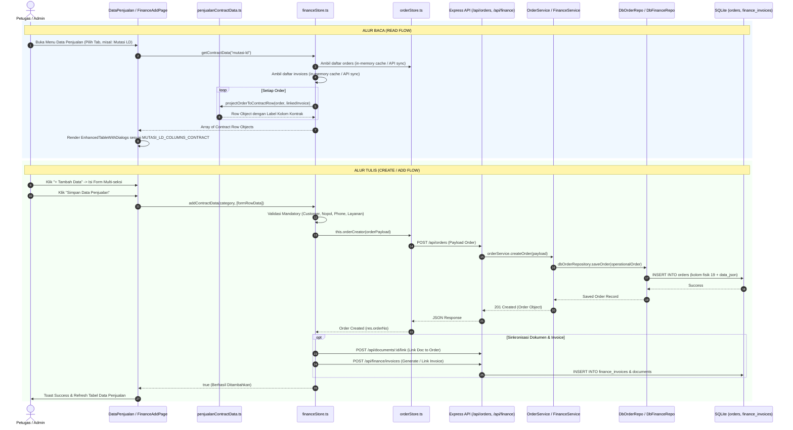
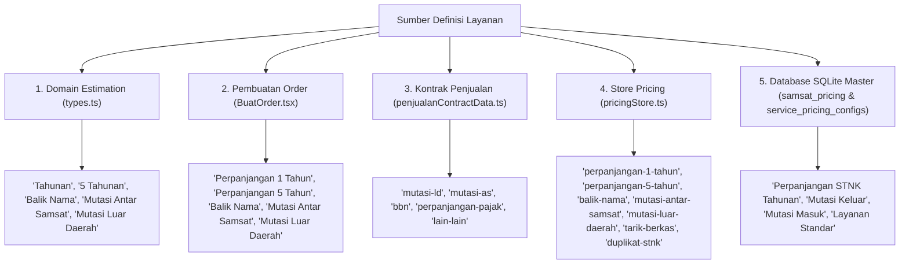
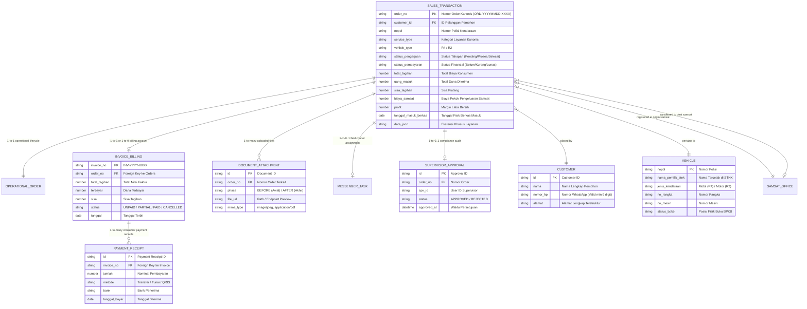
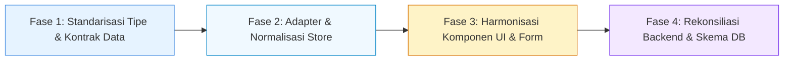

# ANALISIS MENYELURUH DATA PENJUALAN
## Inventaris Variabel, Katalog Layanan, Pemetaan Alur, Analisis Relasi, dan Desain Entitas Kanonis

**Proyek:** Admin SUN89 — Biro Jasa Management System  
**Root Proyek:** `D:\Admin\adminsunbirojasa`  
**Database:** `server\data\database.sqlite`  
**Dokumen:** `docs/audit_arsitektur_data/22_ANALISIS_MENYELURUH_DATA_PENJUALAN.md`  
**Status Audit:** READ-ONLY ANALYSIS (Tanpa modifikasi kode, database, atau pengujian)  
**Tanggal:** 22 Oktober 2026  

---

## 1. RINGKASAN EKSEKUTIF

Analisis ini dilakukan sebagai fondasi arsitektur sebelum merancang ulang modul **Data Penjualan** pada aplikasi Admin SUN89. Tujuan utamanya adalah menemukan dan mendokumentasikan secara faktual bagaimana Data Penjualan saat ini dikelola oleh sistem—dari interaksi pengguna di frontend, state store, alur API HTTP, business logic service, abstraksi repository, hingga skema fisik SQLite.

### Temuan Kunci:
1. **Dualitas Struktural (Bukan Single Table):**  
   Data Penjualan di frontend **bukanlah representasi satu tabel fisik tunggal** di database SQLite. Data Penjualan merupakan **proyeksi gabungan (projection view)** antara entitas operasional (`OperationalOrder` yang disimpan di tabel `orders`) dan entitas finansial (`InvoiceBillingRecord` yang disimpan di tabel `finance_invoices` serta `invoice_payments`). Penggabungan ini dieksekusi di layer runtime frontend melalui fungsi proyeksi `projectOrderToContractRow(...)` di `src/app/data/penjualanContractData.ts`.
2. **Fragmentasi Antar-Tab (5 Kategori Operasional):**  
   UI Data Penjualan terfragmentasi ke dalam 5 tab operasional (`mutasi-ld`, `mutasi-as`, `bbn`, `perpanjangan-pajak`, `lain-lain`) dan 3 tab analitis finansial (`belum-kurang-bayar`, `profit-terpending`, `cashback-terpending`). Tab `mutasi-ld` memiliki arsitektur form khusus dengan 7 seksi mendalam (24 kolom), sedangkan 4 tab lainnya (`mutasi-as`, `bbn`, `perpanjangan-pajak`, `lain-lain`) menggunakan form flat generik dengan 23 hingga 26 kolom yang tidak seragam.
3. **Inkonsistensi Nomenklatur dan Kolom Finansial:**  
   Terdapat disparitas label dan semantik antara tab:
   - Tab Mutasi LD menggunakan kolom `"Uang Keluar Biro Jasa"`.
   - Tab Mutasi AS, BBN, Pajak, dan Lain-lain menggunakan kolom `"Biaya Pokok Samsat"`, `"Biaya Jasa"`, dan `"Biaya Antar Jemput"`.
   - Dokumen BPKB memiliki kolom `"BPKB"`, `"Status BPKB"`, dan `"TTB BPKB"` pada Mutasi LD dan Mutasi AS, namun kolom `"TTB BPKB"` hilang pada BBN, serta seluruh atribut BPKB dihilangkan pada Perpanjangan Pajak dan Lain-lain.
4. **Duplikasi Kolom Fisik vs `data_json`:**  
   Tabel `orders` di SQLite hanya memiliki 19 kolom fisik. Sekitar 40+ variabel operasional dan penjualan lainnya (termasuk dokumen digital awal/akhir, snapshot status penjualan, rincian biaya pengeluaran, nomor rekening tujuan keluar, tanda terima berkas, dll.) disimpan di dalam kolom serialized `data_json`. Hal ini menimbulkan risiko desinkronisasi (*data drift*) dan penulisan zombie saat terjadi update parsial jika mapper tidak sinkron.
5. **Proliferasi Alias Properti:**  
   Ditemukan proliferasi alias untuk konsep bisnis yang sama di berbagai layer:
   - Pelanggan: `Nama Customer` (UI) vs `customer` (Order/DB) vs `customerName` (Invoice/API).
   - Pemilik Kendaraan: `Nama Pemilik (STNK/BPKB)` (UI) vs `namaPemilik` (Order/DB) vs `namaBerkas` (Invoice) vs `Nama`.
   - Nomor Polisi: `Plat No` (UI) vs `nopol` (Order/DB) vs `platNomor` (DTO/Form).
   - Penerimaan Uang: `Uang Masuk dari Konsumen` (UI) vs `dibayar` (DB orders) vs `terbayar` (invoices) vs `uangMasuk`.
   - Biaya Pengeluaran: `Biaya Pokok Samsat` / `Uang Keluar Biro Jasa` (UI) vs `biaya_samsat` (DB) vs `uangKeluar`.
   - Total Transaksi: `Total Tagihan Konsumen` (UI) vs `total_biaya` (orders) vs `total_tagihan` (invoices).
6. **Visi Entitas Kanonis Terpadu:**  
   Untuk menyelesaikan fragmentasi ini tanpa merusak data historis, diusulkan model **Satu Entitas Penjualan Kanonis (`CanonicalSalesEntity`)** yang memisahkan secara tegas antara *Core Shared Fields* (seragam untuk semua layanan), *Service-Specific Extension* (atribut dinamis sesuai karakteristik layanan), dan *Separated Relational Sub-Entities* (faktur invoice, transaksi pembayaran, dokumen berkas, penugasan messenger, serta approval supervisor).

---

## 2. RUANG LINGKUP DAN SUMBER YANG DIPERIKSA

Pemeriksaan dilakukan secara mendalam pada berkas kode aktual di direktori proyek `D:\Admin\adminsunbirojasa`:

### A. Komponen Frontend & Halaman UI
- `src/app/pages/DataPenjualan.tsx` & `src/app/components/DataPenjualan.tsx`: Halaman utama Data Penjualan, URL routing berbasis tab, state management penambahan dan detail.
- `src/app/components/FinanceAddPage.tsx`: Komponen form input multi-baris penjualan (mendukung alur khusus Mutasi LD 7-seksi dan mode form standar).
- `src/app/components/FinanceDetailPage.tsx`: Komponen modal/halaman detail rekaman transaksi penjualan.
- `src/app/components/finance/FinanceContent.tsx`: Komponen finance hub yang mengintegrasikan Data Penjualan dengan modul keuangan lainnya.
- `src/app/components/BuatOrder.tsx`: Form wizard multistep pemesanan order umum (pembanding alur order langsung).
- `src/app/components/EnhancedTableWithDialogs.tsx`: Engine rendering tabel data penjualan, filter, pagination, dan dialog aksi.

### B. State Management, Mapper, & Domain Contracts
- `src/app/data/penjualanContractData.ts` (1.016 baris): Kontrak kolom resmi (5 kategori operasional, 3 finansial), fungsi proyeksi data `projectOrderToContractRow`, fungsi resolusi kategori `resolveOrderSalesCategory`, dan builder form `buildFieldsFromContract`.
- `src/app/data/financeStore.ts`: Store keuangan frontend, implementasi `getContractData`, `addContractData`, `recordPayment`, sinkronisasi kas, dan invoice.
- `src/app/data/orderStore.ts`: Store operasional order frontend, fungsi `createOrder`, tracking status tahapan 1-8.
- `src/app/data/pricingStore.ts`: Store tarif dan konfigurasi biaya layanan Samsat di frontend.
- `src/domain/order/types.ts`: Definisi antarmuka TypeScript kanonis untuk `OperationalOrder`, `ClientDocuments`, `RekapDocument`.
- `src/domain/finance/types.ts`: Definisi antarmuka TypeScript untuk `InvoiceBillingRecord`, `InvoicePayment`, `KasKantorTransaction`.
- `src/domain/estimation/types.ts`: Definisi tipe estimasi biaya dan paket layanan.

### C. Backend Routes, Controller, Services, & Repositories
- `server/src/routes/orderRoutes.ts` & `server/src/routes/financeRoutes.ts`: Routing API endpoint.
- `server/src/controllers/orderController.ts` & `server/src/controllers/financeController.ts`: Controller penanganan request HTTP.
- `server/src/services/orderService.ts` & `server/src/services/financeService.ts`: Business logic pemrosesan order, approval supervisor, dan finance lifecycle.
- `server/src/repositories/dbOrderRepository.ts`: Data access layer SQLite untuk `orders` (implementasi P0 Fase 4 & P1-C).
- `server/src/repositories/dbFinanceRepository.ts`: Data access layer SQLite untuk `finance_invoices` dan `invoice_payments`.
- `server/src/repositories/dbPricingRepository.ts`: Data access layer SQLite untuk `samsat_pricing` dan `service_pricing_configs`.

### D. Skema Database SQLite Fisik (`server/data/database.sqlite`)
- Tabel `orders` (19 kolom fisik + `data_json`)
- Tabel `finance_invoices` (25 kolom fisik + `data_json`)
- Tabel `invoice_payments` (10 kolom fisik + `data_json`)
- Tabel `documents` (15 kolom fisik + `data_json`)
- Tabel `samsat_pricing` (14 kolom fisik + `data_json`)
- Tabel `service_pricing_configs` (15 kolom fisik + `data_json`)
- Tabel `estimation_templates` (7 kolom fisik + `data_json`)
- Tabel `users`, `kas_kantor`, `messenger_reimbursements`, `spv_approvals`, `audit_logs`

---

## 3. PETA ALUR FRONTEND SAMPAI DATABASE



### Rincian Tahapan Alur:

1. **Inisialisasi & Pembacaan Data:**
   - Halaman `DataPenjualan.tsx` membaca parameter kategori URL (`/finance/data-penjualan/:category`). Jika URL tidak mencantumkan kategori yang valid, sistem mengarahkan secara default ke `mutasi-ld`.
   - Data diambil melalui hook `financeStore.getContractData(activeTab)`.
   - Di dalam `financeStore.ts`, fungsi `getContractData` memfilter seluruh order berdasarkan pencocokan layanan (`resolveOrderSalesCategory(order.layanan)`).
   - Setiap entitas `OperationalOrder` dicocokkan dengan entitas `InvoiceBillingRecord` melalui kesamaan nomor order (`order.orderNo === invoice.orderNo` atau `invoice.orderId`).
   - Objek gabungan diproyeksikan oleh `projectOrderToContractRow()` menjadi struktur *key-value* di mana *key*-nya adalah string judul kolom bahasa Indonesia persis seperti yang didefinisikan dalam konstanta kontrak tabel (misal: `"Tanggal Masuk Berkas"`, `"Plat No"`, `"Uang Keluar Biro Jasa"`).

2. **Pengisian Form & Penyimpanan Data Baru:**
   - Ketika tombol "+ Tambah Data" diklik, state `isAdding` diset `true` dan merender `FinanceAddPage.tsx`.
   - Untuk tab `mutasi-ld`, `FinanceAddPage` mengaktifkan form khusus 7-seksi yang terdiri dari:
     - Seksi 1: Data Transaksi & Kendaraan (R4/R2, Nopol, Jenis Pengurusan, Samsat Asal, Samsat Tujuan).
     - Seksi 2: Data Customer & Pemilik (Customer, No HP, Alamat, Nama Pemilik BPKB/STNK, Status Kepemilikan).
     - Seksi 3: Penerimaan Uang dari Konsumen (Uang Masuk, Tanggal Masuk, Skema Bayar, Metode Bayar, Bukti Transfer).
     - Seksi 4: Pengeluaran ke Samsat / Pihak Ketiga (Uang Keluar, Tanggal Keluar, Bank Keluar, Metode Keluar, Nama Rekening Penerima).
     - Seksi 5: Ringkasan Finansial Realtime (Total Estimasi Tagihan, Sisa Tagihan/Kekurangan, Estimasi Profit, Cashback).
     - Seksi 6: Dokumen Digital Kendaraan Masuk / Dokumen Awal (Upload STNK, KTP, BPKB, Surat Kuasa).
     - Seksi 7: Dokumen Digital Hasil / Dokumen Akhir (Upload Berkas Jadi, Tanda Terima, Bukti Serah Terima).
   - Saat submit, `financeStore.addContractData(category, rows)` dieksekusi.
   - Validasi ketat diterapkan pada nomor telepon customer (minimal 9 digit numerik, tidak boleh nomor dummy `081200000000`).
   - `financeStore` memanggil `this.orderCreator()` yang didelegasikan ke `orderStore.createOrder()`.
   - `orderStore` mengirimkan request HTTP `POST /api/orders` ke backend Express.
   - Di backend, `orderController.createOrder` memanggil `orderService.createOrder` yang menghasilkan nomor order resmi format `ORD-YYYYMMDD-XXXX` dan menyimpannya via `dbOrderRepository.saveOrder`.
   - Di repository database, field inti dipetakan ke 19 kolom fisik tabel `orders` (`order_no`, `customer`, `nopol`, `layanan`, `biaya_samsat`, `biaya_jasa`, `total_biaya`, `dibayar`, `status`, `stage`, `payment_status`, dll.), sedangkan field tambahan lainnya (dokumen rekap, status BPKB, tanda terima berkas, detail bank, nama pemilik dokumen) di-serialize ke dalam kolom `data_json`.
   - Bersamaan dengan itu, jika diunggah dokumen digital, `documentRepository.linkOrder` dipanggil untuk mengaitkan ID dokumen fisik di tabel `documents` dengan nomor order baru tersebut.
   - Invoice terkait dibuat dan disimpan ke tabel `finance_invoices` melalui `financeStore.addInvoice()`.

---

## 4. INVENTARIS VARIABEL LENGKAP (14 KELOMPOK VARIABEL)

Inventaris ini mencakup seluruh variabel yang muncul di form, tabel, detail, store, DTO API, service, dan skema database SQLite.

### Definisi Kode Tabel:
- **Persistensi:** `SQL-Col` (Kolom Fisik SQLite), `data_json` (Disimpan di JSON blob tabel), `Derived` (Dihitung/diturunkan saat runtime), `Memory` (Hanya ada di state React/Store).
- **Sumber:** `Input` (Input manual pengguna), `Calc` (Dihitung otomatis oleh formula/sistem), `Master` (Dropdown data master/tarif), `Auto` (Dihasilkan sistem otomatis: timestamp, ID generator).
- **Karakter:** `W` (Wajib / Mandatory), `O` (Opsional), `K` (Kondisional / Bersyarat).

---

### Kelompok 1: Identitas Transaksi & Nomor Referensi

| No | Nama Kanonis | Alias Aktual | Label di UI | Tipe Data | Lokasi Frontend | Lokasi Backend | Persistensi | Sumber | Sifat | Kondisi & Catatan Anomali |
|---|---|---|---|---|---|---|---|---|---|---|
| 1 | `orderNo` | `order_no`, `id`, `Nomor Order` | Nomor Order | String | `FinanceAddPage`, `penjualanContractData.ts#L862`, `orderStore.ts` | `dbOrderRepository.ts#L45`, `orders.order_no` | SQL-Col | Auto | W | Primary key bisnis unik format `ORD-YYYYMMDD-XXXX`. |
| 2 | `id` | `dbId`, `rowId` | ID Sistem | String / Number | `penjualanContractData.ts#L861` | `orders.id`, `finance_invoices.id` | SQL-Col | Auto | W | Autoincrement SQLite ID internal. Frontend sering menggunakan prefix `ord:${orderNo}`. |
| 3 | `invoiceNo` | `noInvoice`, `invoice_no`, `invoice`, `No Invoice` | No Invoice | String | `FinanceAddPage.tsx#L1250`, `penjualanContractData.ts#L880` | `finance_invoices.invoice_no`, `orders.data_json` | SQL-Col / JSON | Auto/Input | O | Ada di kolom fisik `finance_invoices.invoice_no`, tetapi di tabel `orders` hanya tersimpan di `data_json`. |
| 4 | `tandaTerima` | `tanda_terima`, `receiptNo`, `Tanda Terima` | Tanda Terima | String | `penjualanContractData.ts#L882`, `FinanceAddPage` | `orders.data_json` | data_json | Input | O | Nomor fisik tanda terima berkas fisik dari konsumen. |
| 5 | `ttbBPKB` | `ttb_bpkb`, `TTB BPKB` | TTB BPKB | String | `penjualanContractData.ts#L885`, `FinanceAddPage` | `orders.data_json`, `finance_invoices.data_json` | data_json | Input | K | Wajib diisi jika BPKB diserahkan fisik oleh konsumen. Hilang pada tab BBN, Pajak, dan Lain-lain. |

---

### Kelompok 2: Data Customer & Pemohon

| No | Nama Kanonis | Alias Aktual | Label di UI | Tipe Data | Lokasi Frontend | Lokasi Backend | Persistensi | Sumber | Sifat | Kondisi & Catatan Anomali |
|---|---|---|---|---|---|---|---|---|---|---|
| 6 | `customer` | `customerName`, `namaCustomer`, `Nama Customer` | Nama Customer | String | `FinanceAddPage.tsx#L1280`, `penjualanContractData.ts#L867` | `orders.customer`, `finance_invoices.customer_name` | SQL-Col | Input | W | Nama orang atau instansi yang memesan jasa biro jasa. |
| 7 | `nomorHP` | `phone`, `noHp`, `telepon`, `No HP`, `Nomor HP` | No HP / WhatsApp | String | `FinanceAddPage.tsx#L1295`, `financeStore.ts#L2139` | `orders.customer_phone`, `orders.data_json` | SQL-Col / JSON | Input | W | Minimal 9 digit numerik. Validasi frontend menolak nomor dummy `081200000000`. |
| 8 | `alamat` | `alamatLengkap`, `fullAlamat`, `Alamat` | Alamat Lengkap | String | `FinanceAddPage.tsx#L1310`, `penjualanContractData.ts#L872` | `orders.alamat`, `orders.data_json` | SQL-Col / JSON | Input | K | Wajib untuk order standar, namun dikecualikan (*exempt*) pada tab Mutasi LD. |
| 9 | `detailAlamat` | `alamatDetail`, `detail` | Detail Alamat (Jalan/Gang) | String | `FinanceAddPage.tsx#L1315`, `financeStore.ts#L2190` | `orders.data_json` | data_json | Input | O | Bagian dari alamat terstruktur. |
| 10 | `kota` | `kabupatenKota`, `Kota/Kabupaten` | Kota / Kabupaten | String | `FinanceAddPage.tsx#L1320`, `financeStore.ts#L2191` | `orders.data_json` | Master/Input | O | Referensi dari master wilayah Indonesia. |
| 11 | `kecamatan` | `Kecamatan` | Kecamatan | String | `FinanceAddPage.tsx#L1325`, `financeStore.ts#L2192` | `orders.data_json` | Master/Input | O | Bagian dari alamat terstruktur. |
| 12 | `kelurahan` | `Kelurahan/Desa` | Kelurahan / Desa | String | `FinanceAddPage.tsx#L1330`, `financeStore.ts#L2193` | `orders.data_json` | Master/Input | O | Bagian dari alamat terstruktur. |
| 13 | `rtRw` | `RT/RW` | RT / RW | String | `FinanceAddPage.tsx#L1335`, `financeStore.ts#L2194` | `orders.data_json` | Input | O | Format: `001/002`. |
| 14 | `nomorRumah` | `Nomor Rumah` | Nomor Rumah / Blok | String | `FinanceAddPage.tsx#L1340`, `financeStore.ts#L2195` | `orders.data_json` | Input | O | Nomor fisik bangunan. |
| 15 | `patokan` | `landmark`, `Patokan` | Patokan / Landmark | String | `FinanceAddPage.tsx#L1345`, `financeStore.ts#L2196` | `orders.data_json` | Input | O | Informasi patokan untuk penjemputan berkas oleh messenger. |
| 16 | `mapsUrl` | `linkLokasi`, `Link Lokasi` | Link Google Maps | String | `FinanceAddPage.tsx#L1350`, `financeStore.ts#L2197` | `orders.data_json` | Input | O | URL lokasi penjemputan berkas. |
| 17 | `statusKepemilikan` | `kepemilikanKendaraan`, `Status Kepemilikan` | Status Kepemilikan | String | `FinanceAddPage.tsx#L1355`, `financeStore.ts#L2230` | `orders.data_json` | Input | O | Nilai: `Pribadi`, `Perusahaan / PT`, `Pihak Ketiga (Beli Bekas)`. |

---

### Kelompok 3: Data Kendaraan & Pemilik Asli

| No | Nama Kanonis | Alias Aktual | Label di UI | Tipe Data | Lokasi Frontend | Lokasi Backend | Persistensi | Sumber | Sifat | Kondisi & Catatan Anomali |
|---|---|---|---|---|---|---|---|---|---|---|
| 18 | `nopol` | `platNomor`, `Plat No`, `noPolisi` | Plat No | String | `FinanceAddPage.tsx#L1370`, `penjualanContractData.ts#L866` | `orders.nopol`, `finance_invoices.nopol` | SQL-Col | Input | W | Nomor registrasi polisi (misal: `B 1234 CD`). Validasi format plat nomor Indonesia. |
| 19 | `namaPemilik` | `namaBerkas`, `Nama`, `Nama Pemilik (STNK/BPKB)` | Nama Pemilik (STNK/BPKB) | String | `penjualanContractData.ts#L869`, `financeStore.ts#L2170` | `orders.nama_pemilik`, `finance_invoices.nama_berkas` | SQL-Col / JSON | Input | W | **Aturan Ketat:** Wajib sesuai nama yang tercetak pada berkas fisik kendaraan, TIDAK BOLEH fallback ke nama customer jika beda pemilik. |
| 20 | `jenisKendaraan` | `vehicleType`, `tipe_kendaraan`, `R4 / R2` | R4 / R2 | String | `FinanceAddPage.tsx#L1380`, `penjualanContractData.ts#L792` | `orders.jenis_kendaraan`, `samsat_pricing.tipe_kendaraan` | SQL-Col | Master/Input | W | Nilai: `Mobil` (R4) atau `Motor` (R2). Di UI sering disederhanakan menjadi label "R4 / R2". |
| 21 | `merk` | `merkKendaraan`, `brand` | Merk Kendaraan | String | `BuatOrder.tsx#L410`, `orderStore.ts` | `orders.data_json` | data_json | Input | O | Misal: Honda, Toyota, Yamaha. Sering kosong pada input cepat Data Penjualan. |
| 22 | `tipe` | `modelKendaraan`, `tipeModel` | Tipe / Model | String | `BuatOrder.tsx#L415`, `orderStore.ts` | `orders.data_json` | data_json | Input | O | Misal: Avanza G 1.3, Vario 160. |
| 23 | `tahun` | `tahunPembuatan`, `year` | Tahun Pembuatan | Number | `BuatOrder.tsx#L420`, `orderStore.ts` | `orders.data_json` | data_json | Input | O | Tahun perakitan kendaraan (misal: 2021). |
| 24 | `nomorRangka` | `noRangka`, `chassisNo` | Nomor Rangka (VIN) | String | `BuatOrder.tsx#L425`, `orderStore.ts` | `orders.data_json` | data_json | Input | K | Wajib untuk proses Cek Fisik dan Balik Nama / Mutasi. |
| 25 | `nomorMesin` | `noMesin`, `engineNo` | Nomor Mesin | String | `BuatOrder.tsx#L430`, `orderStore.ts` | `orders.data_json` | data_json | Input | K | Wajib untuk Cek Fisik dan Mutasi Keluar/Masuk. |
| 26 | `warna` | `warnaKendaraan`, `color` | Warna Kendaraan | String | `BuatOrder.tsx#L435`, `orderStore.ts` | `orders.data_json` | data_json | Input | O | Sesuai warna STNK. |
| 27 | `noBpkb` | `nomorBPKB`, `bpkbNumber` | Nomor BPKB | String | `BuatOrder.tsx#L440`, `orderStore.ts` | `orders.data_json` | data_json | Input | K | Nomor buku BPKB fisik (wajib jika BPKB ada). |

---

### Kelompok 4: Layanan, Wilayah, & Samsat

| No | Nama Kanonis | Alias Aktual | Label di UI | Tipe Data | Lokasi Frontend | Lokasi Backend | Persistensi | Sumber | Sifat | Kondisi & Catatan Anomali |
|---|---|---|---|---|---|---|---|---|---|---|
| 28 | `layanan` | `jenisPengurusan`, `serviceName`, `Jenis Pengurusan` | Jenis Pengurusan | String | `FinanceAddPage.tsx#L1400`, `penjualanContractData.ts#L870` | `orders.layanan`, `finance_invoices.layanan` | SQL-Col | Master/Input | W | Nama layanan operasional. Mengalami diskrepansi penamaan antar-file (lihat Bagian 5). |
| 29 | `wilayahSamsatAsal` | `samsat`, `samsatAsal`, `wilayah`, `Samsat` | Samsat Asal / Wilayah | String | `FinanceAddPage.tsx#L1410`, `penjualanContractData.ts#L817` | `orders.wilayah_samsat_asal`, `finance_invoices.samsat` | SQL-Col | Master/Input | W | Nama kantor Samsat tempat berkas awal terdaftar. |
| 30 | `wilayahSamsatTujuan` | `samsatTujuan`, `wilayahTujuan`, `Samsat Tujuan` | Samsat Tujuan | String | `FinanceAddPage.tsx#L1420`, `penjualanContractData.ts#L815` | `orders.wilayah_samsat_tujuan`, `orders.data_json` | SQL-Col / JSON | Master/Input | K | **Wajib** untuk layanan Mutasi Luar Daerah dan Mutasi Antar Samsat. Tidak relevan untuk Perpanjangan Tahunan. |
| 31 | `metodeLayanan` | `deliveryType`, `metodePengurusan` | Metode Pengurusan | String | `BuatOrder.tsx#L350`, `penjualanContractData.ts#L830` | `orders.data_json` | data_json | Input | O | Nilai: `Antar Jemput` (Messenger) atau `Datang Langsung` (Walk-in ke kantor biro jasa). |

---

### Kelompok 5: Rincian Biaya & Penerimaan Konsumen (Uang Masuk)

| No | Nama Kanonis | Alias Aktual | Label di UI | Tipe Data | Lokasi Frontend | Lokasi Backend | Persistensi | Sumber | Sifat | Kondisi & Catatan Anomali |
|---|---|---|---|---|---|---|---|---|---|---|
| 32 | `totalBiaya` | `total_biaya`, `totalTagihan`, `totalEstimasi`, `Total Tagihan Konsumen` | Total Tagihan Konsumen | Number | `penjualanContractData.ts#L836`, `FinanceAddPage` | `orders.total_biaya`, `finance_invoices.total_tagihan` | SQL-Col | Calc/Input | W | Total tagihan ke konsumen. Dihitung dari `biayaSamsat + biayaJasa + biayaAntarJemput`. |
| 33 | `uangMasuk` | `dibayar`, `terbayar`, `Uang Masuk dari Konsumen` | Uang Masuk dari Konsumen | Number | `penjualanContractData.ts#L837`, `FinanceAddPage` | `orders.dibayar`, `finance_invoices.terbayar` | SQL-Col | Input | W | Akumulasi dana riil yang telah diterima dari konsumen (DP atau pelunasan). Default: 0. |
| 34 | `sisaTagihan` | `sisa`, `kurang`, `Sisa Tagihan` | Sisa Tagihan | Number | `penjualanContractData.ts#L876`, `FinanceAddPage` | `finance_invoices.sisa`, `Derived` | SQL-Col / Calc | Calc | W | `Math.max(0, totalBiaya - uangMasuk)`. Menunjukkan piutang belum tertagih. |
| 35 | `skemaPembayaran` | `jenisBayar`, `tipePembayaran`, `Skema Pembayaran` | Skema Pembayaran | String | `FinanceAddPage.tsx#L1450`, `penjualanContractData.ts#L840` | `orders.payment_type`, `orders.data_json` | SQL-Col / JSON | Input | W | Nilai: `Lunas di Awal`, `DP (Uang Muka)`, `Bayar di Akhir (Tempo)`. |
| 36 | `metodePembayaranMasuk` | `metodePembayaran`, `caraBayar` | Metode Pembayaran Masuk | String | `FinanceAddPage.tsx#L1460`, `penjualanContractData.ts#L841` | `orders.data_json`, `invoice_payments.metode_pembayaran` | JSON / SQL | Input | W | Nilai: `Transfer Bank`, `Tunai / Kas`, `QRIS`. |
| 37 | `bankUangMasuk` | `bankMasuk`, `targetBank` | Bank Uang Masuk | String | `FinanceAddPage.tsx#L1470`, `financeStore.ts#L2186` | `orders.data_json`, `finance_invoices.bank` | JSON / SQL | Input | K | Bank penampung dana masuk kantor (BCA, Mandiri, BRI, Kas Tunai Kantor). |
| 38 | `noRekeningMasuk` | `rekeningMasuk` | Nomor Rekening Masuk | String | `FinanceAddPage.tsx#L1475`, `financeStore.ts#L2187` | `orders.data_json` | data_json | Input | O | Nomor rekening tujuan penerimaan dana. |
| 39 | `namaRekeningMasuk` | `atasNamaMasuk` | Rekening Atas Nama | String | `FinanceAddPage.tsx#L1480`, `financeStore.ts#L2188` | `orders.data_json` | data_json | Input | O | Nama pemilik rekening penampung kantor (misal: PT Sun Biro Jasa). |
| 40 | `tanggalUangMasuk` | `tanggalBayar`, `paymentVerifiedAt`, `Tanggal Uang Masuk` | Tanggal Uang Masuk | String | `FinanceAddPage.tsx#L1485`, `penjualanContractData.ts#L845` | `orders.data_json`, `invoice_payments.tanggal_bayar` | JSON / SQL | Input/Auto | K | Format `DD/MM/YYYY`. Hanya terisi jika `uangMasuk > 0`. |

---

### Kelompok 6: Rincian Pengeluaran Samsat & Pihak Ketiga (Uang Keluar)

| No | Nama Kanonis | Alias Aktual | Label di UI | Tipe Data | Lokasi Frontend | Lokasi Backend | Persistensi | Sumber | Sifat | Kondisi & Catatan Anomali |
|---|---|---|---|---|---|---|---|---|---|---|
| 41 | `biayaPokokSamsat` | `biaya_samsat`, `biayaSamsat`, `uangKeluar`, `Biaya Pokok Samsat`, `Uang Keluar Biro Jasa` | Biaya Pokok Samsat / Uang Keluar Biro Jasa | Number | `penjualanContractData.ts#L852`, `FinanceAddPage` | `orders.biaya_samsat`, `finance_invoices.biaya_samsat` | SQL-Col | Calc/Input | W | **Anomali:** Tab Mutasi LD melabeli field ini sebagai `"Uang Keluar Biro Jasa"`, sedangkan tab lain melabelinya `"Biaya Pokok Samsat"`. |
| 42 | `pkb` | `pajakKendaraanBermotor`, `biayaPKB` | PKB Pokok | Number | `FinanceAddPage.tsx#L1500`, `penjualanContractData.ts#L856` | `orders.data_json` | data_json | Master/Input | O | Nilai Pajak Kendaraan Bermotor resmi sesuai lembar SKPD/SKP. |
| 43 | `swdkllj` | `asuransiJasaRaharja`, `biayaSWDKLLJ` | SWDKLLJ | Number | `FinanceAddPage.tsx#L1505`, `penjualanContractData.ts#L856` | `orders.data_json` | Master/Input | O | Sumbangan Wajib Dana Kecelakaan Lalu Lintas Jalan (R2: Rp 35.000, R4: Rp 143.000). |
| 44 | `dendaSwdkllj` | `dendaSWD`, `dendaPajak` | Denda Pajak & SWDKLLJ | Number | `FinanceAddPage.tsx#L1510`, `penjualanContractData.ts#L856` | `orders.data_json` | data_json | Input | O | Denda keterlambatan pembayaran pajak dari Samsat jika ada. |
| 45 | `biayaJasa` | `biaya_jasa`, `jasaBiro`, `Biaya Jasa` | Biaya Jasa | Number | `penjualanContractData.ts#L879`, `FinanceAddPage` | `orders.biaya_jasa`, `orders.data_json` | SQL-Col | Master/Input | W | Imbalan jasa pengurusan biro jasa SUN89. |
| 46 | `biayaAntarJemput` | `biayaKirim`, `deliveryFee`, `Biaya Antar Jemput` | Biaya Antar Jemput | Number | `penjualanContractData.ts#L880`, `FinanceAddPage` | `orders.data_json` | data_json | Input | O | Biaya operasional penjemputan berkas fisik jika menggunakan kurir. |
| 47 | `bankUangKeluar` | `bankKeluar`, `Bank Uang Keluar` | Bank Uang Keluar | String | `FinanceAddPage.tsx#L1525`, `penjualanContractData.ts#L848` | `orders.data_json`, `kas_kantor.bank` | data_json | Master/Input | W | Sumber rekening pengeluaran kas (BCA, Mandiri, Kas Tunai Kantor). |
| 48 | `tanggalUangKeluar` | `tanggalPengeluaranSamsat`, `Tanggal Uang Keluar` | Tanggal Uang Keluar | String | `FinanceAddPage.tsx#L1530`, `penjualanContractData.ts#L850` | `orders.tanggal_pengeluaran_samsat`, `orders.data_json` | SQL-Col / JSON | Input | K | Tanggal kas biro jasa dikeluarkan ke Samsat/pihak ketiga. |
| 49 | `namaPenerimaKeluar` | `namaPemilikRekeningKeluar`, `Nama Rekening/Penerima` | Nama Rekening / Penerima | String | `FinanceAddPage.tsx#L1535`, `penjualanContractData.ts#L881` | `orders.data_json` | data_json | Input | K | Nama petugas loket Samsat, agen daerah, atau penerima transfer kas keluar. |
| 50 | `metodePembayaranKeluar` | `metodeKeluar` | Metode Pengeluaran | String | `FinanceAddPage.tsx#L1540`, `financeStore.ts#L2184` | `orders.data_json` | data_json | Input | O | Nilai: `Transfer Bank`, `Kasbon Tunai Messenger`, `QRIS Pembayaran Samsat`. |

---

### Kelompok 7: Keuangan, Margin, Profit, & Saldo

| No | Nama Kanonis | Alias Aktual | Label di UI | Tipe Data | Lokasi Frontend | Lokasi Backend | Persistensi | Sumber | Sifat | Kondisi & Catatan Anomali |
|---|---|---|---|---|---|---|---|---|---|---|
| 51 | `profit` | `estimasiProfit`, `keuntungan`, `laba`, `Profit` | Profit | Number | `penjualanContractData.ts#L859`, `FinanceAddPage` | `finance_invoices.profit`, `orders.data_json` | SQL-Col / JSON | Calc | W | `totalBiaya - uangKeluar` (atau setara dengan `biayaJasa`). |
| 52 | `cashback` | `kelebihanBayar`, `uangKembalian` | Cashback / Kembalian | Number | `penjualanContractData.ts#L904`, `financeStore.ts#L2179` | `orders.data_json`, `finance_invoices.data_json` | data_json | Calc | K | Terhitung jika `uangMasuk > totalBiaya` (`Math.max(0, uangMasuk - totalBiaya)`). |
| 53 | `cashbackStatus` | `statusCashback` | Status Cashback | String | `financeStore.ts#L2866` | `orders.data_json` | data_json | Auto/Input | K | Nilai: `PENDING`, `DIBAYARKAN`, `DISMISS`. Muncul di tab analitis *Cashback Terpending*. |
| 54 | `statusPembayaran` | `payment_status`, `Status Pembayaran` | Status Pembayaran | String | `penjualanContractData.ts#L863`, `financeStore.ts#L2235` | `orders.payment_status`, `finance_invoices.status` | SQL-Col | Calc/Input | W | Nilai: `Belum Bayar`, `Kurang Bayar`, `Lunas`, `Kelebihan Bayar`, `Dibatalkan`. |
| 55 | `billingStatus` | `invoiceStatus` | Status Penagihan | String | `financeStore.ts#L864` | `finance_invoices.status` | SQL-Col | Auto | W | Nilai: `UNPAID`, `PARTIAL`, `PAID`, `CANCELLED`. Sinkron dengan `statusPembayaran`. |

---

### Kelompok 8: Status Operasional & Tahapan Berkas

| No | Nama Kanonis | Alias Aktual | Label di UI | Tipe Data | Lokasi Frontend | Lokasi Backend | Persistensi | Sumber | Sifat | Kondisi & Catatan Anomali |
|---|---|---|---|---|---|---|---|---|---|---|
| 56 | `statusPengerjaan` | `salesSnapshotStatus`, `Status Pengerjaan` | Status Pengerjaan | String | `penjualanContractData.ts#L862`, `FinanceAddPage` | `orders.status`, `orders.data_json` | SQL-Col / JSON | Input/Calc | W | Nilai: `Pending`, `Dalam Proses`, `Selesai`, `Dibatalkan`. Diambil dari snapshot order atau turunan step. |
| 57 | `currentStep` | `step`, `currentStage` | Tahap Angka (1-8) | Number | `penjualanContractData.ts#L832`, `orderStore.ts` | `orders.stage`, `orders.data_json` | SQL-Col | Auto/Action | W | Nilai 1 s/d 8 mewakili progres tahapan operasional. Selesai = step 8. |
| 58 | `currentStageName` | `stageName`, `tahap` | Nama Tahap Operasional | String | `penjualanContractData.ts#L861`, `orderStore.ts` | `orders.stage`, `orders.data_json` | SQL-Col / JSON | Auto/Action | W | Misal: `Order Dibuat`, `Penjemputan Berkas`, `Verifikasi Fisik`, `Proses Samsat`, `Selesai`. |
| 59 | `isArchived` | `arsip`, `archived` | Status Arsip | Boolean | `penjualanContractData.ts#L789`, `financeStore.ts#L2242` | `orders.data_json` | data_json | Auto | O | Bernilai `true` jika transaksi telah selesai dan diarsipkan dari daftar aktif. |
| 60 | `isCancelled` | `dibatalkan`, `cancelled` | Status Batal | Boolean | `penjualanContractData.ts#L860`, `orderService.ts` | `orders.status`, `orders.data_json` | SQL-Col / JSON | Action | W | Bernilai `true` jika transaksi dibatalkan oleh pengguna atau supervisor. |

---

### Kelompok 9: Dokumen Masuk & Berkas Fisik

| No | Nama Kanonis | Alias Aktual | Label di UI | Tipe Data | Lokasi Frontend | Lokasi Backend | Persistensi | Sumber | Sifat | Kondisi & Catatan Anomali |
|---|---|---|---|---|---|---|---|---|---|---|
| 61 | `dokumenAwal` | `uploadedDocsBefore`, `clientDocuments` | Dokumen Kendaraan Awal | Array<Doc> | `FinanceAddPage.tsx#L1600`, `financeStore.ts#L2205` | `orders.data_json`, `documents` | JSON / Table | Upload | O | Berkas yang diterima sebelum pengerjaan (foto STNK asli, KTP pemilik, BPKB, dll). |
| 62 | `bpkb` | `statusFisikBPKB`, `BPKB` | BPKB | String | `penjualanContractData.ts#L883`, `FinanceAddPage` | `orders.data_json`, `finance_invoices.data_json` | data_json | Input | K | Nilai: `Ada` atau `Tidak Ada`. **Anomali:** Kolom ini ada di Mutasi LD, AS, dan BBN, tapi hilang di Pajak dan Lain-lain. |
| 63 | `statusBPKB` | `posisiBPKB`, `Status BPKB` | Status BPKB | String | `penjualanContractData.ts#L884`, `FinanceAddPage` | `orders.data_json`, `finance_invoices.data_json` | data_json | Input | K | Nilai: `Di Kantor`, `Di Samsat`, `Di Leasing`, `Selesai Diambil`. |
| 64 | `stnk` | `stnkDocument` | Berkas STNK | Object | `BuatOrder.tsx#L550`, `orderStore.ts` | `orders.data_json`, `documents` | JSON / Table | Upload | K | Digital attachment untuk STNK lama. |
| 65 | `ktp` | `ktpDocument` | Berkas KTP | Object | `BuatOrder.tsx#L555`, `orderStore.ts` | `orders.data_json`, `documents` | JSON / Table | Upload | K | Digital attachment identitas pemilik/pemohon. |

---

### Kelompok 10: Dokumen Keluar & Serah Terima

| No | Nama Kanonis | Alias Aktual | Label di UI | Tipe Data | Lokasi Frontend | Lokasi Backend | Persistensi | Sumber | Sifat | Kondisi & Catatan Anomali |
|---|---|---|---|---|---|---|---|---|---|---|
| 66 | `dokumenAkhir` | `uploadedDocsAfter`, `rekapDocuments` | Dokumen Kendaraan Akhir | Array<Doc> | `FinanceAddPage.tsx#L1620`, `financeStore.ts#L2215` | `orders.data_json`, `documents` | JSON / Table | Upload | O | Berkas hasil pengurusan (foto STNK baru terbit, SKPD baru, BPKB baru, plat nomor baru). |
| 67 | `deliveryHandover` | `serahTerimaBerkas`, `handoverProof` | Bukti Serah Terima | Object | `penjualanContractData.ts#L895`, `orderStore.ts` | `orders.data_json` | data_json | Upload/Input | K | Data saat berkas selesai diantar ke konsumen (foto serah terima, nama penerima, timestamp). |
| 68 | `photoProofUrl` | `fotoSerahTerima`, `deliveryPhoto` | Foto Bukti Penerimaan | String | `penjualanContractData.ts#L896`, `orderStore.ts` | `orders.data_json` | data_json | Upload | K | URL gambar hasil dokumentasi kamera kurir saat berkas diterima konsumen. |
| 69 | `receivedBy` | `diterimaOleh`, `namaPenerimaBerkas` | Diterima Oleh | String | `BuatOrder.tsx#L620`, `orderStore.ts` | `orders.data_json` | data_json | Input | K | Nama orang yang menandatangani bukti penyerahan berkas akhir. |

---

### Kelompok 11: Approval, Verifikasi, & Pengawasan

| No | Nama Kanonis | Alias Aktual | Label di UI | Tipe Data | Lokasi Frontend | Lokasi Backend | Persistensi | Sumber | Sifat | Kondisi & Catatan Anomali |
|---|---|---|---|---|---|---|---|---|---|---|
| 70 | `approvedBySpv` | `isSpvApproved`, `spvApproved` | Persetujuan Supervisor | Boolean | `OrderTracking.tsx#L210`, `orderService.ts#L180` | `orders.data_json`, `spv_approvals` | JSON / Table | Action | K | Flag persetujuan SPV. **Proteksi Backend (P1-B):** Kebal terhadap bypass `PUT /api/orders/:orderNo`. |
| 71 | `spvApprovedAt` | `tanggalApprovalSpv` | Waktu Disetujui SPV | String | `orderService.ts#L185` | `orders.data_json`, `spv_approvals.created_at` | JSON / Table | Auto | K | ISO timestamp persetujuan supervisor. |
| 72 | `spvApprovedBy` | `supervisorName`, `spvUserId` | Disetujui Oleh (SPV) | String | `orderService.ts#L186` | `orders.data_json`, `spv_approvals.spv_id` | JSON / Table | Auto | K | Nama atau user ID supervisor yang melakukan approval. |
| 73 | `spvNotes` | `catatanSpv`, `alasanPenolakan` | Catatan Supervisor | String | `orderService.ts#L187` | `orders.data_json`, `spv_approvals.notes` | JSON / Table | Input | O | Catatan atau alasan koreksi dari supervisor. |
| 74 | `verificationStatus` | `statusVerifikasi` | Status Verifikasi Berkas | String | `BuatOrder.tsx#L680`, `orderStore.ts` | `orders.data_json` | data_json | Action | O | Nilai: `Menunggu`, `Lengkap`, `Berkas Kurang`, `Ditolak`. |

---

### Kelompok 12: Petugas, Messenger, & Pelaksana Lapangan

| No | Nama Kanonis | Alias Aktual | Label di UI | Tipe Data | Lokasi Frontend | Lokasi Backend | Persistensi | Sumber | Sifat | Kondisi & Catatan Anomali |
|---|---|---|---|---|---|---|---|---|---|---|
| 75 | `messengerId` | `assignedMessengerId`, `kurirId` | ID Messenger | String | `OrderTracking.tsx#L320`, `orderStore.ts` | `orders.data_json`, `messenger_tasks.messenger_id` | JSON / Table | Action | O | User ID kurir/messenger yang ditugaskan mengambil atau mengantar berkas. |
| 76 | `messengerName` | `namaKurir`, `messenger` | Nama Petugas Lapangan | String | `OrderTracking.tsx#L325`, `orderStore.ts` | `orders.data_json` | data_json | Master/Auto | O | Nama lengkap kurir yang ditugaskan. |
| 77 | `taskStatus` | `messengerTaskStatus` | Status Tugas Lapangan | String | `orderStore.ts` | `messenger_tasks.status`, `orders.data_json` | JSON / Table | Action | O | Nilai: `ASSIGNED`, `IN_TRANSIT`, `COMPLETED`, `CANCELLED`. |
| 78 | `createdBy` | `adminId`, `dibuatOleh` | Petugas Input | String | `orderStore.ts`, `financeStore.ts` | `orders.data_json`, `finance_invoices.created_by` | JSON / SQL | Auto | W | User ID admin atau staf yang memasukkan data transaksi penjualan. |

---

### Kelompok 13: Timeline, Tanggal, & Histori Waktu

| No | Nama Kanonis | Alias Aktual | Label di UI | Tipe Data | Lokasi Frontend | Lokasi Backend | Persistensi | Sumber | Sifat | Kondisi & Catatan Anomali |
|---|---|---|---|---|---|---|---|---|---|---|
| 79 | `createdAt` | `tanggalOrder`, `created_at` | Waktu Transaksi Dibuat | String | `penjualanContractData.ts#L831`, `orderStore.ts` | `orders.created_at`, `finance_invoices.created_at` | SQL-Col | Auto | W | ISO 8601 string waktu rekaman pertama kali dibuat di sistem. |
| 80 | `updatedAt` | `lastModified`, `updated_at` | Waktu Terakhir Diupdate | String | `orderStore.ts` | `orders.updated_at`, `finance_invoices.updated_at` | SQL-Col | Auto | W | ISO 8601 string waktu perubahan data terakhir. |
| 81 | `tanggalMasukBerkas` | `tanggalBerkas`, `Tanggal Masuk Berkas` | Tanggal Masuk Berkas | String | `FinanceAddPage.tsx#L1240`, `penjualanContractData.ts#L827` | `orders.data_json` | data_json | Input/Auto | W | **Aturan Ketat:** Tanggal fisik berkas diterima di loket/kantor. Bukan sekadar tanggal pembuatan order di web. |
| 82 | `pickupCompletedAt` | `tanggalJemputBerkas` | Waktu Penjemputan Selesai | String | `penjualanContractData.ts#L832`, `orderStore.ts` | `orders.data_json` | data_json | Auto | K | Timestamp saat kurir menyelesaikan penjemputan berkas dari konsumen. |
| 83 | `tanggalInvoice` | `invoiceDate`, `tanggal`, `Tanggal Invoice` | Tanggal Invoice | String | `penjualanContractData.ts#L881`, `financeStore.ts` | `finance_invoices.tanggal`, `finance_invoices.created_at` | SQL-Col | Auto/Input | O | Tanggal resmi penerbitan tagihan invoice ke konsumen. |

---

### Kelompok 14: Catatan, Keterangan, & Metadata Teknis

| No | Nama Kanonis | Alias Aktual | Label di UI | Tipe Data | Lokasi Frontend | Lokasi Backend | Persistensi | Sumber | Sifat | Kondisi & Catatan Anomali |
|---|---|---|---|---|---|---|---|---|---|---|
| 84 | `catatan` | `notes`, `keterangan`, `Catatan` | Catatan Transaksi | String | `FinanceAddPage.tsx#L1560`, `BuatOrder.tsx` | `orders.data_json`, `finance_invoices.notes` | JSON / SQL | Input | O | Catatan khusus dari customer atau admin mengenai penanganan berkas. |
| 85 | `rekapDocuments` | `attachedDocs`, `rekap_docs` | Rekap Dokumen Terlampir | Array<Rekap> | `penjualanContractData.ts#L890`, `financeStore.ts#L2204` | `orders.data_json` | data_json | System | O | Koleksi metadata seluruh dokumen digital yang terhubung dengan order ini. |
| 86 | `dataJson` | `data_json`, `metadata` | Payload JSON SQLite | String (JSON) | - | `orders.data_json`, `finance_invoices.data_json` | SQL-Col | System | W | Kolom SQLite penampung atribut dinamis yang tidak memiliki kolom fisik. |

---

## 5. DAFTAR LAYANAN AKTUAL DAN SUMBER DEFINISINYA

Pemeriksaan komprehensif pada seluruh basis kode menemukan bahwa penamaan layanan biro jasa saat ini terfragmentasi ke dalam beberapa berkas sumber yang berbeda:



### Rincian Perbandingan Antarsumber:

| Kategori Layanan Kanonis | Sumber 1: `estimation/types.ts` | Sumber 2: `BuatOrder.tsx` | Sumber 3: `penjualanContractData.ts` | Sumber 4: `pricingStore.ts` | Sumber 5: SQLite Database (`samsat_pricing` / `service_pricing_configs`) |
|---|---|---|---|---|---|
| **Mutasi Luar Daerah** | `Mutasi Luar Daerah` | `Mutasi Luar Daerah` | `mutasi-ld` / `Mutasi Luar Daerah` | `mutasi-luar-daerah` | `Mutasi Keluar` (`samsat_pricing`), `serviceId: "mutasi-keluar"` |
| **Mutasi Antar Samsat** | `Mutasi Antar Samsat` | `Mutasi Antar Samsat` | `mutasi-as` / `Mutasi Antar Samsat` | `mutasi-antar-samsat` | `Mutasi Masuk` (`samsat_pricing`), `serviceId: "mutasi-masuk"` |
| **Balik Nama (BBN)** | `Balik Nama` | `Balik Nama` | `bbn` / `Balik Nama` | `balik-nama` | `Balik Nama` (di template estimasi), `serviceId: "balik-nama"` |
| **Perpanjangan Pajak 1 Thn**| `Tahunan` | `Perpanjangan 1 Tahun` | `perpanjangan-pajak` / `Perpanjangan Pajak` | `perpanjangan-1-tahun` | `Perpanjangan STNK Tahunan` (`service_pricing_configs`), `Layanan Standar` |
| **Perpanjangan Pajak 5 Thn**| `5 Tahunan` | `Perpanjangan 5 Tahun`| Tergabung di `perpanjangan-pajak` | `perpanjangan-5-tahun` | `Perpanjangan STNK 5 Tahunan` |
| **Layanan Khusus / Lainnya** | Tidak ada | Tidak ada | `lain-lain` / `Lain-Lain` | `tarik-berkas`, `duplikat-stnk` | `Tarik Berkas`, `Duplikat STNK` |

### Diskrepansi yang Teridentifikasi:
1. **Pemisahan vs Penggabungan Perpanjangan Pajak:**  
   Di wizard pemesanan (`BuatOrder.tsx`) dan pricing master (`pricingStore.ts`), layanan perpanjangan pajak dipisah secara tegas menjadi **Perpanjangan 1 Tahun** (tanpa cek fisik) dan **Perpanjangan 5 Tahun** (dengan cek fisik ganti plat). Namun pada menu Data Penjualan (`penjualanContractData.ts`), keduanya digabung ke dalam satu tab `perpanjangan-pajak`.
2. **Perbedaan Istilah Mutasi:**  
   Frontend menggunakan istilah operasional pengguna: **Mutasi Antar Samsat** (satu provinsi) dan **Mutasi Luar Daerah** (beda provinsi). Di sisi database master Samsat (`samsat_pricing`), istilah yang digunakan adalah istilah administrasi kepolisian: **Mutasi Keluar** (cabut berkas dari Samsat asal) dan **Mutasi Masuk** (daftar berkas ke Samsat tujuan).
3. **Ketiadaan Tab Tersendiri untuk Layanan Khusus:**  
   Layanan seperti "Duplikat STNK Hilang", "Tarik Berkas Leasing", dan "Rubah Bentuk / Nopol Cantik" saat ini ditampung secara acak di tab `lain-lain` tanpa memiliki kolom terstruktur khusus (seperti nomor laporan kehilangan polisi untuk duplikat STNK).

---

## 6. MATRIKS PERBANDINGAN VARIABEL ANTARLAYANAN

Matriks ini membandingkan kebutuhan variabel pada 6 kelompok layanan utama.

**Keterangan Simbol:**
- **`W`** = Wajib diisi (Mandatory).
- **`O`** = Opsional (Boleh kosong).
- **`K`** = Bersyarat / Kondisional (Wajib jika memenuhi kriteria tertentu).
- **`—`** = Tidak Relevan / Tidak Digunakan.
- **`?`** = Ambigu / Implementasi saat ini tidak konsisten.

| Variabel Bisnis | Mutasi Luar Daerah (LD) | Mutasi Antar Samsat (AS) | Balik Nama (BBN) | Perpanjangan 1 Tahun | Perpanjangan 5 Tahun | Layanan Lain-Lain (Duplikat/Tarik) |
|---|:---:|:---:|:---:|:---:|:---:|:---:|
| **Nomor Order (`orderNo`)** | `W` | `W` | `W` | `W` | `W` | `W` |
| **Nama Customer (`customer`)** | `W` | `W` | `W` | `W` | `W` | `W` |
| **Nomor HP (`nomorHP`)** | `W` | `W` | `W` | `W` | `W` | `W` |
| **Alamat Lengkap Customer** | `O` *(exempt)* | `W` | `W` | `W` | `W` | `W` |
| **Plat Nomor (`nopol`)** | `W` | `W` | `W` | `W` | `W` | `W` |
| **R4 / R2 (`jenisKendaraan`)** | `W` | `W` | `W` | `W` | `W` | `W` |
| **Nama Pemilik Lama (STNK)** | `W` | `W` | `W` | `W` | `W` | `W` |
| **Nama Pemilik Baru (KTP)** | `—` | `—` | `W` | `—` | `—` | `—` |
| **Samsat Asal (`wilayahSamsatAsal`)** | `W` | `W` | `W` | `W` | `W` | `W` |
| **Samsat Tujuan (`wilayahSamsatTujuan`)**| `W` | `W` | `—` | `—` | `—` | `—` |
| **No Fiskal / Surat Jalan Cabut** | `W` | `K` | `—` | `—` | `—` | `—` |
| **Nomor Rangka & Mesin** | `W` | `W` | `W` | `—` | `W` | `K` |
| **Dokumen Fisik BPKB (`bpkb`)** | `W` | `W` | `W` | `—` | `—` | `K` *(tarik berkas)* |
| **Status BPKB (`statusBPKB`)** | `W` | `W` | `W` | `—` | `—` | `K` |
| **Tanda Terima BPKB (`ttbBPKB`)** | `W` | `W` | `?` *(hilang)* | `—` | `—` | `—` |
| **Dokumen Fisik STNK Asli** | `W` | `W` | `W` | `W` | `W` | `K` *(jika tidak hilang)* |
| **Surat Laporan Kehilangan Polisi** | `—` | `—` | `—` | `—` | `—` | `K` *(duplikat STNK)* |
| **Hasil Gesek Cek Fisik** | `W` | `W` | `W` | `—` | `W` | `K` |
| **Total Tagihan Konsumen** | `W` | `W` | `W` | `W` | `W` | `W` |
| **Uang Masuk dari Konsumen** | `W` | `W` | `W` | `W` | `W` | `W` |
| **Sisa Tagihan Konsumen** | `W` | `W` | `W` | `W` | `W` | `W` |
| **Biaya Pokok Samsat** | `W` | `W` | `W` | `W` | `W` | `W` |
| **Biaya Jasa Biro** | `W` | `W` | `W` | `W` | `W` | `W` |
| **Biaya Antar Jemput Kurir** | `O` | `O` | `O` | `O` | `O` | `O` |
| **Tanggal Masuk Berkas** | `W` | `W` | `W` | `W` | `W` | `W` |
| **Tanggal Uang Masuk** | `K` *(jika bayar)*| `K` | `K` | `K` | `K` | `K` |
| **Tanggal Uang Keluar Samsat** | `K` *(jika kas keluar)*| `K` | `K` | `K` | `K` | `K` |
| **Bank Uang Keluar** | `W` | `W` | `W` | `W` | `W` | `W` |
| **Nama Penerima Rekening Keluar**| `W` | `?` *(opsional)* | `?` | `?` | `?` | `?` |
| **Status Pengerjaan** | `W` | `W` | `W` | `W` | `W` | `W` |
| **Status Pembayaran** | `W` | `W` | `W` | `W` | `W` | `W` |
| **Dokumen Kendaraan Awal** | `O` | `O` | `O` | `O` | `O` | `O` |
| **Dokumen Kendaraan Akhir** | `O` | `O` | `O` | `O` | `O` | `O` |

---

## 7. ERD KONSEPTUAL DAN ANALISIS RELASI

Berikut adalah Entity-Relationship Diagram konseptual yang menggambarkan bagaimana transaksi penjualan berelasi dengan entitas operasional, finansial, dan dokumen master.



### Klasifikasi Relasi: Terkonfirmasi vs Belum Pasti
1. **Relasi Terkonfirmasi (Confirmed):**
   - `orders.order_no` <-> `finance_invoices.order_no`: Terkonfirmasi 1-to-1 di mana pembuatan order pada Data Penjualan selalu memicu pembuatan atau sinkronisasi invoice.
   - `finance_invoices.invoice_no` <-> `invoice_payments.invoice_id`: Terkonfirmasi 1-to-many di mana pembayaran dicatat per cicilan.
   - `orders.order_no` <-> `documents.order_no`: Terkonfirmasi 1-to-many melalui pemanggilan fungsi `documentRepository.linkOrder`.
2. **Relasi Belum Pasti / Longgar (Loose / Unconfirmed):**
   - `orders` <-> `CUSTOMER` table: **Belum ada tabel fisik `customers` terpisah.** Data customer disimpan langsung sebagai kolom teks (`customer`, `customer_phone`, `alamat`) di tabel `orders`. Jika customer yang sama bertransaksi 5 kali, datanya terduplikasi 5 kali tanpa foreign key master pelanggan.
   - `orders` <-> `VEHICLE` table: **Belum ada tabel fisik `vehicles` terpisah.** Data kendaraan disimpan sebagai teks (`nopol`, `nama_pemilik`, `jenis_kendaraan`) di dalam `orders`.
   - `orders` <-> `samsat_pricing`: Hubungan antara order dan tarif master hanya didasarkan pada kecocokan string nama layanan (`layanan`) dan wilayah (`wilayah_samsat_asal`), bukan melalui foreign key fisik ID tarif.

---

## 8. MASALAH STRUKTUR SAAT INI BESERTA BUKTI KODE

Pemeriksaan kode membuktikan adanya cacat struktural signifikan pada implementasi Data Penjualan saat ini:

### 1. Masalah Dualitas Entitas tanpa Single Source of Truth
- **Bukti Kode:** `src/app/data/penjualanContractData.ts#L786-L865`
- **Analisis:** Baris 786 mendefinisikan fungsi `projectOrderToContractRow(order: OperationalOrder, invoice?: InvoiceBillingRecord)`. Fungsi ini menggabungkan data dari dua entitas yang berbeda.
  - Pada baris 836: `const totalBiaya = order.payment?.totalBiaya ?? invoice?.totalTagihan ?? order.totalEstimasi ?? 0;`
  - Pada baris 837: `const uangMasuk = order.payment?.dibayar ?? invoice?.terbayar ?? 0;`
  - Pada baris 840: `const jenisBayar = order.payment?.tipePembayaran || (invoice as any)?.tipePembayaran || ...`
  Jika `order.payment` diupdate di satu tempat sedangkan `invoice` diupdate di tempat lain, frontend akan mengalami kondisi balapan (*race condition*) atau menampilkan data yang berbeda tergantung urutan pemuatan store di memory.

### 2. Fragmentasi Form & Tab UI yang Ekstrem
- **Bukti Kode:** `src/app/components/FinanceAddPage.tsx#L105-L125` & `src/app/components/DataPenjualan.tsx#L40-L50`
- **Analisis:** Pada `FinanceAddPage.tsx#L105`, terdapat percabangan logika:
  ```typescript
  const isMutasiLD = category === "mutasi-ld" || subTabName === "mutasi-ld" || title.toLowerCase().includes("mutasi ld");
  ```
  Jika bernilai `true`, form merender UI 7-seksi yang sangat kaya dan rapi (Seksi Transaksi, Customer, Penerimaan Uang, Pengeluaran Samsat, Dokumen Awal/Akhir). Namun jika bernilai `false` (misal: user membuka tab BBN atau Mutasi Antar Samsat), sistem jatuh ke mode form flat generik yang kaku, tanpa seksi upload dokumen kendaraan terintegrasi. Hal ini menyebabkan inkonsistensi pengalaman pengguna (*user experience*) dan kesenjangan kelengkapan data.

### 3. Kontradiksi Nama Kolom Finansial dan Berkas Antartab
- **Bukti Kode:** `src/app/data/penjualanContractData.ts#L17-L115`
- **Analisis:**
  - `MUTASI_LD_COLUMNS_CONTRACT` (baris 32) menggunakan kolom `"Uang Keluar Biro Jasa"`.
  - `MUTASI_AS_COLUMNS_CONTRACT` (baris 57) menggunakan kolom `"Biaya Pokok Samsat"`, `"Biaya Jasa"`, dan `"Biaya Antar Jemput"`.
  - Kolom `"TTB BPKB"` didefinisikan pada Mutasi LD (baris 41) dan Mutasi AS (baris 67), tetapi **hilang** pada `BBN_COLUMNS_CONTRACT` (baris 72-98), padahal layanan Balik Nama (BBN) mutlak melibatkan penerimaan buku BPKB fisik untuk pencetakan BPKB baru.
  - Tab `PERPANJANGAN_PAJAK` (baris 100-125) tidak memiliki kolom BPKB sama sekali, padahal untuk Perpanjangan 5 Tahunan ganti plat, verifikasi BPKB asli seringkali disyaratkan oleh Samsat.

### 4. Proliferasi Alias Variabel (Property Name Sprawl)
- **Bukti Kode:** `src/app/data/penjualanContractData.ts#L865-L895`
- **Analisis:** Untuk mengakomodasi berbagai komponen yang memanggil properti dengan nama berbeda, objek hasil proyeksi mengembalikan properti ganda untuk satu nilai yang sama:
  ```typescript
  "Nomor Order": order.orderNo,
  orderNo: order.orderNo,
  "Nama Customer": order.customer,
  "Plat No": order.nopol,
  "No HP": noHp,
  "Nomor HP": noHp,
  "Nama Pemilik (STNK/BPKB)": namaPemilik,
  "Nama": namaPemilik,
  "Jenis Pengurusan": order.layanan,
  "Biaya Pokok Samsat": uangKeluar,
  "Uang Keluar Biro Jasa": uangKeluar,
  "Uang Keluar dari Biro Jasa": uangKeluar,
  "Biaya Jasa": (order as any).biayaJasa || profit,
  biayaJasa: (order as any).biayaJasa || profit,
  ```
  Ini adalah indikasi jelas bahwa sistem belum memiliki kontrak data yang matang, sehingga programmer sebelumnya memilih menduplikasi kunci objek ke dalam 3-4 variasi nama.

### 5. Over-reliance pada `data_json` dan Resiko Zombie State
- **Bukti Kode:** `server/src/repositories/dbOrderRepository.ts#L18-L45`
- **Analisis:** Tabel `orders` hanya memiliki 19 kolom fisik. Sementara itu, di `financeStore.ts#L2255-L2320`, ada lebih dari 30 atribut tambahan yang disuntikkan ke dalam order (`salesSnapshotStatus`, `bpkb`, `statusBPKB`, `tandaTerima`, `ttbBPKB`, `dokumenAwal`, `dokumenAkhir`, `namaPenerimaKeluar`, `bankUangKeluar`, dll.).
  Seluruh atribut ini dipadatkan ke dalam string `orders.data_json`. Ketika terjadi pembaruan sebagian (*partial update*) melalui endpoint API yang kurang cermat, atribut-atribut di `data_json` rentan terhapus, tertimpa nilai `undefined`, atau menghidupkan kembali nilai lama yang telah diubah di tempat lain (*zombie state*).

---

## 9. USULAN DESAIN SATU ENTITAS PENJUALAN KANONIS

Untuk mengatasi seluruh masalah di atas, diusulkan arsitektur **Satu Entitas Penjualan Kanonis (`CanonicalSalesEntity`)**.

### Prinsip Desain:
1. **Pemisahan Entitas Bisnis vs Tabel Fisik:**  
   Entitas bisnis kanonis ini menyatukan sudut pandang operasional dan finansial dalam satu struktur kontrak TypeScript yang utuh, tanpa harus merombak seluruh tabel fisik database secara terburu-buru.
2. **Core Shared Fields (Seragam untuk Seluruh Layanan):**  
   Setiap transaksi penjualan—baik itu Perpanjangan STNK 1 Tahun, Balik Nama, Mutasi Luar Daerah, maupun Duplikat STNK—pasti memiliki atribut inti yang seragam: Identitas Transaksi, Customer, Kendaraan Dasar, Layanan, Ringkasan Finansial, dan Status Pengerjaan.
3. **Service-Specific Extensions (Ekstensi Spesifik Layanan):**  
   Atribut khusus yang hanya berlaku untuk layanan tertentu (misal: Samsat Asal & Tujuan untuk Mutasi, Pemilik Baru untuk Balik Nama, SKPD/PKB untuk Pajak) ditempatkan dalam sub-objek terisolasi (`serviceDetails`).
4. **Separated Sub-Entities:**  
   Invoice, Pembayaran Bertahap, Dokumen Digital, Penugasan Messenger, dan Persetujuan Supervisor diperlakukan sebagai relasi sub-entitas yang bersih.

### Definisi Antarmuka TypeScript Kanonis:

```typescript
/**
 * ENUM KANONIS UNTUK SELURUH SISTEM
 */
export type CanonicalServiceCategory = 
  | "MUTASI_LUAR_DAERAH"
  | "MUTASI_ANTAR_SAMSAT"
  | "BALIK_NAMA"
  | "PERPANJANGAN_1_TAHUN"
  | "PERPANJANGAN_5_TAHUN"
  | "LAYANAN_KHUSUS";

export type VehicleClass = "R4" | "R2";
export type WorkStatus = "PENDING" | "IN_PROGRESS" | "COMPLETED" | "CANCELLED";
export type PaymentStatus = "UNPAID" | "PARTIAL" | "PAID" | "OVERPAID" | "CANCELLED";
export type PaymentScheme = "FULL_UPFRONT" | "DOWN_PAYMENT" | "PAY_AT_END";
export type BpkbStatus = "DI_KANTOR" | "DI_SAMSAT" | "DI_LEASING" | "SELESAI_DIAMBIL" | "TIDAK_ADA";

/**
 * STRUKTUR INTI SATU ENTITAS PENJUALAN KANONIS
 */
export interface CanonicalSalesEntity {
  // 1. Identitas Transaksi
  id: string;                                 // UUID / ID Internal
  orderNo: string;                            // Canonical Business Key: "ORD-YYYYMMDD-XXXX"
  createdAt: string;                          // ISO 8601 Timestamp
  updatedAt: string;                          // ISO 8601 Timestamp
  createdById: string;                        // Admin / Operator Creator User ID
  createdByName?: string;

  // 2. Data Customer (Pemohon)
  customer: {
    name: string;                             // Nama Customer
    phone: string;                            // Nomor HP / WA (Valid min 9 digit)
    address: {
      fullAddress: string;                    // Alamat Lengkap
      streetDetail?: string;
      rtRw?: string;
      village?: string;                       // Kelurahan
      district?: string;                      // Kecamatan
      city: string;                           // Kota / Kabupaten
      landmark?: string;
      mapsUrl?: string;
    };
  };

  // 3. Data Kendaraan (Objek Jasa)
  vehicle: {
    plateNumber: string;                      // Nomor Polisi (misal: "B 1234 CD")
    vehicleClass: VehicleClass;               // "R4" (Mobil) | "R2" (Motor)
    currentOwnerName: string;                 // Nama Pemilik Asli di STNK/BPKB saat ini
    ownershipType?: "PRIBADI" | "PERUSAHAAN" | "PIHAK_KETIGA";
    brand?: string;                           // Merk (Toyota, Honda, dll.)
    modelType?: string;                       // Tipe/Model (Avanza, Vario, dll.)
    manufactureYear?: number;
    chassisNumber?: string;                   // Nomor Rangka (VIN)
    engineNumber?: string;                    // Nomor Mesin
    bpkbNumber?: string;
    bpkbPhysicalStatus: BpkbStatus;
    bpkbReceiptNo?: string;                   // TTB BPKB jika BPKB fisik dititipkan
  };

  // 4. Layanan & Lokasi Samsat
  service: {
    category: CanonicalServiceCategory;       // Kategori Layanan Kanonis
    serviceName: string;                      // Display Name: "Mutasi Luar Daerah R4"
    originSamsat: string;                     // Samsat Asal Berkas
    destinationSamsat?: string;               // Samsat Tujuan (Wajib jika Mutasi)
    intakeDate: string;                       // Tanggal Masuk Berkas Fisik (YYYY-MM-DD)
  };

  // 5. Finansial & Penerimaan Konsumen (Uang Masuk)
  billing: {
    invoiceNo?: string;                       // No Invoice Faktur (INV-YYYY-XXXX)
    invoiceDate?: string;
    totalAmount: number;                      // Total Tagihan Konsumen
    totalReceived: number;                    // Total Uang Masuk dari Konsumen
    balanceDue: number;                       // Sisa Tagihan (totalAmount - totalReceived)
    cashbackAmount: number;                   // Kelebihan Bayar jika ada
    paymentScheme: PaymentScheme;             // Skema Pembayaran
    paymentStatus: PaymentStatus;             // Belum / Kurang / Lunas
    lastPaymentDate?: string;                 // Tanggal Terakhir Uang Masuk
    receiptReceiptNo?: string;                // Nomor Tanda Terima Uang
  };

  // 6. Pengeluaran Samsat & Biaya Operasional (Uang Keluar)
  costing: {
    samsatPrincipalCost: number;              // Biaya Pokok Samsat (Uang Keluar Biro Jasa)
    serviceFee: number;                       // Biaya Jasa Murni SUN89 (Profit)
    deliveryFee: number;                      // Biaya Kurir / Antar-Jemput
    disbursementDate?: string;                // Tanggal Uang Keluar ke Samsat
    disbursementBank?: string;                // Bank Kas Keluar (BCA, Kas Tunai)
    disbursementRecipient?: string;           // Nama Penerima Kas Keluar
    netProfit: number;                        // Profit Bersih (totalAmount - samsatPrincipalCost)
  };

  // 7. Status Operasional & Tahapan
  lifecycle: {
    workStatus: WorkStatus;                   // Status Pengerjaan (Pending/Proses/Selesai/Batal)
    currentStep: number;                      // Tahap Angka 1 s/d 8
    stageName: string;                        // Label Tahap Aktif
    isArchived: boolean;
    isCancelled: boolean;
    cancellationReason?: string;
  };

  // 8. Ekstensi Spesifik Layanan (Service-Specific Extension)
  serviceDetails?: {
    // Khusus Mutasi (LD / AS)
    mutasiDetails?: {
      fiscalLetterNo?: string;                // No Surat Keterangan Fiskal Antar Daerah
      fiskalIssuedDate?: string;
      cabutBerkasCompletedAt?: string;
      daftarBerkasTargetAt?: string;
    };
    // Khusus Balik Nama (BBN)
    balikNamaDetails?: {
      newOwnerName: string;                   // Nama Pemilik Baru di KTP
      newOwnerNik: string;                    // NIK KTP Pemilik Baru
      newOwnerAddress: string;                // Alamat KTP Pemilik Baru
    };
    // Khusus Perpanjangan Pajak
    pajakDetails?: {
      pkbAmount?: number;                     // Nilai Pokok PKB
      swdklljAmount?: number;                 // Nilai Pokok SWDKLLJ
      penaltyAmount?: number;                 // Denda jika terlambat
      validUntilDate?: string;                // Masa Berlaku Pajak Baru
    };
    // Khusus Layanan Khusus
    customServiceDetails?: {
      policeReportNo?: string;                // Surat Kehilangan jika Duplikat STNK
      leasingName?: string;                   // Nama Leasing jika Tarik Berkas
    };
  };

  // 9. Relasi Dokumen Digital
  documents: {
    intakeDocuments: Array<{                  // Dokumen Awal (Sebelum Pengerjaan)
      id: string;
      name: string;
      type: "STNK" | "KTP" | "BPKB" | "OTHER";
      fileUrl: string;
      uploadedAt: string;
    }>;
    completionDocuments: Array<{              // Dokumen Akhir (Setelah Selesai)
      id: string;
      name: string;
      type: "STNK_BARU" | "SKPD_BARU" | "BPKB_BARU" | "BUKTI_SERAH_TERIMA";
      fileUrl: string;
      uploadedAt: string;
    }>;
  };

  // 10. Audit & Pengawasan Supervisor
  supervision?: {
    spvApproved: boolean;
    approvedAt?: string;
    approvedBy?: string;
    spvNotes?: string;
  };

  // 11. Pelaksana Lapangan (Messenger)
  dispatch?: {
    assignedMessengerId?: string;
    assignedMessengerName?: string;
    pickupStatus?: string;
    deliveryStatus?: string;
  };
}
```

---

## 10. CONTOH STRUKTUR JSON KONSEPTUAL

### Contoh A: Transaksi Layanan Standar (Perpanjangan STNK Tahunan Mobil)

```json
{
  "id": "e4b1c280-a612-4291-8b21-4f18b3200001",
  "orderNo": "ORD-20261022-0001",
  "createdAt": "2026-10-22T08:30:00.000Z",
  "updatedAt": "2026-10-22T14:15:00.000Z",
  "createdById": "usr-admin-01",
  "createdByName": "Admin Operasional",
  "customer": {
    "name": "Bambang Sudarmono",
    "phone": "081288997766",
    "address": {
      "fullAddress": "Jl. Cipinang Muara No. 45, RT 003/RW 002, Kel. Cipinang, Kec. Jatinegara, Jakarta Timur",
      "streetDetail": "Jl. Cipinang Muara",
      "rtRw": "003/002",
      "village": "Cipinang",
      "district": "Jatinegara",
      "city": "Jakarta Timur",
      "landmark": "Sebelah Masjid Al-Ikhlas"
    }
  },
  "vehicle": {
    "plateNumber": "B 1984 TYZ",
    "vehicleClass": "R4",
    "currentOwnerName": "Bambang Sudarmono",
    "ownershipType": "PRIBADI",
    "brand": "Toyota",
    "modelType": "Avanza Veloz 1.5 AT",
    "manufactureYear": 2020,
    "bpkbPhysicalStatus": "TIDAK_ADA"
  },
  "service": {
    "category": "PERPANJANGAN_1_TAHUN",
    "serviceName": "Perpanjangan STNK Tahunan Mobil",
    "originSamsat": "Samsat Jakarta Timur",
    "intakeDate": "2026-10-22"
  },
  "billing": {
    "invoiceNo": "INV-2026-0042",
    "invoiceDate": "2026-10-22",
    "totalAmount": 3250000,
    "totalReceived": 3250000,
    "balanceDue": 0,
    "cashbackAmount": 0,
    "paymentScheme": "FULL_UPFRONT",
    "paymentStatus": "PAID",
    "lastPaymentDate": "2026-10-22"
  },
  "costing": {
    "samsatPrincipalCost": 3050000,
    "serviceFee": 200000,
    "deliveryFee": 0,
    "disbursementDate": "2026-10-22",
    "disbursementBank": "BCA Rekening Operasional",
    "disbursementRecipient": "Loket Kasir Samsat Jaktim",
    "netProfit": 200000
  },
  "lifecycle": {
    "workStatus": "COMPLETED",
    "currentStep": 8,
    "stageName": "Selesai",
    "isArchived": false,
    "isCancelled": false
  },
  "serviceDetails": {
    "pajakDetails": {
      "pkbAmount": 2907000,
      "swdklljAmount": 143000,
      "penaltyAmount": 0,
      "validUntilDate": "2027-10-22"
    }
  },
  "documents": {
    "intakeDocuments": [
      {
        "id": "doc-stnk-lama-01",
        "name": "Foto STNK Asli Lama",
        "type": "STNK",
        "fileUrl": "/api/documents/doc-stnk-lama-01/preview",
        "uploadedAt": "2026-10-22T08:35:00.000Z"
      },
      {
        "id": "doc-ktp-01",
        "name": "Foto KTP Pemilik",
        "type": "KTP",
        "fileUrl": "/api/documents/doc-ktp-01/preview",
        "uploadedAt": "2026-10-22T08:35:00.000Z"
      }
    ],
    "completionDocuments": [
      {
        "id": "doc-stnk-baru-01",
        "name": "Foto Lembar SKPD STNK 2026",
        "type": "SKPD_BARU",
        "fileUrl": "/api/documents/doc-stnk-baru-01/preview",
        "uploadedAt": "2026-10-22T13:45:00.000Z"
      }
    ]
  },
  "supervision": {
    "spvApproved": true,
    "approvedAt": "2026-10-22T14:00:00.000Z",
    "approvedBy": "Supervisor Ahmad",
    "spvNotes": "Verifikasi pembayaran dan berkas fisik valid."
  }
}
```

---

### Contoh B: Transaksi Layanan Khusus Kompleks (Mutasi Luar Daerah R4 Multi-Wilayah)

```json
{
  "id": "f8a9d102-19bc-4ef0-9112-a1b2c3d4e5f6",
  "orderNo": "ORD-20261022-0002",
  "createdAt": "2026-10-22T09:10:00.000Z",
  "updatedAt": "2026-10-22T16:00:00.000Z",
  "createdById": "usr-admin-02",
  "createdByName": "Admin Cabang",
  "customer": {
    "name": "PT Maju Logistik Nusantara",
    "phone": "081199887711",
    "address": {
      "fullAddress": "Kawasan Industri MM2100 Blok C-3, Cikarang Barat, Kab. Bekasi",
      "city": "Kabupaten Bekasi"
    }
  },
  "vehicle": {
    "plateNumber": "B 9450 KDA",
    "vehicleClass": "R4",
    "currentOwnerName": "PT Maju Logistik Nusantara",
    "ownershipType": "PERUSAHAAN",
    "brand": "Mitsubishi",
    "modelType": "Colt Diesel Canter HD125",
    "manufactureYear": 2019,
    "chassisNumber": "MHMFE74P5KK019283",
    "engineNumber": "4D34T-L09812",
    "bpkbNumber": "N-0988765-H",
    "bpkbPhysicalStatus": "DI_KANTOR",
    "bpkbReceiptNo": "TTB-BPKB-2026-081"
  },
  "service": {
    "category": "MUTASI_LUAR_DAERAH",
    "serviceName": "Mutasi Luar Daerah R4 (Bekasi ke Semarang)",
    "originSamsat": "Samsat Kabupaten Bekasi",
    "destinationSamsat": "Samsat Kota Semarang (Jateng)",
    "intakeDate": "2026-10-22"
  },
  "billing": {
    "invoiceNo": "INV-2026-0043",
    "invoiceDate": "2026-10-22",
    "totalAmount": 5500000,
    "totalReceived": 3000000,
    "balanceDue": 2500000,
    "cashbackAmount": 0,
    "paymentScheme": "DOWN_PAYMENT",
    "paymentStatus": "PARTIAL",
    "lastPaymentDate": "2026-10-22",
    "receiptReceiptNo": "KW-2026-10-099"
  },
  "costing": {
    "samsatPrincipalCost": 3800000,
    "serviceFee": 1500000,
    "deliveryFee": 200000,
    "disbursementDate": "2026-10-22",
    "disbursementBank": "Mandiri Rekening Cabang",
    "disbursementRecipient": "Bripka Hendra (Baur Cek Fisik Samsat Kab. Bekasi)",
    "netProfit": 1500000
  },
  "lifecycle": {
    "workStatus": "IN_PROGRESS",
    "currentStep": 4,
    "stageName": "Proses Cabut Berkas Induk",
    "isArchived": false,
    "isCancelled": false
  },
  "serviceDetails": {
    "mutasiDetails": {
      "fiscalLetterNo": "FISKAL-JBR-2026-4410",
      "fiskalIssuedDate": "2026-10-22",
      "cabutBerkasCompletedAt": null,
      "daftarBerkasTargetAt": "2026-11-05"
    }
  },
  "documents": {
    "intakeDocuments": [
      {
        "id": "doc-bpkb-fisik-01",
        "name": "Scan Asli BPKB Hal 1-4",
        "type": "BPKB",
        "fileUrl": "/api/documents/doc-bpkb-fisik-01/preview",
        "uploadedAt": "2026-10-22T09:15:00.000Z"
      },
      {
        "id": "doc-cekfisik-01",
        "name": "Hasil Gesek Rangka & Mesin",
        "type": "OTHER",
        "fileUrl": "/api/documents/doc-cekfisik-01/preview",
        "uploadedAt": "2026-10-22T10:00:00.000Z"
      }
    ],
    "completionDocuments": []
  },
  "supervision": {
    "spvApproved": true,
    "approvedAt": "2026-10-22T11:00:00.000Z",
    "approvedBy": "Supervisor Ahmad",
    "spvNotes": "Berkas lengkap, BPKB fisik tersimpan di brankas kantor No. 2."
  },
  "dispatch": {
    "assignedMessengerId": "usr-msg-04",
    "assignedMessengerName": "Dedi Kurniawan",
    "pickupStatus": "COMPLETED",
    "deliveryStatus": "PENDING"
  }
}
```

---

## 11. PEMETAAN VARIABEL LAMA KE KANONIS

Tabel berikut menunjukkan panduan transformasi dari nama-nama variabel lama yang tersebar di sistem ke struktur Kanonis yang baru:

| Variabel Lama (Frontend / UI Contract) | Variabel Lama (Backend / API / SQLite) | Properti Kanonis Baru | Keterangan & Aturan Transformasi |
|---|---|---|---|
| `"Nomor Order"`, `orderNo` | `order_no`, `orders.order_no` | `orderNo` | Standar kanonis `orderNo`. Format: `ORD-YYYYMMDD-XXXX`. |
| `"Nama Customer"`, `customer` | `customer`, `customer_name` | `customer.name` | Dikelompokkan ke sub-objek `customer`. |
| `"Nomor HP"`, `"No HP"`, `noHp` | `customer_phone`, `phone` | `customer.phone` | Dinormalisasi numerik (minimal 9 digit). |
| `"Alamat"`, `alamat`, `fullAlamat` | `alamat`, `detailAlamat`, dll. | `customer.address.fullAddress` | Alamat string penuh tetap dipertahankan bersama struktur rinci. |
| `"Plat No"`, `nopol` | `nopol`, `platNomor` | `vehicle.plateNumber` | Format kapital rapi dengan spasi seragam. |
| `"R4 / R2"` | `jenis_kendaraan`, `tipe_kendaraan` | `vehicle.vehicleClass` | Nilai dibakukan menjadi `"R4"` atau `"R2"`. |
| `"Nama Pemilik (STNK/BPKB)"`, `"Nama"` | `nama_pemilik`, `nama_berkas` | `vehicle.currentOwnerName` | Wajib nama pemilik dokumen, dilarang fallback ke customer. |
| `"BPKB"` | `bpkb` (di data_json) | `vehicle.bpkbPhysicalStatus` | Enum: `DI_KANTOR`, `DI_SAMSAT`, `DI_LEASING`, `TIDAK_ADA`. |
| `"TTB BPKB"` | `ttb_bpkb`, `ttbBPKB` | `vehicle.bpkbReceiptNo` | Nomor tanda terima berkas BPKB fisik. |
| `"Jenis Pengurusan"`, `layanan` | `layanan`, `serviceId` | `service.serviceName` & `service.category` | Dipetakan ke enum kategori kanonis + string nama display. |
| `"Samsat"`, `"Samsat Asal"` | `wilayah_samsat_asal`, `samsat` | `service.originSamsat` | Nama kantor Samsat asal berkas terdaftar. |
| `"Samsat Tujuan"` | `wilayah_samsat_tujuan` | `service.destinationSamsat` | Samsat tujuan mutasi. |
| `"Tanggal Masuk Berkas"` | `tanggal_masuk_berkas` (data_json)| `service.intakeDate` | Tanggal fisik dokumen diserahkan. |
| `"Total Tagihan Konsumen"` | `total_biaya`, `total_tagihan` | `billing.totalAmount` | Nilai total piutang tagihan ke konsumen. |
| `"Uang Masuk dari Konsumen"` | `dibayar`, `terbayar`, `uangMasuk` | `billing.totalReceived` | Total penerimaan pembayaran riil yang diverifikasi. |
| `"Sisa Tagihan"` | `sisa`, `kurang` | `billing.balanceDue` | Nilai selisih: `totalAmount - totalReceived`. |
| `"Skema Pembayaran"`, `"Jenis Bayar"`| `payment_type`, `tipePembayaran` | `billing.paymentScheme` | Nilai dibakukan: `FULL_UPFRONT`, `DOWN_PAYMENT`, `PAY_AT_END`. |
| `"Status Pembayaran"` | `payment_status`, `billingStatus` | `billing.paymentStatus` | Nilai dibakukan: `UNPAID`, `PARTIAL`, `PAID`, `OVERPAID`, `CANCELLED`. |
| `"Biaya Pokok Samsat"`, `"Uang Keluar Biro Jasa"` | `biaya_samsat`, `uangKeluar` | `costing.samsatPrincipalCost` | **Penyatuan Nomenklatur:** Menghilangkan kebingungan antara istilah Samsat dan Biro Jasa. |
| `"Biaya Jasa"` | `biaya_jasa` | `costing.serviceFee` | Imbalan jasa operasional biro. |
| `"Biaya Antar Jemput"` | `biayaAntarJemput` (data_json) | `costing.deliveryFee` | Ongkos kurir messenger. |
| `"Profit"` | `profit` | `costing.netProfit` | `billing.totalAmount - costing.samsatPrincipalCost`. |
| `"Status Pengerjaan"` | `status`, `stage` | `lifecycle.workStatus` | Nilai dibakukan: `PENDING`, `IN_PROGRESS`, `COMPLETED`, `CANCELLED`. |
| Dokumen Awal (Upload) | `uploadedDocs`, `documents` | `documents.intakeDocuments` | Koleksi array dokumen digital awal. |
| Dokumen Akhir (Upload) | `rekapDocuments`, `documents` | `documents.completionDocuments`| Koleksi array dokumen digital selesai. |

---

## 12. RISIKO, PERTANYAAN TERBUKA, DAN KEPUTUSAN YANG PERLU DISETUJUI PENGGUNA

### A. Analisis Risiko
1. **Risiko Regresi Frontend (UI Regression):**  
   Saat ini, puluhan komponen frontend (`EnhancedTableWithDialogs`, `FinanceDetailPage`, `InvoiceA5Dialog`, `OrderTracking`) mengakses properti tabel menggunakan label string bahasa Indonesia langsung (`row["Plat No"]`, `row["Uang Keluar Biro Jasa"]`). Jika properti ini diubah secara drastis tanpa compatibility layer, tabel Data Penjualan dan dialog cetak akan mengalami *blank screen* atau nilai `undefined`.
2. **Risiko Pemisahan vs Penggabungan Tabel SQLite:**  
   Menyatukan tabel `orders` dan `finance_invoices` menjadi satu tabel fisik `sales_transactions` di SQLite berpotensi memutus integritas foreign key modul keuangan lain yang sudah berjalan (`invoice_payments`, `kas_kantor`, `reimbursements`).
3. **Risiko Kehilangan Data Historis:**  
   Order-order lama yang dibuat sebelum normalisasi P0 Fase 4 menyimpan banyak field penting secara tidak terstruktur di dalam `data_json`. Migrasi data historis harus dilakukan dengan skrip transformator yang aman tanpa operasi destruktif.

### B. Pertanyaan Terbuka & Keputusan Strategis untuk Pengguna:

> [!IMPORTANT]
> Mohon pertimbangkan 4 poin keputusan di bawah ini sebelum tim pengembang melangkah ke fase implementasi teknis:

1. **Keputusan Model Integrasi Database:**
   - **Opsi A (Rekomendasi - Kompatibel & Bertahap):** Pertahankan tabel fisik `orders` dan `finance_invoices` di SQLite, namun bangun **Kanonis Repository Adapter** di backend dan **Kanonis Model Mapper** di frontend yang menjamin kedua tabel tersebut selalu tersinkronisasi secara otomatis 100% tanpa celah inkonsistensi.
   - **Opsi B (Penuh / Refactor Total):** Buat tabel fisik baru `sales_transactions` di SQLite yang menggabungkan seluruh kolom `orders` dan `finance_invoices`, lalu jalankan migrasi data historis secara menyeluruh. Opsi ini membutuhkan downtime dan pembaruan besar pada seluruh route API backend.
2. **Harmonisasi UI Form (7 Seksi vs Form Generik):**
   - Apakah Anda menyetujui agar antarmuka form interaktif 7-seksi yang saat ini eksklusif untuk **Mutasi LD** diterapkan juga secara seragam untuk seluruh layanan lainnya (**Mutasi AS, BBN, Perpanjangan Pajak, dan Lain-lain**) dengan menyesuaikan kolom yang relevan secara dinamis?
3. **Standarisasi Istilah Layanan:**
   - Apakah Anda setuju penamaan layanan dibakukan ke 6 kategori kanonis resmi:
     1. `Mutasi Luar Daerah` (LD)
     2. `Mutasi Antar Samsat` (AS)
     3. `Balik Nama` (BBN)
     4. `Perpanjangan STNK 1 Tahun` (Pajak Tahunan)
     5. `Perpanjangan STNK 5 Tahun` (Ganti Plat / Cek Fisik)
     6. `Layanan Khusus` (Duplikat STNK, Tarik Berkas, Nopol Pilihan)
   - Hal ini akan memisahkan Perpanjangan 1 Tahun dan 5 Tahun pada tab Data Penjualan seperti yang sudah dilakukan pada menu Buat Order dan Master Tarif.
4. **Penyatuan Istilah Kolom Finansial:**
   - Apakah istilah `"Uang Keluar Biro Jasa"` pada Mutasi LD disepakati untuk diseragamkan menjadi `"Biaya Pokok Samsat"` (atau sebaliknya) di seluruh tab, agar tidak membingungkan staf kasir?

---

## 13. ROADMAP IMPLEMENTASI MASA DEPAN (RANCANGAN BERTAHAP)

> [!NOTE]
> Roadmap di bawah ini merupakan rancangan kerja bertahap untuk masa depan. **Sesuai batasan instruksi, TIDAK ADA implementasi yang dijalankan pada fase analisis ini.**



### Tahap 1: Pembakuan Tipe Data & Kontrak Kanonis
- Membuat berkas domain resmi `src/domain/sales/canonicalSalesTypes.ts` yang berisi definisi antarmuka `CanonicalSalesEntity` dan enum kanonis.
- Membuat fungsi bidirectional mapper:
  - `toCanonicalSalesEntity(order, invoice)`
  - `toLegacyContractRow(canonicalEntity)` (untuk menjaga kompatibilitas tabel lama).

### Tahap 2: Pembangunan Data Adapter di Layer Store
- Memperbarui `financeStore.getContractData` dan `orderStore` agar beroperasi berbasis `CanonicalSalesEntity`.
- Menyediakan *proxy getter* pada baris data tabel sehingga properti dapat diakses baik menggunakan nama kanonis (`row.vehicle.plateNumber`) maupun label kontrak lama (`row["Plat No"]`).
- Mengamankan validasi mandatory form input agar seragam dan menolak nilai dummy.

### Tahap 3: Harmonisasi Komponen Frontend (Form, Tabel, & Detail)
- Memperbarui `FinanceAddPage.tsx` agar memanfaatkan sistem seksi modular: Seksi Kendaraan, Seksi Pembayaran, dan Seksi Dokumen tampil secara proporsional untuk seluruh kategori layanan.
- Mengaktifkan kolom dokumen BPKB (`BPKB`, `Status BPKB`, `TTB BPKB`) pada tab Balik Nama (BBN).
- Menyediakan tab khusus atau filter pemisah antara Perpanjangan Pajak 1 Tahun dan Perpanjangan 5 Tahun (Ganti Plat).

### Tahap 4: Rekonsiliasi Backend, Database, & Migrasi Historis
- Menyinkronkan controller dan service di backend Express agar menerima payload kanonis dan memetakan field ke database secara aman tanpa ketergantungan berlebihan pada `data_json`.
- Menyiapkan skrip migrasi data SQLite untuk menormalkan record order historis yang memiliki field JSON tidak lengkap.
- Mengaktifkan audit log untuk setiap perubahan status dan nilai finansial.

---

## 14. PERNYATAAN KEPATUHAN BATASAN

Dengan ini dinyatakan secara formal dan eksplisit:
1. **Status Read-Only Mutlak:**  
   Selama pelaksanaan tugas analisis ini, **TIDAK ADA** berkas kode aplikasi (`.ts`, `.tsx`, `.js`, `.json`) di direktori `src/` maupun `server/` yang dimodifikasi, dibuat ulang, dipindahkan, atau dihapus.
2. **Integritas Database Terjaga:**  
   Database SQLite pada `server/data/database.sqlite` berada dalam kondisi asli tanpa perubahan. **TIDAK ADA** operasi DDL, mutasi data, penambahan baris baru, penghapusan baris, eksekusi migrasi, maupun *database seeding*.
3. **Tanpa Eksekusi Pengujian / Build:**  
   Sesuai batasan instruksi, **TIDAK ADA** runner tes (`npm test`, `jest`, `vitest`), pipeline build (`npm run build`, `tsc`), maupun proses final check yang dijalankan.
4. **Server Dev Aktif:**  
   Backend dev server yang berjalan di port 3001 tetap berjalan normal tanpa gangguan atau perubahan konfigurasi.

---
*Laporan analisis ini disusun secara objektif berdasarkan penelusuran kode aktual dan skema database SQLite yang ada di proyek Admin SUN89.*
