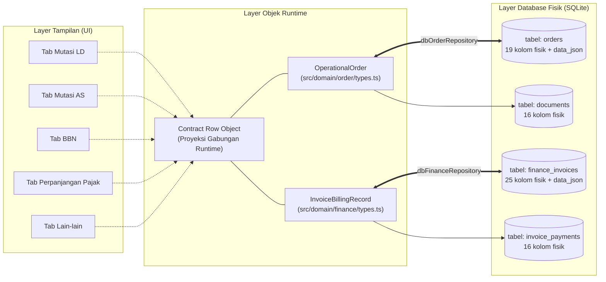

# AUDIT VARIABEL DATA PENJUALAN PER LAYANAN — READ ONLY
## Inventaris Variabel Mendalam, Matriks Komparasi Antarlayanan, dan Pemetaan Skema Database Fisik

**Proyek:** Admin SUN89 — Biro Jasa Management System  
**Root Proyek:** `D:\Admin\adminsunbirojasa`  
**Database:** `server\data\database.sqlite`  
**Dokumen:** `docs/audit_arsitektur_data/23_INVENTARIS_VARIABEL_DATA_PENJUALAN_PER_LAYANAN.md`  
**Status Audit:** READ-ONLY (Tanpa modifikasi kode, skema/isi database, konfigurasi, data, test, atau build)  
**Tanggal Audit:** 22 Oktober 2026  

---

## 1. PENELUSURAN SUMBER KODE AKTUAL

Investigasi dilakukan secara menyeluruh terhadap berkas kode sumber frontend, store, repositori, DTO/payload API, controller, service, dan skema SQLite fisik:

### A. Berkas Frontend & State Management
1. `src/app/pages/DataPenjualan.tsx` & `src/app/components/DataPenjualan.tsx`:
   - Entry point menu Data Penjualan, routing tab berbasis URL (`/finance/data-penjualan/:category`), penanganan aksi tambah (`isAdding`), detail (`viewingItem`), edit (`onEdit`), dan pembatalan (`onDelete`).
2. `src/app/data/penjualanContractData.ts` (1.016 baris):
   - Sumber kanonis definisi kolom tabel per layanan (`MUTASI_LD_COLUMNS_CONTRACT`, `MUTASI_AS_COLUMNS_CONTRACT`, `BBN_COLUMNS_CONTRACT`, `PERPANJANGAN_PAJAK_COLUMNS_CONTRACT`, `LAIN_LAIN_COLUMNS_CONTRACT`).
   - Logika pembangunan field form: `buildFieldsFromContract()`.
   - Engine proyeksi data: `projectOrderToContractRow()`.
   - Helper resolusi kategori: `resolveOrderSalesCategory()`.
   - Derivasi status: `deriveStatusPengerjaan()` dan `deriveStatusPembayaran()`.
3. `src/app/components/FinanceAddPage.tsx`:
   - Formulir tambah transaksi data penjualan multi-baris.
   - Mengimplementasikan dua mode rendering:
     - Mode 7-Seksi Khusus untuk Mutasi LD (`isMutasiLD = true`).
     - Mode Single Card Generik untuk 4 layanan lainnya (`isMutasiLD = false`).
4. `src/app/components/FinanceDetailPage.tsx`:
   - Komponen tampilan detail lengkap transaksi penjualan, resolusi order kanonis via `orderNo` atau `ord:${orderNo}`, pemformatan badge plat nomor, tanggal, status, dan nominal rupiah.
5. `src/app/data/financeStore.ts`:
   - Store singleton pengelola data finansial:
     - `getContractData(category)`: Mengambil order operasional, memadukan dengan invoice, dan memproyeksikan ke baris kontrak.
     - `addContractData(category, rows)`: Validasi input, pemetaan field, pendelegasian ke `orderCreator`, penyimpanan dokumen, dan sinkronisasi invoice.
     - `updateContractData(category, id, updatedFields)`: Update parsial ke order operasional dan invoice terkait.
6. `src/app/data/orderStore.ts`:
   - Store singleton order operasional:
     - `addOrderFromContract(data)` & `addOrderFromContractAsync(data)`: Penerima payload dari `financeStore.addContractData`.
     - Penghasil nomor order kanonis (`ORD-YYYYMMDD-XXXX`).
7. `src/data/repositories/orderRepository.ts` & `src/data/repositories/documentRepository.ts`:
   - Abstraksi data access layer frontend yang menghubungkan state dengan API backend atau localStorage cache.

### B. Berkas Backend & Repositori Database
1. `server/src/routes/orderRoutes.ts` & `server/src/controllers/orderController.ts`:
   - Endpoint HTTP Express: `GET /api/orders`, `POST /api/orders`, `GET /api/orders/:orderNo`, `PUT /api/orders/:orderNo`, `DELETE /api/orders/:orderNo`.
2. `server/src/routes/financeRoutes.ts` & `server/src/controllers/financeController.ts`:
   - Endpoint HTTP Express: `GET /api/finance/invoices`, `POST /api/finance/invoices`, `POST /api/finance/payments`, dll.
3. `server/src/services/orderService.ts` & `server/src/services/financeService.ts`:
   - Aturan bisnis pembuatan order, proteksi approval supervisor (implementasi P1-B), sinkronisasi pembayaran ke kas kantor, dan lifecycle invoice.
4. `server/src/repositories/dbOrderRepository.ts`:
   - Mapping baris SQLite ke objek `OperationalOrder`: mengekstrak 19 kolom fisik dan menggabungkannya dengan payload `data_json`.
5. `server/src/repositories/dbFinanceRepository.ts`:
   - Mapping baris SQLite ke objek `InvoiceBillingRecord`: mengekstrak 25 kolom fisik dan menggabungkannya dengan `data_json`.
6. Skema Database SQLite Fisik (`server/data/database.sqlite`):
   - Tabel `orders` (19 kolom fisik + `data_json`).
   - Tabel `finance_invoices` (25 kolom fisik + `data_json`).
   - Tabel `invoice_payments` (16 kolom fisik + relasi FK).
   - Tabel `documents` (16 kolom fisik + relasi FK).
   - Master tarif: `samsat_pricing`, `service_pricing_configs`, `estimation_templates`.

---

## 2. INVENTARIS VARIABEL PER LAYANAN

Berikut adalah inventaris variabel lengkap untuk masing-masing dari 5 layanan yang dikelola di menu Data Penjualan.

Setiap variabel dianalisis dari antarmuka pengguna (Label UI), penamaan variabel di kode frontend, properti payload pengiriman API, kolom fisik database SQLite, lokasi penyimpanan aktual, tipe data, kewajiban, kondisi pemunculan, lokasi kode sumber, serta catatan alias/transformasi.

---

### A. LAYANAN 1: MUTASI LD (MUTASI LUAR DAERAH)

Tab URL: `/finance/data-penjualan/mutasi-ld`  
Karakteristik Khusus: Memiliki form 7-seksi terstruktur di `FinanceAddPage.tsx`. Kolom tabel berjumlah 24 kolom kanonis. Validasi alamat domisili di-bypass (*exempt*). Input uang masuk dan uang keluar bersifat editable langsung pada form.

| No. | Label UI | Nama variabel frontend | Nama field payload/API | Nama kolom database | Lokasi penyimpanan | Tipe data | Kewajiban | Kondisi | Sumber kode | Catatan |
|:---:|---|---|---|---|---|---|---|---|---|---|
| **I** | **Identitas Transaksi & Nomor Order** | | | | | | | | | |
| 1 | Nomor Order | `orderNo` / `"Nomor Order"` | `orderNo` / `order_no` | `order_no` | Kolom fisik `orders` | String | Wajib | Muncul di semua view; dibuat otomatis sistem | `penjualanContractData.ts#L862`, `FinanceAddPage.tsx#L166` | Format: `ORD-YYYYMMDD-XXXX`. Read-only di form. |
| 2 | ID Sistem | `id` | `id` | `id` | Kolom fisik `orders` / `finance_invoices` | Number / String | Wajib | Dihasilkan oleh SQLite | `penjualanContractData.ts#L861` | Prefix `ord:${orderNo}` di frontend. |
| 3 | No Invoice | `noInvoice` / `"No Invoice"` | `noInvoice` / `invoice_no` | `invoice_no` | Kolom fisik `finance_invoices`, `orders.data_json` | String | Opsional | Dibuat saat penagihan diterbitkan | `FinanceAddPage.tsx#L215`, `penjualanContractData.ts#L880` | Format: `INV-YYYY-XXXX`. |
| 4 | Tanda Terima | `tandaTerima` / `"Tanda Terima"` | `tandaTerima` | `orders.data_json` | `data_json` | String | Opsional | Input manual / default string | `FinanceAddPage.tsx#L217`, `penjualanContractData.ts#L882` | Di Mutasi LD default string kosong `""`. |
| **II** | **Data Pelanggan & Kontak** | | | | | | | | | |
| 5 | Nama Customer | `customer` / `"Nama Customer"` | `customer` / `customerName` | `customer` | Kolom fisik `orders` & `finance_invoices` | String | Wajib | Selalu wajib diisi | `FinanceAddPage.tsx#L176`, `financeStore.ts#L2154` | Nama pihak pemohon/konsumen. |
| 6 | Nomor HP | `nomorHP` / `"Nomor HP"` / `phone` | `nomorHP` / `phone` | `nomor_hp` | Kolom fisik `orders`, `data_json` | String | Wajib | Wajib valid min. 9 digit | `FinanceAddPage.tsx#L178`, `financeStore.ts#L2139` | Dicegah dari nomor dummy `081200000000`. |
| 7 | Detail Alamat | `detailAlamat` / `"Detail Alamat"` | `detail` | `orders.data_json` | `data_json` | String | Opsional | Muncul di Seksi 2 Mutasi LD | `FinanceAddPage.tsx#L180`, `financeStore.ts#L2190` | Bebas validasi wajib pada Mutasi LD. |
| 8 | Kota/Kabupaten | `kota` / `"Kota/Kabupaten"` | `kota` | `orders.data_json` | `data_json` | String | Opsional | Muncul di Seksi 2 Mutasi LD | `FinanceAddPage.tsx#L181`, `financeStore.ts#L2191` | Dropdown master wilayah administratif. |
| 9 | Kecamatan | `kecamatan` / `"Kecamatan"` | `kecamatan` | `orders.data_json` | `data_json` | String | Opsional | Muncul di Seksi 2 Mutasi LD | `FinanceAddPage.tsx#L182`, `financeStore.ts#L2192` | Bagian alamat terstruktur. |
| 10 | Kelurahan/Desa | `kelurahan` / `"Kelurahan/Desa"` | `kelurahan` | `orders.data_json` | `data_json` | String | Opsional | Muncul di Seksi 2 Mutasi LD | `FinanceAddPage.tsx#L183`, `financeStore.ts#L2193` | Bagian alamat terstruktur. |
| 11 | RT/RW | `rtRw` / `"RT/RW"` | `rtRw` | `orders.data_json` | `data_json` | String | Opsional | Muncul di Seksi 2 Mutasi LD | `FinanceAddPage.tsx#L184`, `financeStore.ts#L2194` | Contoh format: `005/002`. |
| 12 | Nomor Rumah | `nomorRumah` / `"Nomor Rumah"` | `nomor` | `orders.data_json` | `data_json` | String | Opsional | Muncul di Seksi 2 Mutasi LD | `FinanceAddPage.tsx#L185`, `financeStore.ts#L2195` | Nomor fisik bangunan. |
| 13 | Patokan | `patokan` / `"Patokan"` | `landmark` | `orders.data_json` | `data_json` | String | Opsional | Muncul di Seksi 2 Mutasi LD | `FinanceAddPage.tsx#L186`, `financeStore.ts#L2196` | Petunjuk arah kurir penjemput. |
| 14 | Link Lokasi | `linkLokasi` / `"Link Lokasi"` | `mapsUrl` | `orders.data_json` | `data_json` | String | Opsional | Muncul di Seksi 2 Mutasi LD | `FinanceAddPage.tsx#L187`, `financeStore.ts#L2197` | URL Google Maps. |
| 15 | Alamat Lengkap | `alamat` / `"Alamat"` | `alamat` | `orders.data_json` | `data_json` | String | Opsional | Gabungan otomatis struktur alamat | `financeStore.ts#L2199`, `penjualanContractData.ts#L872` | String hasil concat struktur alamat. |
| **III** | **Data Kendaraan & Kepemilikan** | | | | | | | | | |
| 16 | Plat No | `nopol` / `"Plat No"` | `nopol` / `platNomor` | `nopol` | Kolom fisik `orders` & `finance_invoices` | String | Wajib | Selalu wajib diisi | `FinanceAddPage.tsx#L169`, `penjualanContractData.ts#L866` | Input khusus 3 kotak plat nomor. |
| 17 | R4 / R2 | `r4r2` / `"R4 / R2"` | `jenisKendaraan` | `orders.data_json` | `data_json` | String | Wajib | Pilihan: R4 (Mobil) atau R2 (Motor) | `FinanceAddPage.tsx#L167`, `penjualanContractData.ts#L792` | Di database diubah menjadi "Mobil"/"Motor". |
| 18 | Status Kepemilikan | `statusKepemilikan` / `"Status Kepemilikan"` | `statusKepemilikan` | `orders.data_json` | `data_json` | String | Opsional | Pilihan: Pribadi / Perusahaan / PT | `FinanceAddPage.tsx#L168`, `financeStore.ts#L2230` | Default: "Pribadi". |
| 19 | Nama Pemilik (STNK/BPKB) | `namaPemilik` / `"Nama Pemilik (STNK/BPKB)"` | `namaPemilik` / `nama_berkas` | `orders.data_json`, `finance_invoices.data_json` | `data_json` | String | Wajib | Wajib sesuai nama dokumen legal | `FinanceAddPage.tsx#L177`, `penjualanContractData.ts#L869` | Dilarang fallback otomatis ke nama customer. |
| **IV** | **Data Samsat Asal & Tujuan** | | | | | | | | | |
| 20 | Jenis Pengurusan | `layanan` / `"Jenis Pengurusan"` | `layanan` | `layanan` | Kolom fisik `orders` & `finance_invoices` | String | Wajib | Otomatis "Mutasi Luar Daerah" | `FinanceAddPage.tsx#L170`, `penjualanContractData.ts#L870` | Nilai di-lock (*read-only*) pada Mutasi LD. |
| 21 | Samsat Asal | `samsat` / `"Samsat Asal"` / `"Samsat"` | `wilayahSamsatAsal` | `orders.data_json` | `data_json` | String | Wajib | Lokasi Samsat berkas asal terdaftar | `FinanceAddPage.tsx#L171`, `penjualanContractData.ts#L817` | Searchable dropdown master Samsat. |
| 22 | Samsat Tujuan | `wilayahSamsatTujuan` / `"Samsat Tujuan"` | `wilayahSamsatTujuan` | `orders.data_json` | `data_json` | String | Wajib | **Wajib** untuk Mutasi Luar Daerah | `FinanceAddPage.tsx#L173`, `penjualanContractData.ts#L815` | Target pengiriman berkas luar daerah. |
| **V** | **Data BPKB & Dokumen Fisik** | | | | | | | | | |
| 23 | BPKB | `bpkb` / `"BPKB"` | `bpkb` | `orders.data_json` | `data_json` | String | Kondisional | Muncul di Seksi 6; pilihan: "Ada" / "Belum" | `FinanceAddPage.tsx#L218`, `penjualanContractData.ts#L883` | Default kosong pada input baru Mutasi LD. |
| 24 | Status BPKB | `statusBPKB` / `"Status BPKB"` | `statusBPKB` | `orders.data_json` | `data_json` | String | Kondisional | Muncul jika BPKB fisik dititipkan | `FinanceAddPage.tsx#L219`, `penjualanContractData.ts#L884` | Pilihan: Selesai, Proses, Diambil, Belum. |
| 25 | TTB BPKB | `ttbBPKB` / `"TTB BPKB"` | `ttbBPKB` | `orders.data_json` | `data_json` | String | Kondisional | Tanda terima fisik buku BPKB | `FinanceAddPage.tsx#L220`, `penjualanContractData.ts#L885` | Tanda terima berkas BPKB konsumen. |
| **VI** | **Data Biaya, Tagihan, & Pembayaran** | | | | | | | | | |
| 26 | Uang Masuk dari Konsumen | `uangMasuk` / `"Uang Masuk dari Konsumen"` | `uangMasuk` / `dibayar` | `dibayar` | Kolom fisik `finance_invoices` | Number | Wajib | Input manual diperbolehkan di Mutasi LD | `FinanceAddPage.tsx#L191`, `penjualanContractData.ts#L837` | Nominal DP atau pelunasan konsumen. |
| 27 | Tanggal Uang Masuk | `tanggalUangMasuk` / `"Tanggal Uang Masuk"` | `tanggalUangMasuk` | `orders.data_json`, `invoice_payments.tanggal_bayar` | `data_json` / `invoice_payments` | Date (String) | Kondisional | Wajib diisi jika `uangMasuk > 0` | `FinanceAddPage.tsx#L190`, `penjualanContractData.ts#L845` | Format: `DD/MM/YYYY`. |
| 28 | Skema Pembayaran | `skemaPembayaran` / `"Skema Pembayaran"` | `skemaPembayaran` / `payment_type` | `orders.data_json` | `data_json` | String | Wajib | Pilihan: Bayar di Awal / Akhir / Tempo | `FinanceAddPage.tsx#L192`, `penjualanContractData.ts#L840` | Skema penagihan biro jasa. |
| 29 | Metode Pembayaran Masuk | `metodePembayaranMasuk` | `metodePembayaranMasuk` | `orders.data_json` | `data_json` | String | Opsional | Pilihan: Transfer Bank / Tunai / QRIS | `FinanceAddPage.tsx#L193`, `financeStore.ts#L2185` | Metode pembayaran konsumen. |
| 30 | Bank Uang Masuk | `bankUangMasuk` | `bankUangMasuk` | `orders.data_json` | `data_json` | String | Kondisional | Bank penampung dana (BCA/Mandiri/BRI) | `FinanceAddPage.tsx#L194`, `financeStore.ts#L2186` | Akun kas penampung uang masuk. |
| 31 | Nomor Rekening Masuk | `noRekeningMasuk` | `noRekeningMasuk` | `orders.data_json` | `data_json` | String | Opsional | Nomor rekening bank penampung | `FinanceAddPage.tsx#L195`, `financeStore.ts#L2187` | Diambil otomatis dari master pembayaran. |
| 32 | Nama Rekening Masuk | `namaRekeningMasuk` | `namaRekeningMasuk` | `orders.data_json` | `data_json` | String | Opsional | Nama pemilik rekening kantor | `FinanceAddPage.tsx#L196`, `financeStore.ts#L2188` | Atas nama rekening penerima dana. |
| 33 | Uang Keluar Biro Jasa | `uangKeluar` / `"Uang Keluar Biro Jasa"` | `uangKeluar` / `biaya_samsat` | `biaya_samsat` | Kolom fisik `finance_invoices` | Number | Wajib | Modal riil pengeluaran ke Samsat/agen | `FinanceAddPage.tsx#L199`, `penjualanContractData.ts#L852` | **Khusus Mutasi LD**: Dilabeli "Uang Keluar Biro Jasa". |
| 34 | Tanggal Uang Keluar | `tanggalUangKeluar` / `"Tanggal Uang Keluar"` | `tanggalPengeluaranSamsat` | `orders.data_json` | `data_json` | Date (String) | Kondisional | Tanggal realisasi dana keluar | `FinanceAddPage.tsx#L200`, `penjualanContractData.ts#L850` | Tanggal kas operasional keluar. |
| 35 | Bank Uang Keluar | `bankUangKeluar` / `"Bank Uang Keluar"` | `bankUangKeluar` | `bank_uang_keluar` | Kolom fisik `orders`, `data_json` | String | Wajib | Sumber kas pengeluaran kantor | `FinanceAddPage.tsx#L201`, `penjualanContractData.ts#L848` | Pilihan: BCA, Mandiri, Kas Kantor. |
| 36 | Metode Pembayaran Keluar | `metodePembayaranKeluar` | `metodePembayaranKeluar` | `metode_pembayaran_keluar` | Kolom fisik `orders`, `data_json` | String | Opsional | Pilihan: Kas Tunai / Transfer Bank | `FinanceAddPage.tsx#L202`, `financeStore.ts#L2184` | Cara pengeluaran biaya lapangan. |
| 37 | Nama Rekening/Penerima | `namaPenerimaKeluar` / `"Nama Rekening/Penerima"` | `namaPenerimaKeluar` | `nama_penerima_keluar` | Kolom fisik `orders`, `data_json` | String | Kondisional | Nama petugas loket atau agen daerah | `FinanceAddPage.tsx#L203`, `penjualanContractData.ts#L881` | Penerima uang kasbon pengeluaran. |
| 38 | Biaya Jasa | `biayaJasa` / `"Biaya Jasa"` | `biayaJasa` | `biaya_jasa` | Kolom fisik `orders` & `finance_invoices` | Number | Wajib | Imbalan jasa murni biro jasa | `FinanceAddPage.tsx#L207`, `penjualanContractData.ts#L879` | Nilai jasa penanganan Mutasi LD. |
| 39 | Biaya Antar Jemput | `biayaAntarJemput` / `"Biaya Antar Jemput"` | `biayaAntarJemput` | `biaya_antar_jemput` | Kolom fisik `orders` & `finance_invoices` | Number | Opsional | Biaya kurir messenger | `FinanceAddPage.tsx#L208`, `penjualanContractData.ts#L880` | Default: Rp 50.000 (jika ada kurir). |
| 40 | Total Tagihan Konsumen | `totalTagihan` / `"Total Tagihan Konsumen"` | `totalTagihan` / `total_biaya` | `total_biaya` (`orders`), `total_tagihan` (`invoices`) | Kolom fisik `orders` & `finance_invoices` | Number | Wajib | Dihitung: Uang Keluar + Jasa + Antar Jemput | `FinanceAddPage.tsx#L209`, `penjualanContractData.ts#L836` | Total piutang resmi ke customer. |
| 41 | Sisa Tagihan | `sisaTagihan` / `"Sisa Tagihan"` | `sisa` | `sisa` | Kolom fisik `finance_invoices` | Number | Wajib | Dihitung: Total Tagihan - Uang Masuk | `FinanceAddPage.tsx#L210`, `penjualanContractData.ts#L876` | Sisa kekurangan bayar. |
| 42 | Profit | `profit` / `"Profit"` | `profit` | `profit_final` | Kolom fisik `finance_invoices` | Number | Wajib | Dihitung: Total Tagihan - Uang Keluar | `FinanceAddPage.tsx#L211`, `penjualanContractData.ts#L859` | Margin kotor biro jasa. |
| 43 | Jumlah Cashback | `cashback` / `"Jumlah Cashback"` | `cashback` | `cashback_nominal` | Kolom fisik `finance_invoices` | Number | Kondisional | Terhitung jika `uangMasuk > totalTagihan` | `FinanceAddPage.tsx#L212`, `penjualanContractData.ts#L904` | Pengembalian dana lebih konsumen. |
| **VII** | **Tanggal, Proses, & Penyelesaian** | | | | | | | | | |
| 44 | Tanggal Masuk Berkas | `tanggalMasukBerkas` / `"Tanggal Masuk Berkas"` | `tanggalMasukBerkas` | `orders.data_json` | `data_json` | Date (String) | Wajib | Tanggal fisik dokumen diserahkan | `FinanceAddPage.tsx#L165`, `penjualanContractData.ts#L827` | Format: `DD/MM/YYYY`. |
| 45 | Tanggal Invoice | `tanggalInvoice` / `"Tanggal Invoice"` | `tanggalInvoice` | `created_at` | Kolom fisik `finance_invoices` | Date (String) | Opsional | Tanggal penerbitan faktur tagihan | `FinanceAddPage.tsx#L216`, `penjualanContractData.ts#L881` | Default: tanggal hari ini. |
| **VIII** | **Status Operasional & Finansial** | | | | | | | | | |
| 46 | Status Pengerjaan | `statusPengerjaan` / `"Status Pengerjaan"` | `statusPengerjaan` / `current_stage_name` | `current_stage_name` | Kolom fisik `orders`, `data_json` | String | Wajib | Mutasi LD default: "Pending" | `FinanceAddPage.tsx#L221`, `penjualanContractData.ts#L862` | Nilai: Pending / Dalam Proses / Selesai. |
| 47 | Status Pembayaran | `statusPembayaran` / `"Status Pembayaran"` | `statusPembayaran` / `payment_status` | `payment_status` (`orders`), `status` (`invoices`) | Kolom fisik `orders` & `finance_invoices` | String | Wajib | Belum Bayar / Kurang Bayar / Lunas | `FinanceAddPage.tsx#L222`, `penjualanContractData.ts#L863` | Ditentukan dari rasio uang masuk vs total tagihan. |
| **IX** | **Dokumen Digital & Lampiran** | | | | | | | | | |
| 48 | Dokumen Kendaraan Awal | `dokumenAwal` | `uploadedDocsBefore` | `documents` (tabel terkait) | Tabel `documents` & `orders.data_json` | Array<Object> | Opsional | Upload foto STNK, KTP, BPKB fisik awal | `FinanceAddPage.tsx#L225`, `financeStore.ts#L2205` | Dikaitkan ke order via `documentRepository.linkOrder`. |
| 49 | Dokumen Kendaraan Akhir | `dokumenAkhir` | `uploadedDocsAfter` | `documents` (tabel terkait) | Tabel `documents` & `orders.data_json` | Array<Object> | Opsional | Upload bukti cabut berkas, SKPD, fiskal | `FinanceAddPage.tsx#L226`, `financeStore.ts#L2215` | Dikaitkan ke order saat selesai. |

---

### B. LAYANAN 2: MUTASI AS (MUTASI ANTAR SAMSAT)

Tab URL: `/finance/data-penjualan/mutasi-as`  
Karakteristik Khusus: Pengurusan mutasi dalam satu wilayah provinsi/hukum yang sama. Memiliki 26 kolom kanonis pada tabel. Menggunakan form mode generik (`FinanceAddPage.tsx#L2369`) yang terdiri dari 26 kolom kontrak + 4 field tambahan (30 field total). Uang masuk dan biaya pokok Samsat bersifat *read-only* pada form tambah generik.

| No. | Label UI | Nama variabel frontend | Nama field payload/API | Nama kolom database | Lokasi penyimpanan | Tipe data | Kewajiban | Kondisi | Sumber kode | Catatan |
|:---:|---|---|---|---|---|---|---|---|---|---|
| 1 | Nomor Order | `orderNo` / `"Nomor Order"` | `orderNo` | `order_no` | Kolom fisik `orders` | String | Wajib | Dibuat otomatis sistem (read-only di form) | `penjualanContractData.ts#L50`, `DataPenjualan.tsx#L174` | Otomatis generate format `ORD-YYYYMMDD-XXXX`. |
| 2 | Tanggal Masuk Berkas | `tanggalMasukBerkas` / `"Tanggal Masuk Berkas"` | `tanggalMasukBerkas` | `orders.data_json` | `data_json` | Date (String) | Wajib | Wajib diisi tanggal berkas diterima | `penjualanContractData.ts#L49` | Format: `DD/MM/YYYY`. |
| 3 | R4 / R2 | `r4r2` / `"R4 / R2"` | `jenisKendaraan` | `orders.data_json` | `data_json` | String | Wajib | Pilihan: R4 atau R2 | `penjualanContractData.ts#L51` | Dropdown: `["R4", "R2"]`. |
| 4 | Plat No | `nopol` / `"Plat No"` | `nopol` | `nopol` | Kolom fisik `orders` & `finance_invoices` | String | Wajib | Input plat nomor 3 kotak | `penjualanContractData.ts#L52` | Validasi format nomor polisi. |
| 5 | Nama Customer | `customer` / `"Nama Customer"` | `customer` | `customer` | Kolom fisik `orders` & `finance_invoices` | String | Wajib | Wajib diisi nama customer pemohon | `penjualanContractData.ts#L53` | Wajib lolos validasi `addContractData`. |
| 6 | Nomor HP / WhatsApp | `nomorHP` / `"Nomor HP"` | `nomorHP` | `nomor_hp` | Kolom fisik `orders`, `data_json` | String | Wajib | Minimal 9 digit numerik | `penjualanContractData.ts#L614`, `financeStore.ts#L2139` | Ditambahkan otomatis via `buildFieldsFromContract`. |
| 7 | Alamat Lengkap Customer | `alamat` / `"Alamat"` | `alamat` | `orders.data_json` | `data_json` | String | Wajib | **Wajib** untuk Mutasi AS | `penjualanContractData.ts#L623`, `financeStore.ts#L2146` | Berbeda dengan Mutasi LD, di Mutasi AS alamat tidak boleh kosong. |
| 8 | Nama Pemilik (STNK/BPKB) | `namaPemilik` / `"Nama Pemilik (STNK/BPKB)"` | `namaPemilik` | `orders.data_json` | `data_json` | String | Wajib | Nama pemilik sesuai berkas STNK | `penjualanContractData.ts#L54` | Dilarang menyalin otomatis dari nama customer. |
| 9 | Jenis Pengurusan | `layanan` / `"Jenis Pengurusan"` | `layanan` | `layanan` | Kolom fisik `orders` & `finance_invoices` | String | Wajib | Dropdown pilihan layanan | `penjualanContractData.ts#L55` | Default: "Mutasi Antar Samsat". |
| 10 | Samsat Asal | `samsat` / `"Samsat"` | `wilayahSamsatAsal` | `orders.data_json` | `data_json` | String | Wajib | Kantor Samsat asal kendaraan | `penjualanContractData.ts#L56` | Master data Samsat Jawa Barat / DKI / Banten. |
| 11 | Samsat Tujuan | `wilayahSamsatTujuan` / `"Samsat Tujuan"` | `wilayahSamsatTujuan` | `orders.data_json` | `data_json` | String | Wajib | **Wajib** untuk Mutasi Antar Samsat | `penjualanContractData.ts#L632` | Kantor Samsat penerima berkas mutasi. |
| 12 | Skema Pembayaran | `skemaPembayaran` / `"Skema Pembayaran"` | `skemaPembayaran` | `orders.data_json` | `data_json` | String | Wajib | Dropdown: Bayar di Awal / Akhir / Tempo | `penjualanContractData.ts#L57` | Skema penagihan konsumen. |
| 13 | Tanggal Uang Masuk | `tanggalUangMasuk` / `"Tanggal Uang Masuk"` | `tanggalUangMasuk` | `orders.data_json`, `invoice_payments.tanggal_bayar` | `data_json` / `invoice_payments` | Date (String) | Kondisional | Terisi jika sudah ada pembayaran | `penjualanContractData.ts#L58` | Read-only di form generik. |
| 14 | Uang Masuk dari Konsumen | `uangMasuk` / `"Uang Masuk dari Konsumen"` | `uangMasuk` | `dibayar` | Kolom fisik `finance_invoices` | Number | Wajib | Nilai pembayaran riil | `penjualanContractData.ts#L59` | **Read-only** di form tambah generik; dikelola via kas masuk. |
| 15 | Sisa Tagihan | `sisaTagihan` / `"Sisa Tagihan"` | `sisa` | `sisa` | Kolom fisik `finance_invoices` | Number | Wajib | Dihitung: Total Tagihan - Uang Masuk | `penjualanContractData.ts#L60` | Read-only kalkulasi otomatis. |
| 16 | Bank Uang Keluar | `bankUangKeluar` / `"Bank Uang Keluar"` | `bankUangKeluar` | `bank_uang_keluar` | Kolom fisik `orders`, `data_json` | String | Wajib | Pilihan bank/kas pengeluaran biro | `penjualanContractData.ts#L61` | Dropdown master metode pembayaran aktif. |
| 17 | Tanggal Uang Keluar | `tanggalUangKeluar` / `"Tanggal Uang Keluar"` | `tanggalPengeluaranSamsat` | `orders.data_json` | `data_json` | Date (String) | Kondisional | Tanggal biaya keluar ke Samsat | `penjualanContractData.ts#L62` | Terisi saat kas keluar dieksekusi. |
| 18 | Biaya Pokok Samsat | `biayaPokokSamsat` / `"Biaya Pokok Samsat"` | `biaya_samsat` | `biaya_samsat` | Kolom fisik `finance_invoices` | Number | Wajib | Modal pendaftaran Samsat | `penjualanContractData.ts#L63` | **Read-only** di form tambah generik. |
| 19 | Biaya Jasa | `biayaJasa` / `"Biaya Jasa"` | `biayaJasa` | `biaya_jasa` | Kolom fisik `orders` & `finance_invoices` | Number | Wajib | Imbalan jasa biro SUN89 | `penjualanContractData.ts#L64` | Muncul eksplisit di tabel Mutasi AS. |
| 20 | Biaya Antar Jemput | `biayaAntarJemput` / `"Biaya Antar Jemput"` | `biayaAntarJemput` | `biaya_antar_jemput` | Kolom fisik `orders` & `finance_invoices` | Number | Opsional | Ongkos kurir pengantaran berkas | `penjualanContractData.ts#L65` | Muncul eksplisit di tabel Mutasi AS. |
| 21 | Profit | `profit` / `"Profit"` | `profit` | `profit_final` | Kolom fisik `finance_invoices` | Number | Wajib | Margin bersih: Total - Biaya Samsat | `penjualanContractData.ts#L66` | Read-only kalkulasi otomatis. |
| 22 | Jumlah Cashback | `cashback` / `"Jumlah Cashback"` | `cashback` | `cashback_nominal` | Kolom fisik `finance_invoices` | Number | Kondisional | Kelebihan pembayaran konsumen | `penjualanContractData.ts#L605` | Ditambahkan via `buildFieldsFromContract`. |
| 23 | Status Pengerjaan | `statusPengerjaan` / `"Status Pengerjaan"` | `statusPengerjaan` | `current_stage_name` | Kolom fisik `orders`, `data_json` | String | Wajib | Default: "Dalam Proses" | `penjualanContractData.ts#L67` | Read-only; dikendalikan alur operasional. |
| 24 | Status Pembayaran | `statusPembayaran` / `"Status Pembayaran"` | `statusPembayaran` | `payment_status` (`orders`), `status` (`invoices`) | Kolom fisik `orders` & `finance_invoices` | String | Wajib | Belum Bayar / Kurang Bayar / Lunas | `penjualanContractData.ts#L68` | Read-only; dievaluasi otomatis. |
| 25 | No Invoice | `noInvoice` / `"No Invoice"` | `noInvoice` | `invoice_no` | Kolom fisik `finance_invoices` | String | Opsional | Nomor faktur resmi penagihan | `penjualanContractData.ts#L69` | Read-only di form. |
| 26 | Tanggal Invoice | `tanggalInvoice` / `"Tanggal Invoice"` | `tanggalInvoice` | `created_at` | Kolom fisik `finance_invoices` | Date (String) | Opsional | Tanggal penerbitan invoice | `penjualanContractData.ts#L70` | Default tanggal hari ini. |
| 27 | Tanda Terima | `tandaTerima` / `"Tanda Terima"` | `tandaTerima` | `orders.data_json` | `data_json` | String | Opsional | Nomor resi/tanda terima berkas | `penjualanContractData.ts#L71` | Default di non-LD: `"TT-(Otomatis)"`. |
| 28 | BPKB | `bpkb` / `"BPKB"` | `bpkb` | `orders.data_json` | `data_json` | String | Kondisional | Keberadaan buku BPKB fisik (Ada/Belum) | `penjualanContractData.ts#L72` | Wajib ada untuk proses mutasi keluar/masuk. |
| 29 | Status BPKB | `statusBPKB` / `"Status BPKB"` | `statusBPKB` | `orders.data_json` | `data_json` | String | Kondisional | Posisi fisik buku BPKB | `penjualanContractData.ts#L73` | Pilihan: Selesai / Proses / Diambil / Belum. |
| 30 | TTB BPKB | `ttbBPKB` / `"TTB BPKB"` | `ttbBPKB` | `orders.data_json` | `data_json` | String | Kondisional | Resi tanda terima fisik BPKB | `penjualanContractData.ts#L74` | Default di non-LD: `"TTB-(Otomatis)"`. |

---

### C. LAYANAN 3: BBN (BALIK NAMA / BEA BALIK NAMA)

Tab URL: `/finance/data-penjualan/bbn`  
Karakteristik Khusus: Pengurusan alih kepemilikan kendaraan bermotor. Memiliki 25 kolom kanonis pada tabel. Menggunakan form mode generik (`FinanceAddPage.tsx#L2369`) yang terdiri dari 25 kolom kontrak + 4 field tambahan (29 field total).  
**Anomali Struktural Penting:** Kolom `"TTB BPKB"` hilang dari kontrak tabel BBN. Selain itu, tidak tersedia field terpisah untuk mencatat Nama Pemilik Baru (KTP), NIK Pemilik Baru, dan Alamat Baru pada form Data Penjualan.

| No. | Label UI | Nama variabel frontend | Nama field payload/API | Nama kolom database | Lokasi penyimpanan | Tipe data | Kewajiban | Kondisi | Sumber kode | Catatan |
|:---:|---|---|---|---|---|---|---|---|---|---|
| 1 | Nomor Order | `orderNo` / `"Nomor Order"` | `orderNo` | `order_no` | Kolom fisik `orders` | String | Wajib | Dibuat otomatis sistem | `penjualanContractData.ts#L80`, `DataPenjualan.tsx#L175` | Format: `ORD-YYYYMMDD-XXXX`. |
| 2 | Tanggal Masuk Berkas | `tanggalMasukBerkas` / `"Tanggal Masuk Berkas"` | `tanggalMasukBerkas` | `orders.data_json` | `data_json` | Date (String) | Wajib | Tanggal fisik berkas BBN diterima | `penjualanContractData.ts#L79` | Format: `DD/MM/YYYY`. |
| 3 | R4 / R2 | `r4r2` / `"R4 / R2"` | `jenisKendaraan` | `orders.data_json` | `data_json` | String | Wajib | Pilihan: R4 (Mobil) atau R2 (Motor) | `penjualanContractData.ts#L81` | Menentukan komponen biaya cetak TNKB & BPKB baru. |
| 4 | Plat No | `nopol` / `"Plat No"` | `nopol` | `nopol` | Kolom fisik `orders` & `finance_invoices` | String | Wajib | Nomor polisi lama pada STNK | `penjualanContractData.ts#L82` | Input format plat polisi. |
| 5 | Nama Customer | `customer` / `"Nama Customer"` | `customer` | `customer` | Kolom fisik `orders` & `finance_invoices` | String | Wajib | Pihak yang mengorder / pemohon | `penjualanContractData.ts#L83` | Seringkali merupakan pemilik baru kendaraan. |
| 6 | Nomor HP / WhatsApp | `nomorHP` / `"Nomor HP"` | `nomorHP` | `nomor_hp` | Kolom fisik `orders`, `data_json` | String | Wajib | Minimal 9 digit numerik | `penjualanContractData.ts#L614`, `financeStore.ts#L2139` | Ditambahkan via `buildFieldsFromContract`. |
| 7 | Alamat Lengkap Customer | `alamat` / `"Alamat"` | `alamat` | `orders.data_json` | `data_json` | String | Wajib | Domisili customer pemohon | `penjualanContractData.ts#L623`, `financeStore.ts#L2146` | Wajib diisi pada BBN. |
| 8 | Nama Pemilik (STNK/BPKB) | `namaPemilik` / `"Nama Pemilik (STNK/BPKB)"` | `namaPemilik` | `orders.data_json` | `data_json` | String | Wajib | **Nama pemilik lama** pada STNK | `penjualanContractData.ts#L84` | **Anomali:** Nama pemilik baru tidak memiliki field khusus di form ini! |
| 9 | Jenis Pengurusan | `layanan` / `"Jenis Pengurusan"` | `layanan` | `layanan` | Kolom fisik `orders` & `finance_invoices` | String | Wajib | Default: "Balik Nama" | `penjualanContractData.ts#L85` | Dropdown layanan biro jasa. |
| 10 | Samsat | `samsat` / `"Samsat"` | `wilayahSamsatAsal` | `orders.data_json` | `data_json` | String | Wajib | Samsat tempat proses BBN dilakukan | `penjualanContractData.ts#L86` | Searchable dropdown Samsat. |
| 11 | Samsat Tujuan | `wilayahSamsatTujuan` / `"Samsat Tujuan"` | `wilayahSamsatTujuan` | `orders.data_json` | `data_json` | String | Opsional | Ditambahkan generik | `penjualanContractData.ts#L632` | Sering kosong jika BBN tidak disertai mutasi luar daerah. |
| 12 | Skema Pembayaran | `skemaPembayaran` / `"Skema Pembayaran"` | `skemaPembayaran` | `orders.data_json` | `data_json` | String | Wajib | Bayar di Awal / Akhir / Tempo | `penjualanContractData.ts#L87` | Skema tagihan. |
| 13 | Tanggal Uang Masuk | `tanggalUangMasuk` / `"Tanggal Uang Masuk"` | `tanggalUangMasuk` | `orders.data_json`, `invoice_payments.tanggal_bayar` | `data_json` / `invoice_payments` | Date (String) | Kondisional | Terisi jika ada penerimaan uang | `penjualanContractData.ts#L88` | Read-only di form generik. |
| 14 | Uang Masuk dari Konsumen | `uangMasuk` / `"Uang Masuk dari Konsumen"` | `uangMasuk` | `dibayar` | Kolom fisik `finance_invoices` | Number | Wajib | Total uang muka/pelunasan diterima | `penjualanContractData.ts#L89` | Read-only di form generik. |
| 15 | Sisa Tagihan | `sisaTagihan` / `"Sisa Tagihan"` | `sisa` | `sisa` | Kolom fisik `finance_invoices` | Number | Wajib | Total Tagihan - Uang Masuk | `penjualanContractData.ts#L90` | Read-only kalkulasi. |
| 16 | Bank Uang Keluar | `bankUangKeluar` / `"Bank Uang Keluar"` | `bankUangKeluar` | `bank_uang_keluar` | Kolom fisik `orders`, `data_json` | String | Wajib | Sumber kas pengeluaran operasional | `penjualanContractData.ts#L91` | Dropdown master bank. |
| 17 | Tanggal Uang Keluar | `tanggalUangKeluar` / `"Tanggal Uang Keluar"` | `tanggalPengeluaranSamsat` | `orders.data_json` | `data_json` | Date (String) | Kondisional | Tanggal biaya keluar ke loket Samsat | `penjualanContractData.ts#L92` | Terisi saat kas keluar dieksekusi. |
| 18 | Biaya Pokok Samsat | `biayaPokokSamsat` / `"Biaya Pokok Samsat"` | `biaya_samsat` | `biaya_samsat` | Kolom fisik `finance_invoices` | Number | Wajib | Biaya BBN-KB, PNBP BPKB, STNK, TNKB | `penjualanContractData.ts#L93` | Read-only di form generik. |
| 19 | Biaya Jasa | `biayaJasa` / `"Biaya Jasa"` | `biayaJasa` | `biaya_jasa` | Kolom fisik `orders` & `finance_invoices` | Number | Wajib | Imbalan jasa pengurusan balik nama | `penjualanContractData.ts#L94` | Kolom tabel eksplisit. |
| 20 | Biaya Antar Jemput | `biayaAntarJemput` / `"Biaya Antar Jemput"` | `biayaAntarJemput` | `biaya_antar_jemput` | Kolom fisik `orders` & `finance_invoices` | Number | Opsional | Ongkos penjemputan berkas | `penjualanContractData.ts#L95` | Kolom tabel eksplisit. |
| 21 | Profit | `profit` / `"Profit"` | `profit` | `profit_final` | Kolom fisik `finance_invoices` | Number | Wajib | Total Tagihan - Biaya Pokok Samsat | `penjualanContractData.ts#L96` | Read-only kalkulasi. |
| 22 | Jumlah Cashback | `cashback` / `"Jumlah Cashback"` | `cashback` | `cashback_nominal` | Kolom fisik `finance_invoices` | Number | Kondisional | Nilai kelebihan bayar jika ada | `penjualanContractData.ts#L605` | Ditambahkan via `buildFieldsFromContract`. |
| 23 | Status Pengerjaan | `statusPengerjaan` / `"Status Pengerjaan"` | `statusPengerjaan` | `current_stage_name` | Kolom fisik `orders`, `data_json` | String | Wajib | Default: "Dalam Proses" | `penjualanContractData.ts#L97` | Status pengerjaan BBN. |
| 24 | Status Pembayaran | `statusPembayaran` / `"Status Pembayaran"` | `statusPembayaran` | `payment_status` (`orders`), `status` (`invoices`) | Kolom fisik `orders` & `finance_invoices` | String | Wajib | Belum Bayar / Kurang Bayar / Lunas | `penjualanContractData.ts#L98` | Status pelunasan invoice. |
| 25 | No Invoice | `noInvoice` / `"No Invoice"` | `noInvoice` | `invoice_no` | Kolom fisik `finance_invoices` | String | Opsional | Nomor faktur tagihan | `penjualanContractData.ts#L99` | Read-only di form. |
| 26 | Tanggal Invoice | `tanggalInvoice` / `"Tanggal Invoice"` | `tanggalInvoice` | `created_at` | Kolom fisik `finance_invoices` | Date (String) | Opsional | Tanggal penerbitan invoice | `penjualanContractData.ts#L100` | Default tanggal hari ini. |
| 27 | Tanda Terima | `tandaTerima` / `"Tanda Terima"` | `tandaTerima` | `orders.data_json` | `data_json` | String | Opsional | Resi fisik tanda terima berkas | `penjualanContractData.ts#L101` | Default: `"TT-(Otomatis)"`. |
| 28 | BPKB | `bpkb` / `"BPKB"` | `bpkb` | `orders.data_json` | `data_json` | String | Wajib | Keberadaan buku BPKB fisik (Ada/Belum) | `penjualanContractData.ts#L102` | Wajib ada karena BBN mencetak buku BPKB baru. |
| 29 | Status BPKB | `statusBPKB` / `"Status BPKB"` | `statusBPKB` | `orders.data_json` | `data_json` | String | Kondisional | Posisi fisik buku BPKB | `penjualanContractData.ts#L103` | **Catatan:** Kolom `TTB BPKB` hilang pada tab ini! |

---

### D. LAYANAN 4: PAJAK / PERPANJANGAN PAJAK

Tab URL: `/finance/data-penjualan/perpanjangan-pajak`  
Karakteristik Khusus: Pengurusan perpanjangan STNK tahunan maupun 5 tahunan (ganti plat). Memiliki 23 kolom kanonis pada tabel. Menggunakan form mode generik (`FinanceAddPage.tsx#L2369`) yang terdiri dari 23 kolom kontrak + 4 field tambahan (27 field total).  
**Anomali Struktural Penting:** Seluruh atribut BPKB (`BPKB`, `Status BPKB`, dan `TTB BPKB`) tidak ditampilkan pada tab ini. Rincian komponen pajak (PKB Pokok, SWDKLLJ, dan Denda) tidak memiliki input mandiri di form ini.

| No. | Label UI | Nama variabel frontend | Nama field payload/API | Nama kolom database | Lokasi penyimpanan | Tipe data | Kewajiban | Kondisi | Sumber kode | Catatan |
|:---:|---|---|---|---|---|---|---|---|---|---|
| 1 | Nomor Order | `orderNo` / `"Nomor Order"` | `orderNo` | `order_no` | Kolom fisik `orders` | String | Wajib | Dibuat otomatis sistem | `penjualanContractData.ts#L108`, `DataPenjualan.tsx#L176` | Format: `ORD-YYYYMMDD-XXXX`. |
| 2 | Tanggal Masuk Berkas | `tanggalMasukBerkas` / `"Tanggal Masuk Berkas"` | `tanggalMasukBerkas` | `orders.data_json` | `data_json` | Date (String) | Wajib | Tanggal fisik STNK diterima di kantor | `penjualanContractData.ts#L107` | Format: `DD/MM/YYYY`. |
| 3 | R4 / R2 | `r4r2` / `"R4 / R2"` | `jenisKendaraan` | `orders.data_json` | `data_json` | String | Wajib | R4 (Mobil) atau R2 (Motor) | `penjualanContractData.ts#L109` | Menentukan tarif dasar SWDKLLJ (R2: 35rb, R4: 143rb). |
| 4 | Plat No | `nopol` / `"Plat No"` | `nopol` | `nopol` | Kolom fisik `orders` & `finance_invoices` | String | Wajib | Nomor polisi kendaraan bermotor | `penjualanContractData.ts#L110` | Input plat nomor standar. |
| 5 | Nama Customer | `customer` / `"Nama Customer"` | `customer` | `customer` | Kolom fisik `orders` & `finance_invoices` | String | Wajib | Pihak pemesan jasa | `penjualanContractData.ts#L111` | Wajib diisi. |
| 6 | Nomor HP / WhatsApp | `nomorHP` / `"Nomor HP"` | `nomorHP` | `nomor_hp` | Kolom fisik `orders`, `data_json` | String | Wajib | Minimal 9 digit numerik | `penjualanContractData.ts#L614`, `financeStore.ts#L2139` | Ditambahkan via `buildFieldsFromContract`. |
| 7 | Alamat Lengkap Customer | `alamat` / `"Alamat"` | `alamat` | `orders.data_json` | `data_json` | String | Wajib | Alamat penjemputan/pengantaran STNK | `penjualanContractData.ts#L623`, `financeStore.ts#L2146` | Wajib diisi. |
| 8 | Nama Pemilik (STNK/BPKB) | `namaPemilik` / `"Nama Pemilik (STNK/BPKB)"` | `namaPemilik` | `orders.data_json` | `data_json` | String | Wajib | Nama wajib pajak tertera di lembar STNK | `penjualanContractData.ts#L112` | Wajib sesuai fisik lembar STNK. |
| 9 | Jenis Pengurusan | `layanan` / `"Jenis Pengurusan"` | `layanan` | `layanan` | Kolom fisik `orders` & `finance_invoices` | String | Wajib | Pilihan jenis perpanjangan | `penjualanContractData.ts#L113` | Perpanjangan 1 Tahun / 5 Tahun / Pajak. |
| 10 | Samsat | `samsat` / `"Samsat"` | `wilayahSamsatAsal` | `orders.data_json` | `data_json` | String | Wajib | Samsat induk penerbit STNK | `penjualanContractData.ts#L114` | Lokasi loket pembayaran pajak. |
| 11 | Samsat Tujuan | `wilayahSamsatTujuan` / `"Samsat Tujuan"` | `wilayahSamsatTujuan` | `orders.data_json` | `data_json` | String | Opsional | Ditambahkan secara generik | `penjualanContractData.ts#L632` | Tidak relevan untuk perpanjangan tahunan rutin. |
| 12 | Skema Pembayaran | `skemaPembayaran` / `"Skema Pembayaran"` | `skemaPembayaran` | `orders.data_json` | `data_json` | String | Wajib | Bayar di Awal / Akhir / Tempo | `penjualanContractData.ts#L115` | Skema penagihan. |
| 13 | Tanggal Uang Masuk | `tanggalUangMasuk` / `"Tanggal Uang Masuk"` | `tanggalUangMasuk` | `orders.data_json`, `invoice_payments.tanggal_bayar` | `data_json` / `invoice_payments` | Date (String) | Kondisional | Terisi jika dana sudah masuk | `penjualanContractData.ts#L116` | Read-only di form generik. |
| 14 | Uang Masuk dari Konsumen | `uangMasuk` / `"Uang Masuk dari Konsumen"` | `uangMasuk` | `dibayar` | Kolom fisik `finance_invoices` | Number | Wajib | Total uang muka/pajak diterima | `penjualanContractData.ts#L117` | Read-only di form generik. |
| 15 | Sisa Tagihan | `sisaTagihan` / `"Sisa Tagihan"` | `sisa` | `sisa` | Kolom fisik `finance_invoices` | Number | Wajib | Selisih total tagihan dan uang masuk | `penjualanContractData.ts#L118` | Read-only kalkulasi. |
| 16 | Bank Uang Keluar | `bankUangKeluar` / `"Bank Uang Keluar"` | `bankUangKeluar` | `bank_uang_keluar` | Kolom fisik `orders`, `data_json` | String | Wajib | Kas kantor untuk penyetoran pajak Samsat | `penjualanContractData.ts#L119` | Dropdown master rekening operasional. |
| 17 | Tanggal Uang Keluar | `tanggalUangKeluar` / `"Tanggal Uang Keluar"` | `tanggalPengeluaranSamsat` | `orders.data_json` | `data_json` | Date (String) | Kondisional | Tanggal pembayaran kasir/loket Samsat | `penjualanContractData.ts#L120` | Terisi saat setoran kasir dicatat. |
| 18 | Biaya Pokok Samsat | `biayaPokokSamsat` / `"Biaya Pokok Samsat"` | `biaya_samsat` | `biaya_samsat` | Kolom fisik `finance_invoices` | Number | Wajib | Total Pokok Pajak SKPD (PKB + SWDKLLJ) | `penjualanContractData.ts#L121` | Read-only di form generik. |
| 19 | Biaya Jasa | `biayaJasa` / `"Biaya Jasa"` | `biayaJasa` | `biaya_jasa` | Kolom fisik `orders` & `finance_invoices` | Number | Wajib | Ongkos jasa pengurusan perpanjangan | `penjualanContractData.ts#L122` | Imbalan jasa biro. |
| 20 | Biaya Antar Jemput | `biayaAntarJemput` / `"Biaya Antar Jemput"` | `biayaAntarJemput` | `biaya_antar_jemput` | Kolom fisik `orders` & `finance_invoices` | Number | Opsional | Ongkos kurir penjemputan berkas | `penjualanContractData.ts#L123` | Kolom tabel eksplisit. |
| 21 | Profit | `profit` / `"Profit"` | `profit` | `profit_final` | Kolom fisik `finance_invoices` | Number | Wajib | Margin laba: Total Tagihan - Biaya Pokok | `penjualanContractData.ts#L124` | Read-only kalkulasi. |
| 22 | Jumlah Cashback | `cashback` / `"Jumlah Cashback"` | `cashback` | `cashback_nominal` | Kolom fisik `finance_invoices` | Number | Kondisional | Kelebihan setor pajak (jika notice lebih rendah) | `penjualanContractData.ts#L605` | Ditambahkan via `buildFieldsFromContract`. |
| 23 | Status Pengerjaan | `statusPengerjaan` / `"Status Pengerjaan"` | `statusPengerjaan` | `current_stage_name` | Kolom fisik `orders`, `data_json` | String | Wajib | Default: "Dalam Proses" | `penjualanContractData.ts#L125` | Status pengerjaan berkas. |
| 24 | Status Pembayaran | `statusPembayaran` / `"Status Pembayaran"` | `statusPembayaran` | `payment_status` (`orders`), `status` (`invoices`) | Kolom fisik `orders` & `finance_invoices` | String | Wajib | Belum Bayar / Kurang Bayar / Lunas | `penjualanContractData.ts#L126` | Status pelunasan piutang. |
| 25 | No Invoice | `noInvoice` / `"No Invoice"` | `noInvoice` | `invoice_no` | Kolom fisik `finance_invoices` | String | Opsional | Nomor nota penagihan | `penjualanContractData.ts#L127` | Read-only di form. |
| 26 | Tanggal Invoice | `tanggalInvoice` / `"Tanggal Invoice"` | `tanggalInvoice` | `created_at` | Kolom fisik `finance_invoices` | Date (String) | Opsional | Tanggal penerbitan nota | `penjualanContractData.ts#L128` | Default tanggal hari ini. |
| 27 | Tanda Terima | `tandaTerima` / `"Tanda Terima"` | `tandaTerima` | `orders.data_json` | `data_json` | String | Opsional | Nomor resi tanda terima STNK asli | `penjualanContractData.ts#L129` | Default: `"TT-(Otomatis)"`. |

---

### E. LAYANAN 5: LAIN-LAIN (LAYANAN KHUSUS / OPERASIONAL LAIN)

Tab URL: `/finance/data-penjualan/lain-lain`  
Karakteristik Khusus: Menampung layanan ad-hoc seperti Duplikat STNK Hilang, Duplikat BPKB, Tarik Berkas Leasing, Cek Fisik Bantuan, Nopol Pilihan (Cantik), dan Rubah Bentuk. Memiliki 23 kolom kanonis pada tabel (identik dengan Perpanjangan Pajak). Menggunakan form mode generik (`FinanceAddPage.tsx#L2369`) yang terdiri dari 23 kolom kontrak + 4 field tambahan (27 field total).

| No. | Label UI | Nama variabel frontend | Nama field payload/API | Nama kolom database | Lokasi penyimpanan | Tipe data | Kewajiban | Kondisi | Sumber kode | Catatan |
|:---:|---|---|---|---|---|---|---|---|---|---|
| 1 | Nomor Order | `orderNo` / `"Nomor Order"` | `orderNo` | `order_no` | Kolom fisik `orders` | String | Wajib | Dibuat otomatis sistem | `penjualanContractData.ts#L135`, `DataPenjualan.tsx#L177` | Format: `ORD-YYYYMMDD-XXXX`. |
| 2 | Tanggal Masuk Berkas | `tanggalMasukBerkas` / `"Tanggal Masuk Berkas"` | `tanggalMasukBerkas` | `orders.data_json` | `data_json` | Date (String) | Wajib | Tanggal fisik dokumen pengurusan diserahkan | `penjualanContractData.ts#L134` | Format: `DD/MM/YYYY`. |
| 3 | R4 / R2 | `r4r2` / `"R4 / R2"` | `jenisKendaraan` | `orders.data_json` | `data_json` | String | Wajib | Pilihan: R4 atau R2 | `penjualanContractData.ts#L136` | Jenis klasifikasi kendaraan. |
| 4 | Plat No | `nopol` / `"Plat No"` | `nopol` | `nopol` | Kolom fisik `orders` & `finance_invoices` | String | Wajib | Nomor polisi obyek layanan | `penjualanContractData.ts#L137` | Input plat nomor. |
| 5 | Nama Customer | `customer` / `"Nama Customer"` | `customer` | `customer` | Kolom fisik `orders` & `finance_invoices` | String | Wajib | Pemohon layanan | `penjualanContractData.ts#L138` | Wajib diisi. |
| 6 | Nomor HP / WhatsApp | `nomorHP` / `"Nomor HP"` | `nomorHP` | `nomor_hp` | Kolom fisik `orders`, `data_json` | String | Wajib | Minimal 9 digit numerik | `penjualanContractData.ts#L614`, `financeStore.ts#L2139` | Ditambahkan via `buildFieldsFromContract`. |
| 7 | Alamat Lengkap Customer | `alamat` / `"Alamat"` | `alamat` | `orders.data_json` | `data_json` | String | Wajib | Alamat domisili customer | `penjualanContractData.ts#L623`, `financeStore.ts#L2146` | Wajib diisi. |
| 8 | Nama Pemilik (STNK/BPKB) | `namaPemilik` / `"Nama Pemilik (STNK/BPKB)"` | `namaPemilik` | `orders.data_json` | `data_json` | String | Wajib | Nama pemilik sesuai dokumen legal | `penjualanContractData.ts#L139` | Wajib diisi. |
| 9 | Jenis Pengurusan | `layanan` / `"Jenis Pengurusan"` | `layanan` | `layanan` | Kolom fisik `orders` & `finance_invoices` | String | Wajib | Nama layanan khusus | `penjualanContractData.ts#L140` | Misal: Duplikat STNK, Tarik Berkas, Nopol Pilihan. |
| 10 | Samsat | `samsat` / `"Samsat"` | `wilayahSamsatAsal` | `orders.data_json` | `data_json` | String | Wajib | Kantor Samsat pelaksanaan | `penjualanContractData.ts#L141` | Master Samsat terkait. |
| 11 | Samsat Tujuan | `wilayahSamsatTujuan` / `"Samsat Tujuan"` | `wilayahSamsatTujuan` | `orders.data_json` | `data_json` | String | Opsional | Ditambahkan secara generik | `penjualanContractData.ts#L632` | Sering kosong kecuali layanan cabut berkas. |
| 12 | Skema Pembayaran | `skemaPembayaran` / `"Skema Pembayaran"` | `skemaPembayaran` | `orders.data_json` | `data_json` | String | Wajib | Bayar di Awal / Akhir / Tempo | `penjualanContractData.ts#L142` | Skema penagihan. |
| 13 | Tanggal Uang Masuk | `tanggalUangMasuk` / `"Tanggal Uang Masuk"` | `tanggalUangMasuk` | `orders.data_json`, `invoice_payments.tanggal_bayar` | `data_json` / `invoice_payments` | Date (String) | Kondisional | Terisi jika sudah ada pembayaran | `penjualanContractData.ts#L143` | Read-only di form generik. |
| 14 | Uang Masuk dari Konsumen | `uangMasuk` / `"Uang Masuk dari Konsumen"` | `uangMasuk` | `dibayar` | Kolom fisik `finance_invoices` | Number | Wajib | Uang muka / pelunasan | `penjualanContractData.ts#L144` | Read-only di form generik. |
| 15 | Sisa Tagihan | `sisaTagihan` / `"Sisa Tagihan"` | `sisa` | `sisa` | Kolom fisik `finance_invoices` | Number | Wajib | Dihitung otomatis | `penjualanContractData.ts#L145` | Read-only kalkulasi. |
| 16 | Bank Uang Keluar | `bankUangKeluar` / `"Bank Uang Keluar"` | `bankUangKeluar` | `bank_uang_keluar` | Kolom fisik `orders`, `data_json` | String | Wajib | Rekening kas operasional biro | `penjualanContractData.ts#L146` | Dropdown master rekening. |
| 17 | Tanggal Uang Keluar | `tanggalUangKeluar` / `"Tanggal Uang Keluar"` | `tanggalPengeluaranSamsat` | `orders.data_json` | `data_json` | Date (String) | Kondisional | Tanggal kas biro dikeluarkan | `penjualanContractData.ts#L147` | Terisi saat kas keluar dicatat. |
| 18 | Biaya Pokok Samsat | `biayaPokokSamsat` / `"Biaya Pokok Samsat"` | `biaya_samsat` | `biaya_samsat` | Kolom fisik `finance_invoices` | Number | Wajib | Biaya resmi Samsat/pihak ketiga | `penjualanContractData.ts#L148` | Read-only di form generik. |
| 19 | Biaya Jasa | `biayaJasa` / `"Biaya Jasa"` | `biayaJasa` | `biaya_jasa` | Kolom fisik `orders` & `finance_invoices` | Number | Wajib | Jasa penanganan khusus | `penjualanContractData.ts#L149` | Kolom tabel eksplisit. |
| 20 | Biaya Antar Jemput | `biayaAntarJemput` / `"Biaya Antar Jemput"` | `biayaAntarJemput` | `biaya_antar_jemput` | Kolom fisik `orders` & `finance_invoices` | Number | Opsional | Ongkos kurir pengantaran | `penjualanContractData.ts#L150` | Kolom tabel eksplisit. |
| 21 | Profit | `profit` / `"Profit"` | `profit` | `profit_final` | Kolom fisik `finance_invoices` | Number | Wajib | Margin bersih: Total - Biaya Pokok | `penjualanContractData.ts#L151` | Read-only kalkulasi. |
| 22 | Jumlah Cashback | `cashback` / `"Jumlah Cashback"` | `cashback` | `cashback_nominal` | Kolom fisik `finance_invoices` | Number | Kondisional | Kelebihan dana konsumen | `penjualanContractData.ts#L605` | Ditambahkan via `buildFieldsFromContract`. |
| 23 | Status Pengerjaan | `statusPengerjaan` / `"Status Pengerjaan"` | `statusPengerjaan` | `current_stage_name` | Kolom fisik `orders`, `data_json` | String | Wajib | Default: "Dalam Proses" | `penjualanContractData.ts#L152` | Status proses berkas. |
| 24 | Status Pembayaran | `statusPembayaran` / `"Status Pembayaran"` | `statusPembayaran` | `payment_status` (`orders`), `status` (`invoices`) | Kolom fisik `orders` & `finance_invoices` | String | Wajib | Belum Bayar / Kurang Bayar / Lunas | `penjualanContractData.ts#L153` | Status penagihan. |
| 25 | No Invoice | `noInvoice` / `"No Invoice"` | `noInvoice` | `invoice_no` | Kolom fisik `finance_invoices` | String | Opsional | Nomor bukti invoice | `penjualanContractData.ts#L154` | Read-only di form. |
| 26 | Tanggal Invoice | `tanggalInvoice` / `"Tanggal Invoice"` | `tanggalInvoice` | `created_at` | Kolom fisik `finance_invoices` | Date (String) | Opsional | Tanggal invoice terbit | `penjualanContractData.ts#L155` | Default hari ini. |
| 27 | Tanda Terima | `tandaTerima` / `"Tanda Terima"` | `tandaTerima` | `orders.data_json` | `data_json` | String | Opsional | Resi fisik dokumen | `penjualanContractData.ts#L156` | Default: `"TT-(Otomatis)"`. |

---

## 3. PENGELOMPOKAN VARIABEL BERDASARKAN FUNGSI

Variabel-variabel di atas diklasifikasikan ke dalam 13 kelompok fungsi bisnis untuk memetakan peran arsitekturalnya:

### 1. Identitas Transaksi & Nomor Order
- `orderNo` (`Nomor Order`): Kunci bisnis kanonis format `ORD-YYYYMMDD-XXXX`.
- `id` (`ID Sistem`): Primary key teknis (autoincrement SQLite atau prefix `ord:`).
- `noInvoice` (`No Invoice`): Nomor faktur penagihan resmi format `INV-YYYY-XXXX`.
- `tandaTerima` (`Tanda Terima`): Nomor resi serah terima berkas fisik dari konsumen.
- `ttbBPKB` (`TTB BPKB`): Tanda terima berkas khusus buku BPKB fisik asli.

### 2. Data Pelanggan & Kontak
- `customer` (`Nama Customer`): Nama orang atau entitas pemesan jasa.
- `nomorHP` (`Nomor HP / WhatsApp`): Nomor kontak aktif (validasi min. 9 digit).
- `alamat` (`Alamat Lengkap Customer`): Alamat lengkap domisili/kantor pemohon.
- `detailAlamat`, `kota`, `kecamatan`, `kelurahan`, `rtRw`, `nomorRumah`, `patokan`, `mapsUrl`: Bagian dari alamat terstruktur yang ada di Mutasi LD.

### 3. Data Kendaraan
- `nopol` (`Plat No`): Nomor registrasi polisi kendaraan (misal: `B 1234 CD`).
- `r4r2` (`R4 / R2` / `jenisKendaraan`): Klasifikasi Mobil (R4) atau Motor (R2).
- `statusKepemilikan` (`Status Kepemilikan`): Pribadi, Perusahaan, atau Pihak Ketiga.
- `merk`, `tipe`, `tahun`, `nomorRangka`, `nomorMesin`: Atribut kendaraan fisik yang tersimpan di `data_json`.

### 4. Data STNK & Kepemilikan Asli
- `namaPemilik` (`Nama Pemilik (STNK/BPKB)`): Nama wajib pajak yang tercetak sah pada lembar STNK/BPKB. **Aturan:** Tidak boleh fallback ke nama customer.
- *Nama Pemilik Baru*: Khusus layanan BBN, seharusnya ada pemilik baru namun belum terakomodasi dalam form Data Penjualan saat ini.

### 5. Data Samsat Asal & Tujuan
- `samsat` / `wilayahSamsatAsal` (`Samsat Asal`): Kantor Samsat asal kendaraan terdaftar.
- `wilayahSamsatTujuan` (`Samsat Tujuan`): Kantor Samsat tujuan berkas (wajib di Mutasi LD & Mutasi AS).

### 6. Data BPKB & Dokumen Fisik
- `bpkb` (`BPKB`): Ketersediaan fisik buku BPKB (`Ada` atau `Belum`).
- `statusBPKB` (`Status BPKB`): Posisi fisik berkas BPKB (`Selesai`, `Proses`, `Sudah Diambil`, `Belum Diambil`).
- `ttbBPKB` (`TTB BPKB`): Nomor tanda terima fisik BPKB.

### 7. Data Pemeriksaan Fisik
- `hasilCekFisik`, `gesekRangkaMesin`: Tersimpan di dalam `rekapDocuments` atau `dokumenAwal` sebagai berkas lampiran pendukung Cek Fisik Samsat.

### 8. Data Biaya, Tagihan, & Pembayaran
- `totalTagihan` (`Total Tagihan Konsumen`): Total piutang yang wajib dibayar konsumen.
- `uangMasuk` (`Uang Masuk dari Konsumen`): Realisasi dana yang sudah diterima kasir.
- `sisaTagihan` (`Sisa Tagihan`): Piutang belum tertagih (`totalTagihan - uangMasuk`).
- `biayaPokokSamsat` / `uangKeluar` (`Biaya Pokok Samsat` / `Uang Keluar Biro Jasa`): Biaya resmi pendaftaran Samsat/agen.
- `biayaJasa` (`Biaya Jasa`): Imbalan jasa pengurusan biro jasa SUN89.
- `biayaAntarJemput` (`Biaya Antar Jemput`): Biaya operasional messenger.
- `profit` (`Profit`): Margin laba kotor (`totalTagihan - biayaPokokSamsat`).
- `cashback` (`Jumlah Cashback`): Nominal pengembalian kelebihan bayar.
- `skemaPembayaran` (`Skema Pembayaran`): Bayar di Awal / Akhir / Tempo.
- `bankUangKeluar` (`Bank Uang Keluar`): Sumber kas pengeluaran biro.
- `metodePembayaranMasuk`, `bankUangMasuk`, `noRekeningMasuk`, `namaRekeningMasuk`: Detail rekening bank penerima uang masuk.
- `metodePembayaranKeluar`, `namaPenerimaKeluar`: Detail rekening atau nama penerima kas keluar.

### 9. Data Tanggal Penerimaan, Proses, & Penyelesaian
- `tanggalMasukBerkas` (`Tanggal Masuk Berkas`): Tanggal fisik dokumen diserahkan konsumen ke kantor.
- `tanggalUangMasuk` (`Tanggal Uang Masuk`): Tanggal dana pembayaran konsumen diterima.
- `tanggalUangKeluar` (`Tanggal Uang Keluar`): Tanggal pengeluaran kas kantor ke loket Samsat.
- `tanggalInvoice` (`Tanggal Invoice`): Tanggal resmi penerbitan faktur tagihan.

### 10. Data Petugas, Penugasan, & Status Proses
- `statusPengerjaan` (`Status Pengerjaan`): Status tahapan berkas (`Pending`, `Dalam Proses`, `Selesai`, `Dibatalkan`).
- `statusPembayaran` (`Status Pembayaran`): Status pelunasan (`Belum Bayar`, `Kurang Bayar`, `Lunas`, `Kelebihan Bayar`).
- `currentStep`, `currentStageName`: Indikator tahapan operasional 1 s/d 8 di tabel `orders`.
- `messengerId`, `messengerNama`: Kurir penjemput/pengantar berkas.

### 11. Data Dokumen Digital & Lampiran
- `dokumenAwal` (`Dokumen Kendaraan Awal`): Berkas sebelum pengerjaan (foto STNK asli, KTP pemilik, BPKB asli).
- `dokumenAkhir` (`Dokumen Kendaraan Akhir`): Berkas hasil pengerjaan (foto SKPD baru, notice pajak, plat nomor, BPKB baru).
- `rekapDocuments`: Metadata file digital yang terhubung ke tabel `documents`.

### 12. Data Khusus Layanan
- *Mutasi LD*: `wilayahSamsatTujuan`, `namaPenerimaKeluar`, `bankUangKeluar`, dokumen cabut berkas.
- *Mutasi AS*: `wilayahSamsatTujuan`, biaya pendaftaran mutasi masuk.
- *BBN*: Nama pemilik baru, NIK KTP pemilik baru, alamat pemilik baru (saat ini belum terfasilitasi terpisah).
- *Pajak*: Masa berlaku pajak baru, rincian PKB, SWDKLLJ, denda (saat ini dipadatkan di `data_json`).

### 13. Metadata Sistem
- `createdAt` (`created_at`): Timestamp pembuatan record di SQLite.
- `updatedAt` (`updated_at`): Timestamp modifikasi data terakhir.
- `isArchived` (`is_archived`): Status pengarsipan order (0: aktif, 1: arsip selesai, 2: arsip batal).
- `approvedBySpv`, `spvApprovedAt`: Jejak audit persetujuan supervisor.

---

## 4. MATRIKS PERBANDINGAN KELIMA LAYANAN

Matriks berikut membandingkan keberadaan seluruh variabel unik di kelima layanan Data Penjualan.

**Keterangan Simbol:**
- **Ada** = Field tersedia dan aktif digunakan pada tabel/form layanan tersebut.
- **Tidak ada** = Field tidak didefinisikan atau dihilangkan dari tabel/form layanan tersebut.
- **Kondisional** = Field muncul atau aktif hanya jika kondisi tertentu terpenuhi.
- **Belum pasti** = Status field ambigu atau terdapat konflik implementasi pada kode.

| No. | Label UI Umum | Nama Variabel Kanonis yang Disarankan | Mutasi LD | Mutasi AS | BBN | Pajak | Lain-lain | Keterangan & Analisis Khusus |
|:---:|---|---|:---:|:---:|:---:|:---:|:---:|---|
| 1 | Nomor Order | `orderNo` | Ada | Ada | Ada | Ada | Ada | Kunci bisnis primer seragam format `ORD-YYYYMMDD-XXXX`. |
| 2 | Tanggal Masuk Berkas | `tanggalMasukBerkas` | Ada | Ada | Ada | Ada | Ada | Tanggal fisik berkas masuk ke biro jasa. |
| 3 | R4 / R2 | `jenisKendaraan` / `r4r2` | Ada | Ada | Ada | Ada | Ada | Pilihan Mobil (R4) atau Motor (R2). |
| 4 | Plat No | `nopol` | Ada | Ada | Ada | Ada | Ada | Nomor polisi kendaraan. |
| 5 | Nama Customer | `customer` | Ada | Ada | Ada | Ada | Ada | Pemesan order (nama pihak ketiga atau pemilik baru). |
| 6 | Nomor HP / WhatsApp | `nomorHP` | Ada | Ada | Ada | Ada | Ada | Wajib minimal 9 digit numerik di seluruh layanan. |
| 7 | Alamat Lengkap Customer | `alamat` | Kondisional | Ada | Ada | Ada | Ada | **Anomali:** Di Mutasi LD dikecualikan (*exempt*), di 4 tab lain wajib. |
| 8 | Struktur Alamat Rinci | `alamatTerstruktur` | Ada | Tidak ada | Tidak ada | Tidak ada | Tidak ada | Hanya ada di form 7-seksi Mutasi LD. |
| 9 | Status Kepemilikan | `statusKepemilikan` | Ada | Tidak ada | Tidak ada | Tidak ada | Tidak ada | Hanya muncul di form Seksi 1 Mutasi LD. |
| 10 | Nama Pemilik (STNK/BPKB) | `namaPemilik` | Ada | Ada | Ada | Ada | Ada | Nama pemilik lama yang tercetak pada dokumen sah. |
| 11 | Nama Pemilik Baru (KTP) | `namaPemilikBaru` | Tidak ada | Tidak ada | Belum pasti | Tidak ada | Tidak ada | **Celah BBN:** Diperlukan pada BBN tetapi form belum menyediakannya. |
| 12 | Jenis Pengurusan | `layanan` | Ada | Ada | Ada | Ada | Ada | Mutasi LD di-lock (*read-only*), tab lain berupa dropdown. |
| 13 | Samsat Asal | `wilayahSamsatAsal` | Ada | Ada | Ada | Ada | Ada | Kantor Samsat asal berkas terdaftar. |
| 14 | Samsat Tujuan | `wilayahSamsatTujuan` | Ada | Ada | Kondisional | Kondisional | Kondisional | Wajib pada Mutasi LD & AS; ditambahkan secara generik di tab lain. |
| 15 | BPKB | `bpkb` | Ada | Ada | Ada | Tidak ada | Tidak ada | **Anomali:** Dihilangkan pada tab Pajak dan Lain-lain. |
| 16 | Status BPKB | `statusBPKB` | Ada | Ada | Ada | Tidak ada | Tidak ada | Posisi fisik buku BPKB. Dihilangkan pada Pajak dan Lain-lain. |
| 17 | TTB BPKB | `ttbBPKB` | Ada | Ada | Tidak ada | Tidak ada | Tidak ada | **Anomali:** Hadir di Mutasi LD & AS, tapi **hilang di BBN**! |
| 18 | Total Tagihan Konsumen | `totalBiaya` / `totalTagihan` | Ada | Ada | Ada | Ada | Ada | Total piutang wajib bayar konsumen. |
| 19 | Uang Masuk dari Konsumen | `uangMasuk` / `dibayar` | Ada | Ada | Ada | Ada | Ada | Editable di form Mutasi LD; read-only di form generik tab lain. |
| 20 | Sisa Tagihan | `sisaTagihan` | Ada | Ada | Ada | Ada | Ada | Dihitung otomatis: Total Tagihan - Uang Masuk. |
| 21 | Biaya Pokok Samsat | `biayaPokokSamsat` | Ada* | Ada | Ada | Ada | Ada | *Di Mutasi LD dilabeli `"Uang Keluar Biro Jasa"`. |
| 22 | Biaya Jasa | `biayaJasa` | Ada | Ada | Ada | Ada | Ada | Imbalan jasa murni biro jasa SUN89. |
| 23 | Biaya Antar Jemput | `biayaAntarJemput` | Ada | Ada | Ada | Ada | Ada | Ongkos kirim kurir messenger. |
| 24 | Profit | `profit` | Ada | Ada | Ada | Ada | Ada | Margin laba: Total Tagihan - Biaya Pokok Samsat. |
| 25 | Jumlah Cashback | `cashback` | Ada | Ada | Ada | Ada | Ada | Kelebihan uang masuk terhadap tagihan. |
| 26 | Skema Pembayaran | `skemaPembayaran` | Ada | Ada | Ada | Ada | Ada | Bayar di Awal / Bayar di Akhir / Tempo. |
| 27 | Metode Bayar Masuk | `metodePembayaranMasuk` | Ada | Tidak ada | Tidak ada | Tidak ada | Tidak ada | Hanya ada di form Seksi 3 Mutasi LD. |
| 28 | Rekening Bank Masuk | `bankUangMasuk` | Ada | Tidak ada | Tidak ada | Tidak ada | Tidak ada | Hanya ada di form Seksi 3 Mutasi LD. |
| 29 | Bank Uang Keluar | `bankUangKeluar` | Ada | Ada | Ada | Ada | Ada | Sumber rekening pengeluaran kas biro jasa. |
| 30 | Metode Bayar Keluar | `metodePembayaranKeluar` | Ada | Tidak ada | Tidak ada | Tidak ada | Tidak ada | Hanya ada di form Seksi 4 Mutasi LD. |
| 31 | Nama Penerima Keluar | `namaPenerimaKeluar` | Ada | Tidak ada | Tidak ada | Tidak ada | Tidak ada | Hanya ada di form Seksi 4 Mutasi LD. |
| 32 | Tanggal Uang Masuk | `tanggalUangMasuk` | Kondisional | Kondisional | Kondisional | Kondisional | Kondisional | Terisi jika ada penerimaan pembayaran konsumen. |
| 33 | Tanggal Uang Keluar | `tanggalUangKeluar` | Kondisional | Kondisional | Kondisional | Kondisional | Kondisional | Terisi jika ada pengeluaran kas kantor ke loket Samsat. |
| 34 | Status Pengerjaan | `statusPengerjaan` | Ada | Ada | Ada | Ada | Ada | Mutasi LD default "Pending", tab lain default "Dalam Proses". |
| 35 | Status Pembayaran | `statusPembayaran` | Ada | Ada | Ada | Ada | Ada | Belum Bayar / Kurang Bayar / Lunas / Kelebihan Bayar. |
| 36 | No Invoice | `noInvoice` | Ada | Ada | Ada | Ada | Ada | Nomor invoice faktur penjualan. |
| 37 | Tanggal Invoice | `tanggalInvoice` | Ada | Ada | Ada | Ada | Ada | Tanggal invoice terbit. |
| 38 | Tanda Terima | `tandaTerima` | Ada | Ada | Ada | Ada | Ada | Resi tanda terima berkas fisik dari konsumen. |
| 39 | Dokumen Digital Awal | `dokumenAwal` | Ada | Tidak ada | Tidak ada | Tidak ada | Tidak ada | Hanya ada di form Seksi 7 Mutasi LD. |
| 40 | Dokumen Digital Akhir | `dokumenAkhir` | Ada | Tidak ada | Tidak ada | Tidak ada | Tidak ada | Hanya ada di form Seksi 7 Mutasi LD. |

---

### Analisis Khusus Temuan Matriks:

1. **Field dengan Arti Sama tetapi Beda Nama:**
   - Nama customer: `Nama Customer` (UI) vs `customer` (Order/DB) vs `customerName` (API/Invoice).
   - Plat nomor: `Plat No` (UI) vs `nopol` (DB) vs `platNomor` (DTO/Form).
   - Pengeluaran Samsat: Tab Mutasi LD menggunakan nama `"Uang Keluar Biro Jasa"`, sedangkan tab Mutasi AS, BBN, Pajak, dan Lain-lain menggunakan nama `"Biaya Pokok Samsat"`. Keduanya disimpan ke kolom database yang sama: `biaya_samsat` di `finance_invoices`.
   - Penerimaan uang: `Uang Masuk dari Konsumen` (UI) vs `dibayar` (DB `orders`) vs `terbayar` (DB `finance_invoices`) vs `uangMasuk` (form state).
   - Sisa tagihan: `Sisa Tagihan` (UI) vs `sisa` (DB `finance_invoices`) vs `kurang` (order payment state).
2. **Field yang Ada di Form tetapi Tidak Disimpan ke Kolom Fisik:**
   - Field `Status Kepemilikan`, `Detail Alamat`, `Kota/Kabupaten`, `Kecamatan`, `Kelurahan`, `RT/RW`, `Nomor Rumah`, `Patokan`, `Link Lokasi`, `Metode Pembayaran Masuk`, `Bank Uang Masuk`, `Nomor Rekening Masuk`, `Metode Pembayaran Keluar`, `BPKB`, `Status BPKB`, `TTB BPKB`, dan `Tanda Terima`. Seluruh field ini ada di UI form Mutasi LD tetapi **tidak memiliki kolom fisik di SQLite**, melainkan diserialisasi ke dalam string JSON `orders.data_json`.
3. **Field yang Disimpan tetapi Tidak Ditampilkan di Tabel Data Penjualan:**
   - `alasan_pending`: Kolom fisik di `orders` dan `finance_invoices` yang mencatat alasan order terpending, namun tidak memiliki kolom visual di tabel Data Penjualan (hanya ada di tab analitis *Belum/Kurang Bayar* atau modal detail).
   - `created_at` / `updated_at`: Kolom fisik SQLite yang tidak ditampilkan langsung sebagai kolom tabel Data Penjualan (tabel menggunakan `Tanggal Masuk Berkas` yang disimpan di JSON).
4. **Field yang Muncul di Satu Layanan tetapi Dibutuhkan Layanan Lain:**
   - `TTB BPKB` (Tanda Terima BPKB): Muncul di Mutasi LD dan Mutasi AS, namun **hilang di BBN**, padahal layanan Balik Nama sangat membutuhkan tanda terima penyerahan BPKB fisik untuk mencegah sengketa kehilangan buku BPKB konsumen.
   - Seksi Dokumen Digital Awal & Akhir: Saat ini hanya diintegrasikan langsung pada form Mutasi LD. Pengguna yang membuat order BBN atau Perpanjangan Pajak melalui Data Penjualan tidak mendapatkan form upload dokumen langsung.
5. **Perbedaan Nilai Kosong, `null`, dan Default Value:**
   - Untuk tanggal: Jika uang belum masuk, `tanggalUangMasuk` bernilai `"-"` di frontend, `null` di objek order, dan tidak ada baris di `invoice_payments`.
   - Untuk BPKB: Jika tidak diserahkan, nilainya bernilai `"-"` atau `"Belum"`.
   - Untuk nominal uang: Jika kosong, sistem otomatis mengonversi ke angka `0` via `Number(val) || 0`.

---

## 5. PEMETAAN STRUKTUR TABEL DATABASE FISIK

Pemeriksaan skema fisik pada database `server/data/database.sqlite` menunjukkan struktur tabel aktual yang terlibat dalam pemrosesan Data Penjualan:

### 1. Tabel `orders` (Tabel Fisik Operasional)
- **Peran:** Menyimpan data daur hidup order, tahapan operasional (step 1-8), dan atribut kendaraan.
- **Primary Key Fisik:** `order_no` (TEXT).
- **Foreign Key Fisik:** **Tidak ada (0 FK fisik)**. Tabel ini berdiri sebagai entitas root independen.
- **Daftar Kolom Fisik (19 Kolom):**

| Nama Kolom Fisik | Tipe SQLite | Nullable | Nilai Default | Keterangan & Pemetaan |
|---|---|---|---|---|
| `order_no` | TEXT | NO (PK) | None | Nomor order kanonis: `ORD-YYYYMMDD-XXXX` |
| `customer` | TEXT | NO | None | Nama lengkap customer pemohon |
| `nomor_hp` | TEXT | NO | None | Nomor telepon / WhatsApp customer |
| `layanan` | TEXT | NO | None | Nama layanan operasional |
| `nopol` | TEXT | NO | None | Nomor plat registrasi kendaraan |
| `current_step` | INTEGER | NO | None | Tahap angka aktif (1 s/d 8) |
| `current_stage_name` | TEXT | NO | None | Nama tahap operasional aktif |
| `payment_status` | TEXT | NO | None | Status pembayaran (`Belum Lunas`, `Lunas`, dll.) |
| `total_biaya` | REAL | NO | None | Total biaya tagihan order |
| `is_archived` | INTEGER | NO | 0 | Flag arsip (0: aktif, 1: selesai, 2: batal) |
| `data_json` | TEXT | NO | None | **JSON Blob penampung 40+ atribut dinamis** |
| `created_at` | TEXT | NO | None | ISO 8601 creation timestamp |
| `updated_at` | TEXT | NO | None | ISO 8601 update timestamp |
| `biaya_antar_jemput` | REAL | NO | 0 | Biaya kurir penjemputan |
| `biaya_jasa` | REAL | NO | 0 | Imbalan jasa operasional |
| `nama_penerima_keluar` | TEXT | YES | NULL | Nama pihak penerima kas keluar |
| `bank_uang_keluar` | TEXT | YES | NULL | Bank pengeluaran kas |
| `metode_pembayaran_keluar` | TEXT | YES | NULL | Metode pengeluaran kas |
| `alasan_pending` | TEXT | YES | NULL | Catatan penundaan atau pembatalan order |

- **Field yang Disimpan di `orders.data_json`:**
  `namaPemilik`, `statusKepemilikan`, `jenisKendaraan`, `r4r2`, `tahunKendaraan`, `wilayahSamsatAsal`, `wilayahSamsatTujuan`, `tanggalMasukBerkas`, `bpkb`, `statusBPKB`, `ttbBPKB`, `tandaTerima`, `noInvoice`, `alamatPenjemputan` (objek kota, kecamatan, kelurahan, rtRw, nomor, patokan, mapsUrl), `alamatPengantaran`, `clientDocuments`, `rekapDocuments`, `tanggalPengeluaranSamsat`, `tanggalUangMasuk`, `uangMasuk`, `uangKeluar`, `biayaSamsat`, `salesSnapshotStatus`, `messengerId`, `messengerNama`, `deliveryHandover`, `spvApprovedAt`, `supervisorApprovedBy`, `isCancelled`, `cancelledAt`, `cancellationReason`.

---

### 2. Tabel `finance_invoices` (Tabel Fisik Penagihan & Finansial)
- **Peran:** Menyimpan data rekening penagihan, kalkulasi margin profit, cashback, dan status settlement.
- **Primary Key Fisik:** `id` (INTEGER AUTOINCREMENT).
- **Foreign Key Fisik:** **Tidak ada (0 FK fisik)**. Relasi ke `orders` dijaga secara logis melalui string `order_no`.
- **Daftar Kolom Fisik (25 Kolom):**

| Nama Kolom Fisik | Tipe SQLite | Nullable | Nilai Default | Keterangan & Pemetaan |
|---|---|---|---|---|
| `id` | INTEGER | NO (PK) | None | ID internal autoincrement |
| `invoice_no` | TEXT | NO | None | Nomor invoice penagihan unik: `INV-YYYY-XXXX` |
| `order_no` | TEXT | NO | None | Referensi ke `orders.order_no` |
| `customer` | TEXT | NO | None | Nama customer |
| `layanan` | TEXT | NO | None | Jenis layanan penagihan |
| `status` | TEXT | NO | None | Status penagihan (`UNPAID`, `PARTIAL`, `PAID`, `CANCELLED`) |
| `total_tagihan` | REAL | NO | None | Total piutang resmi ke konsumen |
| `dibayar` | REAL | NO | 0 | Total penerimaan pembayaran riil konsumen |
| `sisa` | REAL | NO | None | Sisa tagihan piutang (`total_tagihan - dibayar`) |
| `biaya_samsat` | REAL | NO | 0 | Biaya riil pengeluaran ke Samsat |
| `pendapatan_jasa` | REAL | NO | 0 | Pendapatan kotor jasa biro |
| `overpayment` | REAL | NO | 0 | Kelebihan pembayaran konsumen |
| `settlement_condition` | TEXT | NO | None | Kondisi settlement (`BALANCED`, `UNDERPAID`, `OVERPAID`) |
| `refund_status` | TEXT | NO | None | Status refund (`NONE`, `PENDING`, `PROCESSED`) |
| `cashback_nominal` | REAL | NO | 0 | Nominal cashback |
| `cashback_status` | TEXT | NO | None | Status cashback (`PENDING`, `APPROVED`, `PAID`) |
| `cashback_doc_id` | TEXT | YES | NULL | Referensi file bukti pembayaran cashback |
| `profit_final` | REAL | NO | 0 | Laba bersih final transaksi |
| `profit_status` | TEXT | NO | None | Status pengakuan laba (`PENDING`, `REALIZED`) |
| `biaya_antar_jemput` | REAL | NO | 0 | Biaya antar jemput |
| `biaya_jasa` | REAL | NO | 0 | Nilai jasa biro |
| `nama_penerima_keluar` | TEXT | YES | NULL | Nama penerima kas keluar |
| `alasan_pending` | TEXT | YES | NULL | Catatan penundaan pembayaran/laba |
| `data_json` | TEXT | NO | None | Payload JSON pendukung invoice |
| `created_at` | TEXT | NO | None | Tanggal terbit invoice / creation timestamp |
| `updated_at` | TEXT | NO | None | Tanggal update terakhir |

- **Field yang Disimpan di `finance_invoices.data_json`:**
  `nopol`, `namaBerkas`, `samsat`, `r4r2`, `jatuhTempo`, `tanggalInvoice`, `bank`, `refundAccount`, `refundProcessedAt`, `refundProcessedBy`, `ttbBPKB`, `tandaTerima`.

---

### 3. Tabel `invoice_payments` (Tabel Fisik Transaksi Pembayaran)
- **Peran:** Menyimpan setiap riwayat cicilan atau pelunasan uang masuk dari konsumen.
- **Primary Key Fisik:** `id` (INTEGER AUTOINCREMENT).
- **Foreign Key Fisik yang Aktif:**
  1. `order_no` -> `orders(order_no)` ON UPDATE NO ACTION ON DELETE RESTRICT
  2. `invoice_no` -> `finance_invoices(invoice_no)` ON UPDATE NO ACTION ON DELETE CASCADE
  3. `document_id` -> `documents(id)` ON UPDATE NO ACTION ON DELETE SET NULL
  4. `kas_kantor_id` -> `kas_kantor(id)` ON UPDATE NO ACTION ON DELETE SET NULL
- **Daftar Kolom Fisik (16 Kolom):**
  `id`, `invoice_no`, `order_no`, `nominal`, `metode_pembayaran`, `nama_bank`, `nomor_rekening`, `tanggal_bayar`, `document_id`, `kas_kantor_id`, `status_verifikasi`, `idempotency_key`, `verified_by`, `verified_at`, `catatan`, `created_at`.

---

### 4. Tabel `documents` (Tabel Fisik Berkas Digital)
- **Peran:** Menyimpan berkas fisik digital (foto STNK, KTP, BPKB, bukti transfer, tanda terima).
- **Primary Key Fisik:** `id` (TEXT).
- **Foreign Key Fisik yang Aktif:**
  1. `order_no` -> `orders(order_no)` ON UPDATE NO ACTION ON DELETE SET NULL
  2. `invoice_id` -> `finance_invoices(invoice_no)` ON UPDATE NO ACTION ON DELETE SET NULL
- **Daftar Kolom Fisik (16 Kolom):**
  `id`, `order_no`, `invoice_id`, `document_type`, `original_name`, `storage_name`, `mime_type`, `size_bytes`, `sha256`, `uploaded_by`, `uploaded_by_id`, `uploaded_by_role`, `metadata_json`, `is_active`, `created_at`, `updated_at`.

---

### Pembedaan Tegas Arsitektural:

> [!IMPORTANT]
> **Klarifikasi Batasan Konseptual:**
> 1. **Tab UI Bukanlah Tabel Database:** Kelima tab di Data Penjualan (`mutasi-ld`, `mutasi-as`, `bbn`, `perpanjangan-pajak`, `lain-lain`) **bukan merupakan 5 tabel fisik terpisah**. Semua transaksi dari kelima layanan ini bermuara ke tabel fisik yang sama: `orders` dan `finance_invoices`.
> 2. **Proyeksi Dinamis:** Baris data yang dilihat pengguna di tabel Data Penjualan tidak ada di database dalam bentuk fisik kolom tabel berlabel bahasa Indonesia; objek tersebut dirakit secara on-the-fly di memory browser oleh fungsi `projectOrderToContractRow()`.

---

## 6. TEMUAN DAN REKOMENDASI

### 1. Jumlah Field per Layanan dan Metode Perhitungan

#### Metode Perhitungan:
Jumlah variabel dihitung berdasarkan seluruh variabel yang terlibat langsung dalam siklus hidup data penjualan layanan tersebut, meliputi:
1. Kolom kontrak tabel (`MUTASI_XX_COLUMNS_CONTRACT`).
2. Input field formulir tambah & edit (`buildFieldsFromContract` + seksi khusus form).
3. Payload penyimpanan dan atribut serialized `data_json` yang terkait.

#### Hasil Perhitungan:
- **Mutasi LD (Mutasi Luar Daerah):** **49 field unik**  
  *(24 kolom tabel kanonis + 10 field alamat terstruktur + 6 field rekening pembayaran masuk/keluar + 7 field finansial/dokumen + 2 upload dokumen awal/akhir).*
- **Mutasi AS (Mutasi Antar Samsat):** **30 field unik**  
  *(26 kolom tabel kanonis + 4 field tambahan formulir: Jumlah Cashback, Nomor HP, Alamat, Samsat Tujuan).*
- **BBN (Balik Nama):** **29 field unik**  
  *(25 kolom tabel kanonis + 4 field tambahan formulir: Jumlah Cashback, Nomor HP, Alamat, Samsat Tujuan).*
- **Pajak / Perpanjangan Pajak:** **27 field unik**  
  *(23 kolom tabel kanonis + 4 field tambahan formulir: Jumlah Cashback, Nomor HP, Alamat, Samsat Tujuan).*
- **Lain-lain (Layanan Khusus):** **27 field unik**  
  *(23 kolom tabel kanonis + 4 field tambahan formulir: Jumlah Cashback, Nomor HP, Alamat, Samsat Tujuan).*

---

### 2. Field yang Sama di Seluruh Layanan (Core Shared Fields)
Terdapat **21 field inti** yang mutlak ada dan seragam di kelima layanan:
1. `orderNo` (Nomor Order)
2. `tanggalMasukBerkas` (Tanggal Masuk Berkas)
3. `r4r2` (Klasifikasi R4 / R2)
4. `nopol` (Nomor Polisi)
5. `customer` (Nama Customer Pemohon)
6. `nomorHP` (Nomor HP / WhatsApp Customer)
7. `namaPemilik` (Nama Pemilik Dokumen STNK)
8. `layanan` (Jenis Layanan Pengurusan)
9. `wilayahSamsatAsal` (Samsat Asal Berkas)
10. `skemaPembayaran` (Skema Pembayaran)
11. `totalTagihan` (Total Tagihan Konsumen)
12. `uangMasuk` (Uang Masuk dari Konsumen)
13. `sisaTagihan` (Sisa Tagihan)
14. `biayaPokokSamsat` (Biaya Pokok Pengeluaran Samsat)
15. `biayaJasa` (Biaya Jasa Biro)
16. `profit` (Margin Profit Bersih)
17. `bankUangKeluar` (Bank Kas Pengeluaran)
18. `statusPengerjaan` (Status Pengerjaan Berkas)
19. `statusPembayaran` (Status Pembayaran Konsumen)
20. `noInvoice` (Nomor Faktur Invoice)
21. `tandaTerima` (Nomor Resi Tanda Terima Berkas)

---

### 3. Field Khusus Setiap Layanan (Service-Specific Fields)
1. **Khusus Mutasi LD:**
   - `Samsat Tujuan` (Wajib mutlak).
   - Validasi alamat di-bypass (`exempt`).
   - Alamat terstruktur rinci (RT/RW, Kelurahan, Kecamatan, Patokan, Link Maps).
   - Rekening penampung masuk dan nama rekening penerima pengeluaran kasbon Samsat.
   - Dokumen Kendaraan Awal (Upload Berkas Masuk) dan Dokumen Kendaraan Akhir (Upload Berkas Selesai).
2. **Khusus Mutasi AS:**
   - `Samsat Tujuan` (Wajib mutlak).
   - Pemisahan visual kolom Biaya Pokok Samsat, Biaya Jasa, dan Biaya Antar Jemput.
3. **Khusus BBN (Balik Nama):**
   - Keberadaan fisik dokumen BPKB (`bpkb`) dan `statusBPKB`.
   - *(Defisit)* Belum tersedianya input untuk nama, NIK, dan alamat pemilik baru di KTP.
4. **Khusus Perpanjangan Pajak:**
   - Ketiadaan kolom BPKB (karena mayoritas hanya butuh STNK asli & KTP pemilik).
   - *(Defisit)* Rincian PKB, SWDKLLJ, dan denda belum dipecah di form Data Penjualan.
5. **Khusus Lain-Lain:**
   - Karakteristik generik tanpa atribut khusus yang terstruktur (misal: nomor laporan polisi untuk STNK hilang).

---

### 4. Field yang Memiliki Nama Berbeda tetapi Makna Sama (Alias Reconciliation)
Berikut adalah daftar alias yang harus diseragamkan dalam entitas kanonis baru:

| Konsep Bisnis | Nama di UI | Nama di Objek Order | Nama di Objek Invoice | Nama di Kolom Database | Usulan Kanonis |
|---|---|---|---|---|---|
| Pelanggan Pemohon | `"Nama Customer"` | `customer` | `customerName` | `customer` | `customer.name` |
| Nomor Kontak | `"Nomor HP"` / `"No HP"` | `nomorHP` | `phone` | `nomor_hp` | `customer.phone` |
| Plat Nomor | `"Plat No"` | `nopol` | `nopol` / `platNomor` | `nopol` | `vehicle.plateNumber` |
| Pemilik STNK | `"Nama Pemilik (STNK/BPKB)"` | `namaPemilik` | `namaBerkas` | `data_json` | `vehicle.ownerName` |
| Penerimaan Uang | `"Uang Masuk dari Konsumen"` | `dibayar` / `uangMasuk`| `terbayar` | `dibayar` (`invoices`) | `billing.amountPaid` |
| Biaya Pokok Samsat| `"Biaya Pokok Samsat"` / `"Uang Keluar Biro Jasa"` | `biayaSamsat` / `uangKeluar` | `biayaSamsat` | `biaya_samsat` (`invoices`) | `costing.samsatCost` |
| Sisa Piutang | `"Sisa Tagihan"` | `kurang` | `sisa` | `sisa` (`invoices`) | `billing.balanceDue` |
| Total Transaksi | `"Total Tagihan Konsumen"` | `totalBiaya` | `totalTagihan` | `total_biaya` (`orders`) | `billing.totalAmount` |

---

### 5. Field Duplikat, Inkonsisten, atau Tidak Jelas Sumber Kebenarannya
1. **Dualitas Status Pengerjaan:**
   - Terdapat `order.currentStageName`, `order.currentStep`, `(order as any).salesSnapshotStatus`, dan `statusPengerjaan`. Jika pengguna mengubah status order di satu tempat, berisiko terjadi desinkronisasi jika fungsi `deriveStatusPengerjaan()` tidak dipanggil ulang.
2. **Inkonsistensi TTB BPKB pada Balik Nama:**
   - Kolom `TTB BPKB` ada pada Mutasi LD dan Mutasi AS, tetapi **hilang pada tab BBN**. Ini adalah cacat desain karena serah terima BPKB fisik untuk layanan Balik Nama wajib memiliki nomor tanda terima resmi.
3. **Kontradiksi Uang Keluar Biro Jasa vs Biaya Pokok Samsat:**
   - Penggunaan istilah `"Uang Keluar Biro Jasa"` pada Mutasi LD sangat membingungkan staf keuangan karena di tab lain menggunakan istilah `"Biaya Pokok Samsat"`, padahal keduanya merujuk ke pos akuntansi yang sama (pengeluaran kas ke pihak kepolisian/Samsat).

---

### 6. Rekomendasi Variabel Inti yang Seragam (Canonical Core Entity)
Diusulkan agar seluruh 5 layanan menggunakan satu struktur inti seragam:
- `orderNo`: String (Kunci primer).
- `intakeDate`: Date (Tanggal berkas fisik masuk).
- `customer`: Objek `{ name, phone, address }`.
- `vehicle`: Objek `{ plateNumber, vehicleClass (R4/R2), currentOwnerName }`.
- `service`: Objek `{ category, serviceName, originSamsat }`.
- `billing`: Objek `{ totalAmount, amountPaid, balanceDue, paymentScheme, paymentStatus }`.
- `costing`: Objek `{ samsatCost, serviceFee, deliveryFee, disbursementBank, netProfit }`.
- `lifecycle`: Objek `{ workStatus, currentStep, stageName }`.

---

### 7. Rekomendasi Field Khusus yang Tetap Kondisional per Layanan
1. **Mutasi (LD & AS):**
   - `destinationSamsat`: String (Wajib).
   - `fiskalLetterNo`: String (Opsional).
2. **Balik Nama (BBN):**
   - `newOwner`: Objek `{ name, nik, address }` (Wajib ditambahkan).
   - `bpkbStatus` & `bpkbReceiptNo` (Wajib diaktifkan kembali).
3. **Perpanjangan Pajak:**
   - `taxDetails`: Objek `{ pkbAmount, swdklljAmount, penaltyAmount, validUntilDate }`.
4. **Layanan Khusus (Lain-lain):**
   - `customRequirement`: Objek `{ policeReportNo, leasingName, customNotes }`.

---

### 8. Hal yang Belum Dapat Dipastikan & Perlu Ditelusuri Lebih Lanjut
1. **Alur Penyimpanan Data Pemilik Baru pada BBN:**
   - Saat ini kode di `FinanceAddPage.tsx` dan `financeStore.ts` tidak memiliki field untuk menampung KTP pemilik baru. Perlu ditelusuri apakah pengguna selama ini menulis nama pemilik baru di kolom catatan (*notes*) atau menyalinnya manual ke nama customer.
2. **Sinkronisasi Otomatis Kasbon Pengeluaran:**
   - Pada form Mutasi LD terdapat input `Bank Uang Keluar` dan `Nama Rekening/Penerima`. Perlu verifikasi di fase berikutnya apakah saat data ini disimpan, record di tabel `kas_kantor` otomatis terpotong atau hanya dicatat sebagai data teks semata.

---

## 7. PERNYATAAN KEPATUHAN BATASAN

Dengan ini dikonfirmasi dan dinyatakan secara formal:
1. **Status Read-Only Mutlak:**  
   Pekerjaan ini dilakukan 100% sebagai analisis dan audit dokumen. **Tidak ada berkas kode aplikasi (`.ts`, `.tsx`, `.js`, `.json`, dll.) di direktori `src/` maupun `server/` yang dimodifikasi, dibuat ulang, dipindahkan, atau dihapus.**
2. **Integritas Database Terjaga Sempurna:**  
   Database SQLite pada `server/data/database.sqlite` berada dalam kondisi asli tanpa perubahan. **Tidak ada operasi DDL, mutasi data, penambahan baris baru, penghapusan baris, eksekusi migrasi, maupun perataan data.**
3. **Tanpa Eksekusi Pengujian / Build:**  
   Sesuai batasan instruksi, **tidak ada runner pengujian (`npm test`, `jest`), build pipeline (`npm run build`, `tsc`), maupun proses final check yang dijalankan.**
4. **Server Dev Aktif:**  
   Backend dev server yang berjalan di port 3001 tetap berjalan normal tanpa interupsi.

---
*Laporan inventaris variabel ini disusun berdasarkan audit mendalam terhadap basis kode aktual dan struktur database SQLite pada proyek Admin SUN89.*
